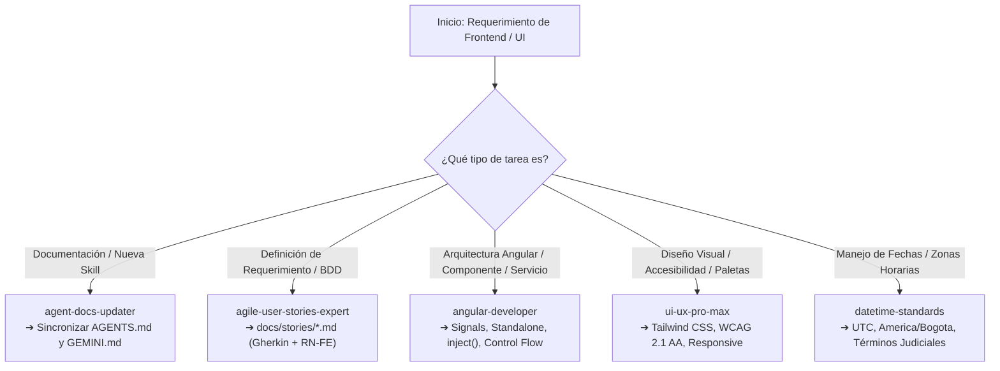

# 💡 Ejemplo de Actualización de `AGENTS.md` para Frontend (`agents-update-example.md`)

Este archivo contiene ejemplos de fragmentos para incorporar una nueva skill en las diferentes secciones de `AGENTS.md` en el proyecto `dokqet-frontend`.

---

## 1. Entrada de Catálogo para la Sección 3

```markdown
### 1. `agent-docs-updater`
* **Ubicación de la Skill:** [`SKILL.md`](.agents/skills/agent-docs-updater/SKILL.md)
* **Propósito:** Automatizar y estandarizar la actualización y sincronización continua de `AGENTS.md` (diagramas Mermaid, catálogo, estructura de archivos) y `GEMINI.md` (comandos útiles y contexto arquitectural del frontend).
* **Cuándo Activar (Triggers):**
  - Creación, modificación o eliminación de skills en `.agents/skills/`.
  - Incorporación de nuevas vistas en `src/app/features/`, modelos en `core/models/` o servicios en `core/services/`.
  - Adición de comandos CLI esenciales para desarrollo, testing o build en Angular.
* **Índice de Referencias y Reglas:**
  - 📏 **[Reglas de Sincronización Segura](.agents/skills/agent-docs-updater/rules/sync-rules.md):** `rules/sync-rules.md`
  - 💡 **[Ejemplo de Actualización de AGENTS.md](.agents/skills/agent-docs-updater/examples/agents-update-example.md):** `examples/agents-update-example.md`
  - 💡 **[Plantilla de Contexto GEMINI.md](.agents/skills/agent-docs-updater/examples/gemini-context-template.md):** `examples/gemini-context-template.md`
```

---

## 2. Actualización de Árbol de Directorios para la Sección 4

```markdown
    ├── agent-docs-updater/
    │   ├── SKILL.md
    │   ├── rules/
    │   │   └── sync-rules.md
    │   └── examples/
    │       ├── agents-update-example.md
    │       └── gemini-context-template.md
```

---

## 3. Ejemplo de Extensión de Diagrama Mermaid en Sección 2


