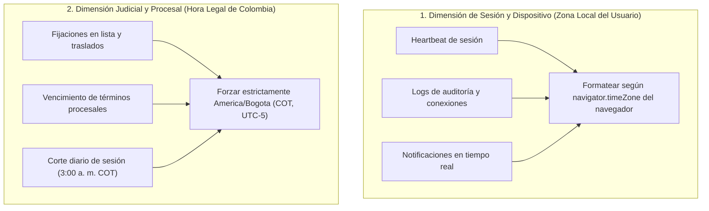

# 🕒 Skill: Estándares de Fecha, Hora y Zonas Horarias en Dokqet (`datetime-standards`)

## 1. La Regla de Oro Arquitectónica
En la plataforma Dokqet se aplica de manera estricta el estándar de oro de la ingeniería de software:

> **"Almacenar y transportar en UTC (`Z`), calcular sobre instantes absolutos, y formatear/presentar en la hora local del usuario en la interfaz visual (UI), o en Hora Legal Colombiana (`America/Bogota` / COT) para términos y actuaciones judiciales."**

---

## 2. Los Dos Contextos Temporales en Dokqet

En una plataforma de vigilancia judicial coexisten dos dimensiones de tiempo que **nunca deben confundirse**:



1. **Contexto de Sesión y Usuario (Hora Local):**
   - Cuando el usuario consulta cuándo inició sesión, cuándo se envió un heartbeat o cuándo llegó una alerta, la hora debe mostrarse en la **zona horaria de su navegador/dispositivo** (`Intl.DateTimeFormat().resolvedOptions().timeZone`).
2. **Contexto Judicial y Procesal (Hora Legal Colombiana - `America/Bogota`):**
   - Según el Código General del Proceso (Ley 1564 de 2012) y la Ley 2213 de 2022, los términos procesales y fijaciones de la Rama Judicial de Colombia corren exclusivamente bajo la **Hora Legal de Colombia (COT, UTC-5)**.
   - Si un abogado colombiano viaja a España (CET, UTC+1) y revisa un radicado, las actuaciones judiciales **deben indicar la hora legal de Colombia** con el sufijo `COT`, para evitar que asuma erróneamente que un término venció antes o después.
   - El **corte diario de Dokqet** ocurre a las **3:00 a. m. COT** (`08:00:00Z`).

---

## 3. Estándares en el Backend (Spring Boot 3+ / Java 21)

### 3.1. Tipos de Datos Obligatorios
- **`java.time.Instant` (Estándar para APIs y Eventos):**
  Usar para todo momento universal: `createdAt`, `updatedAt`, `lastActiveAt`, `expiresAt`, `lockedUntil`, logs de auditoría.
  *Serialización automática de Jackson:* `"2026-11-01T20:12:27.489010Z"`.
- **`java.time.LocalDate` (Para Fechas sin Hora):**
  Usar para fechas de nacimiento, fechas de emisión de cédula o fechas judiciales sin componente horario.
  *Serialización automática:* `"2026-11-01"`.
- **`java.time.ZonedDateTime` / `java.time.OffsetDateTime`:**
  Usar únicamente cuando la zona horaria de origen es parte del requerimiento legal o de auditoría.
- **PROHIBIDO:** El uso de `java.util.Date`, `java.sql.Date`, `java.sql.Timestamp` y `java.util.Calendar`.

### 3.2. Mapeo en Base de Datos (PostgreSQL)
- En PostgreSQL, usar siempre **`TIMESTAMP WITH TIME ZONE` (`TIMESTAMPTZ`)** para columnas de fecha y hora.
- PostgreSQL almacena internamente todos los valores `TIMESTAMPTZ` normalizados en UTC.

### 3.3. Configuración de Jackson (`application.yml`)
```yaml
spring:
  jackson:
    time-zone: UTC
    serialization:
      write-dates-as-timestamps: false
```

### 3.4. Ejemplo de Código en Backend:
```java
// DTO inmutable con Instant
public record SessionHeartbeatResponse(
    boolean valid,
    Instant lastActiveAt,
    Instant expiresAt
) {}

// En servicio: generación en UTC
public SessionHeartbeatResponse createHeartbeat() {
    Instant now = Instant.now(); // Siempre UTC
    // Corte a las 3:00 a. m. COT = 08:00 UTC
    Instant expiresAt = calculateNextDailyCutoffUtc();
    return new SessionHeartbeatResponse(true, now, expiresAt);
}
```

---

## 4. Estándares en el Frontend (Angular 19+ / TypeScript)

### 4.1. Tipado en Modelos TypeScript
Los contratos DTO deben tipar las marcas de tiempo como `string` (representando la cadena ISO 8601) o `null`:
```typescript
export interface SessionHeartbeatResponse {
  valid: boolean;
  lastActiveAt: string | null;  // Ej: "2026-11-01T20:12:27.489010Z"
  expiresAt: string | null;     // Ej: "2026-11-02T08:00:00Z"
}
```

### 4.2. Uso de Utilidades Centralizadas (`datetime.utils.ts`)
Dokqet provee el archivo de utilidades [`src/app/core/utils/datetime.utils.ts`](file:///E:/Workspace%20Angular/dokqet-frontend/src/app/core/utils/datetime.utils.ts):

| Función | Descripción |
| :--- | :--- |
| `getUserTimeZone()` | Obtiene la zona horaria del navegador del usuario vía `Intl`. |
| `parseDate(val)` | Parseador defensivo de cadenas ISO UTC, números epoch o Date. |
| `formatLocalDate(val, format, opts)` | Formatea a hora local con opciones `'time'`, `'date'`, `'datetime'`, `'full'`, `'relative'`, `'legal'`. |
| `formatRelativeTime(date)` | Devuelve texto amigable como *"hace un momento"*, *"hace 5 minutos"*. |

### 4.3. Uso del Pipe Standalone `DokqetDatePipe` (`dokqetDate`)
Para renderizar fechas en plantillas HTML de componentes:

```html
<!-- 1. Formato por defecto (fecha y hora local): "1 nov 2026, 3:12 p. m." -->
<span>{{ session.lastActiveAt | dokqetDate }}</span>

<!-- 2. Solo la hora local: "3:12 p. m." -->
<span>{{ session.lastActiveAt | dokqetDate:'time' }}</span>

<!-- 3. Tiempo relativo amigable: "hace 5 minutos" -->
<span>{{ session.lastActiveAt | dokqetDate:'relative' }}</span>

<!-- 4. Formato Legal Colombiano (con sufijo COT): "1 nov 2026, 3:12 p. m. COT" -->
<span>{{ actuacion.fechaNotificacion | dokqetDate:'legal' }}</span>

<!-- 5. Formato completo con zona explícita: "Domingo, 1 de noviembre de 2026, 3:12 p. m. (GMT-5)" -->
<span>{{ proceso.fechaRadicacion | dokqetDate:'full' }}</span>
```

---

## 5. Anti-Patrones Estrictamente Prohibidos

| ❌ Anti-Patrón Prohibido | ✅ Solución Correcta |
| :--- | :--- |
| **Sumar/restar horas mágicas a mano:**<br>`date.setHours(date.getHours() - 5)` | Usar la API de internacionalización:<br>`new Intl.DateTimeFormat('es-CO', { timeZone: 'America/Bogota' })` |
| **Enviar cadenas de fecha sin zona horaria en APIs:**<br>`"2026-11-01 15:12:00"` | Enviar siempre estándar ISO 8601 UTC:<br>`"2026-11-01T20:12:27.489010Z"` |
| **Convertir fechas a hora local antes de guardarlas en BD:**<br>Guardar hora de Colombia en PostgreSQL sin especificar zona. | Guardar en UTC con `TIMESTAMPTZ` y convertir solo en el cliente visual. |
| **Crear objetos de fecha usando parseo de strings ambiguos:**<br>`new Date("01/11/2026")` (ambigüedad día/mes). | Usar formato ISO estandarizado:<br>`new Date("2026-11-01T00:00:00Z")`. |

---

## 6. Checklist de Verificación para Agentes y Desarrolladores

- [ ] ¿El backend retorna fechas con el sufijo `Z` en formato ISO-8601?
- [ ] ¿El frontend muestra la hora traducida para el usuario y no la cadena cruda `...Z`?
- [ ] ¿Si el dato corresponde a un término judicial colombiano, se muestra con la zona `COT` (`America/Bogota`)?
- [ ] ¿Las pruebas unitarias validan la conversión a través de `DokqetDatePipe` o `formatLocalDate`?
