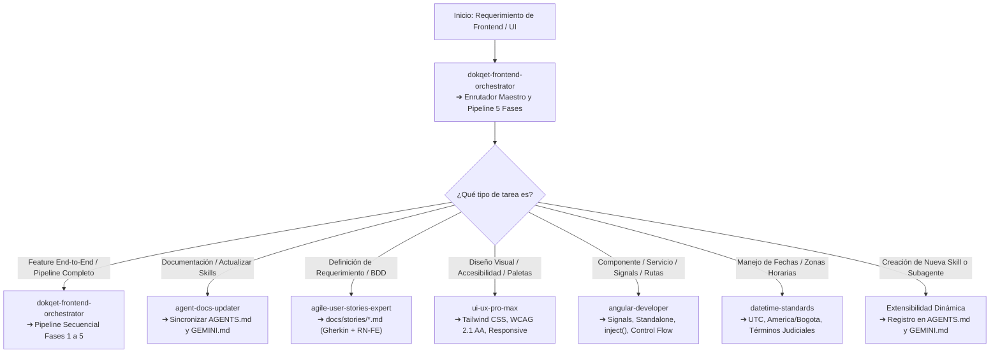

# 🤖 Guía Operativa de Agentes de IA (`AGENTS.md`)
## Plataforma Dokqet — Interfaz Web SPA (Frontend) para Colombia

* **Versión:** 2.1.0
* **Fecha:** Noviembre 2026
* **Ubicación:** `dokqet-frontend/AGENTS.md` (también referenciado como `AGENT.md`)
* **Stack Principal:** Angular 19+ | TypeScript 5.6+ | Tailwind CSS v3 | Signals | Standalone Components | WCAG 2.1 AA | PASETO v4

---

## 1. Principios y Reglas Inviolables para Agentes en Frontend

1. **Stack Tecnológico Obligatorio**:
   - **Framework:** Angular 19+ con Standalone Components (arquitectura moderna sin `NgModule`).
   - **Reactividad Granular:** Angular Signals (`signal`, `computed`, `effect`, `untracked`), Signal Inputs y Outputs (`input()`, `output()`) y nuevo Control Flow declarativo (`@if`, `@for`, `@switch`, `@defer`).
   - **Inyección de Dependencias:** Uso exclusivo de `inject()`. Cero inyección por constructor estilo Angular clásico.
   - **Detección de Cambios:** `ChangeDetectionStrategy.OnPush` en todos los componentes para máximo rendimiento y predictibilidad.
   - **Lenguaje:** TypeScript 5.6+ en modo estricto. Cero uso de `any` injustificado.
   - **Estilos:** Tailwind CSS v3 con clases utilitarias semánticas, diseño adaptativo mobile-first, soporte de modo oscuro (`dark:`) y accesibilidad WCAG 2.1 AA.
   - **Comunicación HTTP:** `HttpClient` consumiendo la API REST imperativa de Spring Boot (`http://localhost:8080/api/v1/`), con mapeo estándar de errores estructurados mediante `ProblemDetail` (RFC 7807 / RFC 9457).
2. **Dominio Judicial Colombiano en Frontend**:
   - **Radicado Único Nacional de 23 Dígitos:** visualización mediante [`RadicadoPipe`](src/app/shared/pipes/radicado.pipe.ts), validación estricta de 23 dígitos numéricos en formularios de registro y búsqueda sin caracteres especiales.
   - **Validación Tributaria DIAN (Módulo 11):** cálculo y validación de Dígito de Verificación (DV) para NIT en organizaciones de personas jurídicas.
   - **Cero Almacenamiento ni Retransmisión de Binarios:** los documentos y providencias de la Rama Judicial y autos del micrositio se descargan y previsualizan directamente en el navegador del cliente mediante `fetch` con `blob:` e `<iframe>` seguro, sin triangular bytes pesados por el servidor de Dokqet.
   - **Manejo de Estados del Micrositio:** representación visual clara de los estados de búsqueda de providencias (`BUSCANDO`, `ENCONTRADO`, `SOLO_ESTADO`, `NO_ENCONTRADO`, `SIN_ESTADOS_DEL_JUZGADO`, `ENLACE`) con polling silencioso inteligente y asociación de auto anterior.
   - **Multi-tenancy y Gobernanza:** Organización Personal (`isPersonal: true`) vs. Firma Jurídica Colectiva (`isPersonal: false`, roles `ADMIN` y `LAWYER`), y rol `SUPER_ADMIN` para el backoffice global de la plataforma con observabilidad y gobierno de catálogos.
3. **Calidad, Clean Code y Métodos Atómicos**:
   - Componentes atómicos reutilizables en `src/app/shared/components/ui/` (`Card`, `Button`, `Modal`, `EmptyState`, `Skeleton`, `FormAlert`, `Breadcrumbs`, `StatCard`).
   - Skeleton loaders contextuales en lugar de spinners de pantalla completa para evitar saltos de layout (Cumulative Layout Shift, CLS < 0.1).
   - Manejo inmutable de fecha y hora bajo la regla de oro de `datetime-standards`: almacenar/transportar en UTC (`Z`), calcular en instantes absolutos y formatear en hora local del usuario o `America/Bogota` (COT) para términos judiciales.

---

## 2. Árbol de Decisión Operativa para Agentes (Mermaid)



---

## 3. Catálogo e Índice de Skills Operativas del Frontend

### 1. `dokqet-frontend-orchestrator`
* **Ubicación:** [SKILL.md](.agents/skills/dokqet-frontend-orchestrator/SKILL.md)
* **Propósito:** Orquestador maestro y enrutador de capacidades en Dokqet Frontend. Detecta e indexa dinámicamente las skills y subagentes, audita el cumplimiento tecnológico de Angular 19+ y coordina pipelines multietapa (Fases 1 a 5).
* **Cuándo Activar (Triggers):** Requerimientos complejos de UI, nuevas pantallas judiciales, auditoría de skills o pipelines end-to-end.
* **Referencias:** [rules/orchestration-pipeline-rules.md](.agents/skills/dokqet-frontend-orchestrator/rules/orchestration-pipeline-rules.md) | [rules/skill-index-detection-rules.md](.agents/skills/dokqet-frontend-orchestrator/rules/skill-index-detection-rules.md) | [scripts/audit_skills.sh](.agents/skills/dokqet-frontend-orchestrator/scripts/audit_skills.sh)

### 2. `agent-docs-updater`
* **Ubicación:** [SKILL.md](.agents/skills/agent-docs-updater/SKILL.md)
* **Propósito:** Automatizar y estandarizar la sincronización continua de `AGENTS.md` / `AGENT.md` (diagramas Mermaid, catálogo, estructura) y `GEMINI.md` (comandos y contexto del proyecto frontend).
* **Cuándo Activar (Triggers):** Creación o modificación de skills, nuevas vistas en `src/app/features/`, modelos en `core/models/`, servicios en `core/services/` o comandos npm/CLI.
* **Referencias:** [rules/sync-rules.md](.agents/skills/agent-docs-updater/rules/sync-rules.md) | [examples/agents-update-example.md](.agents/skills/agent-docs-updater/examples/agents-update-example.md) | [examples/gemini-context-template.md](.agents/skills/agent-docs-updater/examples/gemini-context-template.md)

### 3. `agile-user-stories-expert`
* **Ubicación:** [SKILL.md](.agents/skills/agile-user-stories-expert/SKILL.md)
* **Propósito:** Diseñar, estructurar y redactar historias de usuario con criterios de aceptación en Gherkin BDD riguroso, reglas de negocio de interfaz (RN-FE), modelos TypeScript y accesibilidad WCAG 2.1 AA dentro de `docs/stories/`, y gestionar su transición a estado implementado (`🚀 Implementada / Verificada`) y traslado físico a `docs/stories/implemented/` al superar la verificación.
* **Cuándo Activar (Triggers):** Creación o auditoría de requerimientos funcionales frontend, radicado de 23 dígitos, validación DIAN Módulo 11, estados de carga o modales de interacción.
* **Referencias:** [rules/gherkin-rules.md](.agents/skills/agile-user-stories-expert/rules/gherkin-rules.md) | [rules/story-format-rules.md](.agents/skills/agile-user-stories-expert/rules/story-format-rules.md) | [templates/user-story-template.md](.agents/skills/agile-user-stories-expert/templates/user-story-template.md)

### 4. `angular-developer`
* **Ubicación:** [SKILL.md](.agents/skills/angular-developer/SKILL.md)
* **Propósito:** Desarrollar código Angular de alta calidad siguiendo las mejores prácticas de Angular 19+ (Signals, Standalone Components, `inject()`, Control Flow `@if`/`@for`/`@switch`, `@defer`, Signal Forms, ChangeDetection OnPush, Routing y Testing).
* **Cuándo Activar (Triggers):** Creación de componentes, servicios HTTP, pipes, directivas, guardianes de ruta, enrutamiento o pruebas unitarias con TestBed.
* **Referencias:** [references/components.md](.agents/skills/angular-developer/references/components.md) | [references/signals-overview.md](.agents/skills/angular-developer/references/signals-overview.md) | [references/http-client.md](.agents/skills/angular-developer/references/http-client.md)

### 5. `datetime-standards`
* **Ubicación:** [SKILL.md](.agents/skills/datetime-standards/SKILL.md)
* **Propósito:** Aplicar la regla de oro arquitectónica para el transporte en UTC (`Z`), cálculo de términos procesales e instantes absolutos, y presentación en hora local o legal colombiana (`America/Bogota` / COT).
* **Cuándo Activar (Triggers):** Manipulación de fechas judiciales, términos procesales, filtros por fecha, visualización de marcas temporales y utilidades `datetime.utils.ts`.

### 6. `ui-ux-pro-max`
* **Ubicación:** [SKILL.md](.agents/skills/ui-ux-pro-max/SKILL.md)
* **Propósito:** Inteligencia de diseño visual y experiencia de usuario (UI/UX) para diseño de componentes, paletas de color, tipografía, accesibilidad WCAG 2.1 AA, maquetación responsive con Tailwind CSS y control de calidad visual.
* **Cuándo Activar (Triggers):** Diseño y maquetación de nuevas pantallas, refactorización de estilos, selección de paletas y estados de interacción, microinteracciones y accesibilidad.
* **Referencias:** [references/quick-reference.md](.agents/skills/ui-ux-pro-max/references/quick-reference.md) | [references/pro-rules.md](.agents/skills/ui-ux-pro-max/references/pro-rules.md)

---

## 4. Estructura de Directorios de Skills (`.agents/skills/`)

```
.agents/skills/
├── dokqet-frontend-orchestrator/
│   ├── SKILL.md
│   ├── rules/
│   │   ├── orchestration-pipeline-rules.md
│   │   └── skill-index-detection-rules.md
│   └── scripts/
│       └── audit_skills.sh
├── agent-docs-updater/
│   ├── SKILL.md
│   ├── rules/
│   │   └── sync-rules.md
│   └── examples/
│       ├── agents-update-example.md
│       └── gemini-context-template.md
├── agile-user-stories-expert/
│   ├── SKILL.md
│   ├── rules/
│   │   ├── gherkin-rules.md
│   │   ├── story-format-rules.md
│   │   └── story-lifecycle-rules.md
│   ├── templates/
│   │   └── user-story-template.md
│   └── examples/
├── angular-developer/
│   ├── SKILL.md
│   └── references/
├── datetime-standards/
│   └── SKILL.md
└── ui-ux-pro-max/
    ├── SKILL.md
    ├── references/
    └── scripts/
```

---

## 5. Comandos Operativos Clave (CLI)

### A. Servidor de Desarrollo Local
```bash
# Iniciar servidor de desarrollo en http://localhost:4200
npm start
# o vía Angular CLI
ng serve
```

### B. Compilación y Construcción (Production Build)
```bash
# Compilar bundle de producción optimizado en dist/dokqet-frontend
npm run build
```

### C. Modo Observador (Watch)
```bash
# Compilar continuamente en segundo plano ante cambios
npm run watch
```

### D. Auditoría de Skills del Frontend
```bash
# Ejecutar script de validación e integridad de skills
./.agents/skills/dokqet-frontend-orchestrator/scripts/audit_skills.sh
```

---

## 6. Protocolo de Extensibilidad: Detección, Registro e Indexación de Nuevas Skills y Subagentes

Cuando se incorpore una nueva skill o subagente especializado en el frontend:
1. **Crear Directorio y Archivos**: Colocar en `.agents/skills/{nombre-skill}/` su respectivo `SKILL.md` (con frontmatter YAML `name`, `description`, `tags`, `version`) y carpeta `rules/`.
2. **Validar Stack Tecnológico**: Debe respetar Angular 19+, Signals, Standalone Components y Tailwind CSS. Queda vetado cualquier patrón reactivo WebFlux o de base de datos relacional (exclusivos de backend).
3. **Indexar en `AGENTS.md` / `AGENT.md`**:
   - Insertar el nodo en el diagrama Mermaid del Árbol de Decisión (Sección 2).
   - Añadir la subsección descriptiva correspondiente en el Catálogo de Skills (Sección 3).
   - Actualizar el árbol ASCII de carpetas (Sección 4).
4. **Indexar en `GEMINI.md`**:
   - Agregar la entrada correspondiente en la Sección 4 (Skills de Agentes Disponibles en Frontend).
5. **Auditar Ejecución**: Ejecutar `./.agents/skills/dokqet-frontend-orchestrator/scripts/audit_skills.sh` para verificar que la nueva skill esté registrada y sea íntegra.
