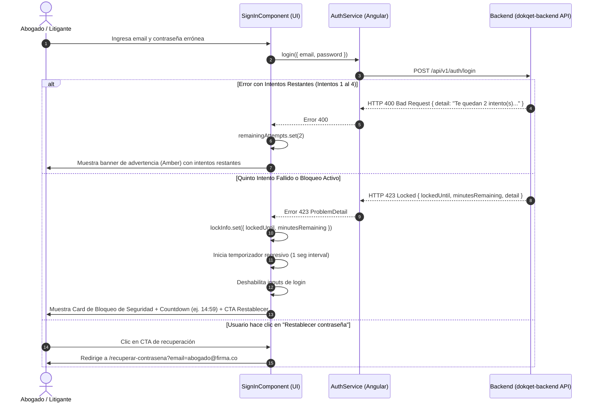

# Historia de Usuario HU-17: Manejo de Intentos Fallidos, Experiencia de Cuenta Bloqueada (HTTP 423 Locked) y Desbloqueo Administrativo

* **ID de Historia:** `HU-17`
* **Código Equivalente Backend:** `US-016` (o `HU-16-AUTH` en microservicio)
* **Título:** Regulación y Alerta de Intentos Fallidos de Inicio de Sesión, Interfaz de Cuenta Bloqueada con Contador Regresivo (HTTP 423) y Desbloqueo Administrativo para SuperAdmin.
* **Estado:** ✅ Completada e Implementada
* **Fecha:** Octubre 2026
* **Módulos Impactados:**
  * **Core Models (`src/app/core/models/user.model.ts`):** Nuevas interfaces `AccountLockedError`, `UserUnlockResponse`, extensión de modelo `User`.
  * **Core Auth (`src/app/core/auth/auth.service.ts`):** Tratamiento y tipado de respuestas de autenticación, propagación de errores RFC 9457 (400 vs 423).
  * **Core Services (`src/app/core/services/user.service.ts`):** Inclusión del método `unlockUser(userId: string)`.
  * **Features Auth - Sign In (`src/app/features/auth/sign-in/`):** Componente reactivo con señales (`signal`), banner de advertencia de intentos restantes, panel de bloqueo con temporizador en tiempo real (`countdown`), bloqueo preventivo de inputs y botón de restablecimiento inmediato.
  * **Features Admin / SuperAdmin:** Integración del flujo de desbloqueo manual de cuentas para usuarios con privilegios `isSuperAdmin`.

---

## 1. Narrativa de la Historia de Usuario

> **Como** abogado litigante, administrador de firma jurídica o SuperAdmin en **Dokqet**,  
> **Quiero** recibir advertencias claras sobre los intentos de inicio de sesión restantes cuando me equivoque de clave, visualizar una pantalla explicativa con temporizador en tiempo real si mi cuenta es bloqueada por seguridad (HTTP 423), acceder a un atajo de desbloqueo mediante restablecimiento de clave, y permitir a los SuperAdmins desbloquear usuarios manualmente,  
> **Para** proteger la integridad de los expedientes judiciales contra ataques automatizados de fuerza bruta, mantener la calma y claridad durante incidentes de acceso y recuperar el ingreso al despacho sin demoras innecesarias.

---

## 2. Diagnóstico del Estado Actual y Justificación UX / Seguridad

### 2.1. Estado Actual en el Frontend
1. **Tratamiento Indiferenciado de Errores de Login:**
   Actualmente en `SignInComponent:82-85`:
   ```typescript
   error: (err) => {
     this.loading.set(false);
     this.errorMessage.set(err.error?.message || 'Credenciales inválidas o correo profesional no registrado.');
   }
   ```
   Cualquier código de error (`400`, `401`, `423`, `500`) se reduce a un string estático en una caja roja genérica (`<app-form-alert type="error">`).
2. **Falta de Advertencia Preventiva de Agotamiento de Intentos:**
   El backend `dokqet-backend` (US-016) ahora descuenta 5 intentos e informa en el cuerpo de error HTTP 400 cuántos intentos restan (`"Credenciales incorrectas. Te quedan 3 intento(s)..."`). El usuario no percibe la criticidad ni el riesgo inminente de bloqueo si solo ve un mensaje de texto plano.
3. **Inexistencia de Interfaz para Cuenta Bloqueada (HTTP 423 Locked):**
   Cuando el backend responde con código HTTP 423 y el payload RFC 9457 conteniendo `lockedUntil` y `minutesRemaining`, la interfaz de Dokqet no muestra un temporizador regresivo, no desactiva el botón de envío (lo que incita al usuario a seguir presionando y recibiendo bloqueos) ni le ofrece un llamado a la acción (CTA) inmediato para desbloquear su cuenta restableciendo la contraseña.
4. **Falta de Capacidad de Desbloqueo para SuperAdmin:**
   El backend expone el endpoint administrativo `POST /api/v1/users/{id}/unlock`, pero el frontend no provee integración en `UserService` ni interfaz gráfica para accionarlo.

---

## 3. Arquitectura Técnica de la Solución Frontend

### 3.1. Flujo de Interacción y Estados de la UI (Mermaid)



---

## 4. Modelos y Contratos de Datos (`TypeScript`)

### 4.1. Interfaces de Error de Bloqueo RFC 9457 (`src/app/core/models/user.model.ts`)

```typescript
export interface ProblemDetailAccountLocked {
  type: string;
  title: string;
  status: 423;
  detail: string;
  instance?: string;
  success: boolean;
  message: string;
  timestamp: string;
  lockedUntil: string; // ISO 8601 UTC (ej. "2026-10-28T21:45:00Z")
  minutesRemaining: number;
}

export interface UserUnlockResponse {
  userId: string;
  email: string;
  failedLoginAttempts: number;
  lockedUntil: string | null;
  isLocked: boolean;
}
```

---

## 5. Reglas de Negocio en Frontend (RN-FE)

* **RN-FE-01 (Detección de Intentos Restantes):**  
  Al recibir una respuesta HTTP 400 en `login`, el componente debe evaluar si el mensaje contiene el patrón de intentos restantes. Si restan $\le 2$ intentos, debe alertar con severidad destacada (borde ámbar/naranja) recomendando al usuario usar la opción de recuperación de clave antes de congelar la cuenta.
* **RN-FE-02 (Transición Inmediata a Estado Bloqueado):**  
  Al capturar un código HTTP `423 Locked`, el formulario debe conmutar inmediatamente a modo "Bloqueado":
  1. Congelar los campos de entrada (`email`, `password`) para evitar reenvíos innecesarios.
  2. Iniciar un temporizador regresivo local basado en la diferencia de segundos entre `Instant.now()` y `lockedUntil`.
  3. Desplegar un enlace o botón de acción rápida que navegue a `/recuperar-contrasena?email=<correo>` con el correo prellenado.
* **RN-FE-03 (Desbloqueo Visual por Expiración del Countdown):**  
  Si el usuario permanece en la pantalla y el temporizador llega a `00:00`, la interfaz debe restaurar el formulario a su estado activo, limpiar la alerta de bloqueo y mostrar un mensaje neutral: *"El tiempo de bloqueo ha expirado. Ya puedes intentar iniciar sesión nuevamente."*
* **RN-FE-04 (Desbloqueo Inmediato por Restablecimiento Exitoso):**  
  Si el usuario utiliza la ruta de recuperación y actualiza su contraseña mediante `/restablecer-contrasena`, el backend (US-016) desbloquea la cuenta automáticamente. Al ser redirigido a `/iniciar-sesion`, la pantalla debe arrancar limpia sin bloqueos.
* **RN-FE-05 (Acceso al Desbloqueo para SuperAdmin):**  
  El servicio `UserService` debe ofrecer la función `unlockUser(userId: string)` que consuma `POST /api/v1/users/{id}/unlock`, permitiendo a operadores SuperAdmin levantar el bloqueo de usuarios reportados por soporte técnico.

---

## 6. Criterios de Aceptación (Gherkin / BDD)

```gherkin
# language: es
Característica: HU-17 - Experiencia de Usuario ante Intentos Fallidos, Bloqueo de Cuentas (HTTP 423) y Desbloqueo Administrativo
  Como Abogado litigante o SuperAdmin de Dokqet
  Quiero que la interfaz gestione de forma clara y segura las restricciones de intentos de login
  Para proteger los expedientes judiciales sin desorientar al usuario legítimo

  # =========================================================================
  # ESCENARIO 1: ADVERTENCIA PREVENTIVA ANTE INTENTOS FALLIDOS (HTTP 400)
  # =========================================================================
  Escenario: Usuario comete un error de contraseña y recibe advertencia de intentos restantes
    Dado que el usuario ingresa su correo "abogado.gonzalez@dokqet.com" y una clave incorrecta
    Cuando hace clic en "Ingresar al despacho"
    Y el servidor responde HTTP 400 con el mensaje "Credenciales incorrectas. Te quedan 2 intento(s) antes de que la cuenta sea bloqueada temporalmente."
    Entonces el formulario permanece activo
    Y se visualiza una alerta preventiva destacando que solo le quedan 2 intentos
    Y se sugiere el enlace "¿Olvidaste tu contraseña?" para evitar el bloqueo

  # =========================================================================
  # ESCENARIO 2: BLOQUEO TEMPORAL DE CUENTA (HTTP 423 LOCKED) CON TEMPORIZADOR
  # =========================================================================
  Escenario: Usuario supera los 5 intentos y la cuenta es bloqueada por 15 minutos
    Dado que el usuario envía su quinto intento consecutivo fallido
    Cuando el servidor responde HTTP 423 con "lockedUntil" y "minutesRemaining": 15
    Entonces la interfaz conmuta al estado de "Cuenta Bloqueada por Seguridad"
    Y se muestra un temporizador regresivo con formato "MM:SS" (iniciando en aproximadamente 15:00)
    Y los campos de texto y el botón principal quedan inhabilitados
    Y se despliega el botón "Restablecer contraseña ahora" con enlace a "/recuperar-contrasena?email=abogado.gonzalez%40dokqet.com"
    Y se notifica que se ha enviado una alerta de seguridad al correo electrónico registrado

  # =========================================================================
  # ESCENARIO 3: EXPIRACIÓN DEL CONTADOR REGRESIVO EN TIEMPO REAL
  # =========================================================================
  Escenario: Finalización de los 15 minutos mientras el usuario tiene la pestaña abierta
    Dado que el formulario se encuentra en estado de bloqueo con el contador activo
    Cuando el temporizador regresivo llega a "00:00"
    Entonces el panel de bloqueo se oculta
    Y los campos de correo y contraseña se habilitan nuevamente
    Y se visualiza un aviso informativo: "El periodo de bloqueo ha concluido. Puedes intentar iniciar sesión."

  # =========================================================================
  # ESCENARIO 4: DESBLOQUEO ADMINISTRATIVO MANUAL POR SUPERADMIN
  # =========================================================================
  Escenario: SuperAdmin desbloquea la cuenta de un litigante mediante UserService
    Dado que un usuario con rol SuperAdmin se encuentra autenticado
    Cuando invoca el método "userService.unlockUser(targetUserId)"
    Entonces el cliente envía una petición POST a "/api/v1/users/{targetUserId}/unlock"
    Y al recibir respuesta 200 OK con "isLocked: false", se confirma el desbloqueo mediante feedback visual
```

---

## 7. Plan de Implementación Paso a Paso (Frontend)

| Fase | Tarea Técnica | Archivos Involucrados | Estimación |
| :--- | :--- | :--- | :--- |
| **Fase 1: Modelos** | Definición de DTOs y tipos TypeScript (`ProblemDetailAccountLocked`, `UserUnlockResponse`). | `src/app/core/models/user.model.ts` | 0.5h |
| **Fase 2: Servicios** | Implementación de método `unlockUser` en `UserService` y ampliación de manejo de errores en `AuthService`. | `src/app/core/services/user.service.ts`, `src/app/core/auth/auth.service.ts` | 1.0h |
| **Fase 3: UI Login** | Rediseño y ampliación reactiva de `SignInComponent`: signals de bloqueo, contador regresivo con `setInterval`/`DestroyRef`, alerta preventiva de intentos y tarjeta de seguridad 423. | `src/app/features/auth/sign-in/sign-in.component.ts`, `src/app/features/auth/sign-in/sign-in.component.html` | 2.5h |
| **Fase 4: Recuperación** | Vinculación del query param `email` desde el botón de la alerta de bloqueo hacia `/recuperar-contrasena`. | `src/app/features/auth/forgot-password/forgot-password.component.ts` | 0.5h |
| **Fase 5: Pruebas** | Pruebas unitarias de componentes y servicios (cobertura completa de casos 400 y 423). | `src/app/features/auth/sign-in/sign-in.component.spec.ts`, `src/app/core/services/user.service.spec.ts` | 1.5h |

---

## 8. Guía de Verificación y Testing

### 8.1. Simulación Manual en Entorno Local
1. Ingresar a `http://localhost:4200/iniciar-sesion`.
2. Digitar un correo válido registrado y una contraseña errónea repetidamente.
3. Verificar que del intento 1 al 4 aparezca la alerta informativa: *"Credenciales incorrectas. Te quedan X intento(s)..."*.
4. Al quinto intento, verificar que el formulario cambie a la tarjeta de bloqueo roja/ámbar con el temporizador activo en cuenta regresiva.
5. Hacer clic en "Restablecer contraseña ahora" y verificar que redirija a `/recuperar-contrasena` con el campo de correo prellenado.
6. Probar el desbloqueo administrativo ejecutando `unlockUser` desde consola o vista de SuperAdmin.

### 8.2. Comandos de Pruebas Automatizadas
```bash
# Ejecutar pruebas unitarias de autenticación en Angular
npx ng test --include="src/app/features/auth/sign-in/**/*.spec.ts" --no-watch --browsers=ChromeHeadless

# Ejecutar pruebas unitarias de servicios de usuario
npx ng test --include="src/app/core/services/user.service.spec.ts" --no-watch --browsers=ChromeHeadless
```
