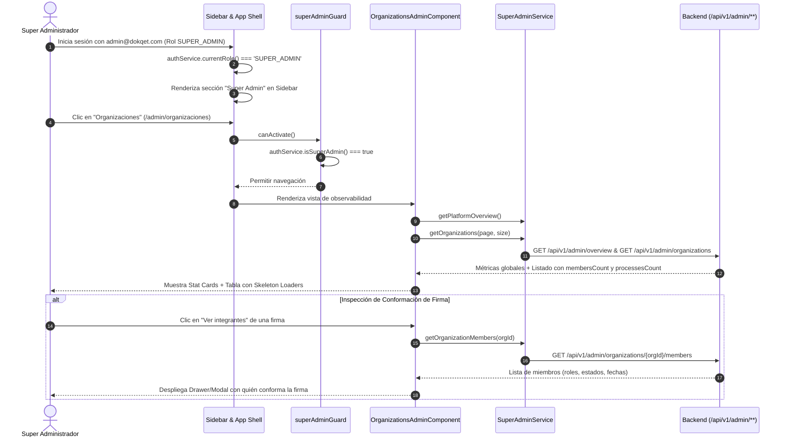

# Historia de Usuario HU-18: Consola de Super Administrador, Observabilidad Global de Organizaciones, Conteo de Expedientes y Gobernanza Exclusiva de Catálogos

* **ID de Historia:** `HU-18`
* **Código Equivalente Backend:** `US-017` (`HU-17-SUPERADMIN`)
* **Título:** Consola de Super Administrador, Observabilidad Global de Organizaciones, Conteo de Expedientes y Gobernanza Exclusiva de Catálogos
* **Épica:** Backoffice, Observabilidad Multi-Tenancy y Gobernanza de Catálogos
* **Prioridad:** Alta (Core Operativo y Soporte Técnico)
* **Estado:** 📝 Lista para Desarrollo
* **Fecha:** Octubre 2026
* **Módulos Impactados:**
  * **Core Models (`src/app/core/models/super-admin.model.ts`):** Interfaces `AdminPlatformOverview`, `AdminOrganizationSummary`, `AdminOrganizationDetail`, `AdminMember`, `AdminUserSummary`.
  * **Core Auth (`src/app/core/auth/auth.service.ts`):** Reconocimiento del rol `SUPER_ADMIN` en `currentRole`, cómputo reactivo de `isSuperAdmin`.
  * **Core Guards (`src/app/core/auth/super-admin.guard.ts`):** Blindaje de rutas `/admin/**` y redirección controlada a `/panel` con notificación de acceso no autorizado.
  * **Core Services (`src/app/core/services/super-admin.service.ts`):** Cliente HTTP reactivo para `/api/v1/admin/**`.
  * **App Shell & Sidebar (`src/app/app.component.html`):** Sección exclusiva de navegación "Super Admin" condicionada reactivamente a `@if (authService.isSuperAdmin())`.
  * **App Routing (`src/app/app.routes.ts`):** Reubicación de `/catalogos` a `/admin/catalogos` y registro de `/admin/organizaciones`.
  * **Features Admin (`src/app/features/admin/organizations/`):** Componente Standalone de observabilidad con tarjetas de métricas, tabla paginada de organizaciones e inspección de miembros.

---

## 🎯 1. Narrativa de la Historia de Usuario

> **Como** Ingeniero del Área Técnica / Super Administrador de la plataforma **Dokqet**,  
> **Quiero** disponer de una consola de observabilidad global que me permita visualizar todas las organizaciones creadas, sus métricas consolidadas (cantidad de personas y expedientes judiciales), inspeccionar quién conforma cada firma jurídica y administrar de forma exclusiva las tablas maestras del sistema,  
> **Para** supervisar la infraestructura multi-tenancy, brindar soporte técnico efectivo a litigantes y firmas, y garantizar que el módulo de catálogos quede completamente protegido y reservado al área técnica sin exposición a roles comunes.

---

## 🔍 2. Diagnóstico del Estado Actual y Justificación UX / Seguridad

### 2.1. Estado Actual en el Frontend
1. **Exposición Abierta del Módulo de Catálogos:**
   En `src/app/app.routes.ts:78-82`, la ruta `/catalogos` se encuentra protegida únicamente por `authGuard`, lo que permite que cualquier usuario autenticado (incluyendo litigantes `LAWYER` y administradores de firmas privadas `ADMIN`) acceda a la vista de catálogos.
2. **Visibilidad en el Sidebar para Todos los Roles:**
   En `src/app/app.component.html:190-215`, el enlace "Catálogos" se renderiza incondicionalmente en la sección de administración para todos los usuarios.
3. **Inexistencia de Interfaz de Observabilidad para el Área Técnica:**
   El backend expone ahora los endpoints `/api/v1/admin/overview`, `/api/v1/admin/organizations`, `/api/v1/admin/organizations/{id}/members` y `/api/v1/admin/organizations/{id}/users`, pero el frontend carece de vistas para monitorear qué firmas existen, quiénes las integran y cuántos expedientes vigilan.
4. **Reconocimiento del Rol `SUPER_ADMIN`:**
   El frontend debe reconocer formalmente el valor `'SUPER_ADMIN'` emitido por el backend en el token PASETO y en la respuesta de login (`AuthResponse.role`), activando las capacidades técnicas de forma transparente y reactiva.

---

## 🧭 2.2. Flujo de Navegación y Arquitectura Visual (Mermaid)



---

## 🧱 3. Modelos y Contratos de Datos (`TypeScript`)

### 3.1. Interfaces de Observabilidad (`src/app/core/models/super-admin.model.ts`)

```typescript
export interface AdminPlatformOverview {
  totalOrganizations: number;
  totalPersonalOrganizations: number;
  totalCollectiveOrganizations: number;
  totalUsers: number;
  totalProcesses: number;
}

export interface AdminOrganizationSummary {
  id: string;
  name: string;
  personType: 'NATURAL' | 'JURIDICA';
  legalName: string | null;
  nit: string | null;
  nitDv: string | null;
  isPersonal: boolean;
  membersCount: number;
  activeMembersCount: number;
  processesCount: number;
  createdAt: string; // ISO 8601 UTC
}

export interface AdminOrganizationDetail extends AdminOrganizationSummary {
  cityId: string | null;
  personalOwnerId: string | null;
  createdById: string | null;
  processVisibility: 'ALL_MEMBERS' | 'OWN_ONLY';
  updatedAt: string;
}

export interface AdminMember {
  membershipId: string;
  userId: string;
  email: string;
  fullName: string;
  documentType: string;
  documentNumber: string;
  role: 'SUPER_ADMIN' | 'ADMIN' | 'LAWYER';
  status: 'ACTIVE' | 'SUSPENDED';
  joinedAt: string;
  lastUsedAt: string | null;
}

export interface AdminUserSummary {
  id: string;
  email: string;
  name: string;
  firstName: string;
  lastName: string;
  documentType: string;
  documentNumber: string;
  cityId: string | null;
  emailVerified: boolean;
  isSuperAdmin: boolean;
  isAccountLocked: boolean;
  createdAt: string;
}

export interface PageResponse<T> {
  content: T[];
  pageable: {
    pageNumber: number;
    pageSize: number;
  };
  totalElements: number;
  totalPages: number;
  last: boolean;
  first: boolean;
  size: number;
  number: number;
  empty: boolean;
}
```

---

## ⚖️ 4. Reglas de Negocio Frontend y UX (RN-FE)

- **RN-FE-01 (Reconocimiento Reactivo del Rol `SUPER_ADMIN`):**  
  En `AuthService`, el Signal `isSuperAdmin` debe evaluar como verdadero si `currentRole === 'SUPER_ADMIN'` o si `currentUser.isSuperAdmin === true`. Esto garantiza reactividad inmediata ante recargas de página (F5) y cambio de contexto.

- **RN-FE-02 (Blindaje Estricto de Rutas con `superAdminGuard`):**  
  Las rutas `/admin/**` y `/admin/catalogos` exigen que `authService.isSuperAdmin()` sea `true`. Si un usuario con rol `ADMIN` (de firma jurídica) o `LAWYER` intenta acceder directamente escribiendo la URL, el guard debe redirigirlo inmediatamente a `/panel` y emitir una notificación visual de acceso restringido.

- **RN-FE-03 (Renderizado Condicional del Menú Lateral):**  
  En la barra lateral (`app.component.html`), se crea la sección agrupada **"Super Admin / Gobernanza"**, la cual está estrictamente envuelta en `@if (authService.isSuperAdmin())`. Dicha sección contendrá:
  1. **Organizaciones:** Acceso a `/admin/organizaciones`.
  2. **Catálogos Maestros:** Acceso a `/admin/catalogos`.  
  Para usuarios regulares (`ADMIN` o `LAWYER`), ninguno de estos dos enlaces será visible en la interfaz.

- **RN-FE-04 (Tarjetas de Métricas de Alto Rendimiento - Stat Cards):**  
  El panel de observabilidad debe cargar de forma asíncrona mediante señales reactivas (`signal`) las métricas de `/api/v1/admin/overview`:
  - Total de Organizaciones (desglosado en Firmas Colectivas vs Espacios Personales).
  - Total de Usuarios registrados.
  - Total de Procesos Judiciales Monitoreados en la plataforma.
  Durante la carga inicial, se deben utilizar los componentes de skeleton loading preexistentes (`<app-skeleton>`).

- **RN-FE-05 (Tabla Interactiva de Organizaciones con Métricas):**  
  La tabla de organizaciones debe mostrar:
  - Identificación comercial y razón social.
  - Indicador visual (`app-badge`): Firma Jurídica (`JURIDICA`) vs Persona Natural (`NATURAL`).
  - Cantidad de personas que la conforman (`membersCount`).
  - Cantidad de expedientes judiciales asignados (`processesCount`).
  - Paginación dinámica y búsqueda por nombre o NIT.

- **RN-FE-06 (Inspección de Conformación de Firma - Drawer / Modal):**  
  Al pulsar sobre una organización, se debe desplegar un panel lateral o modal que cargue la lista de miembros (`/api/v1/admin/organizations/{id}/members`), mostrando quién es el `ADMIN` local de la firma, los litigantes `LAWYER`, su estado (`ACTIVE` o `SUSPENDED`) y su última fecha de actividad.

- **RN-FE-07 (Reubicación y Redirección de Catálogos):**  
  La ruta previa `/catalogos` se traslada a `/admin/catalogos`. Si un usuario accede a `/catalogos`, el router lo redirige a `/admin/catalogos`, donde `superAdminGuard` valida los privilegios técnicos.

---

## 🧪 5. Criterios de Aceptación (Escenarios en Formato Gherkin)

```gherkin
# language: es
Característica: HU-18 - Consola de Super Administrador, Observabilidad Global y Gobernanza de Catálogos
  Como Ingeniero del Área Técnica de Dokqet
  Quiero acceder a la consola de observabilidad de organizaciones y tener control exclusivo de los catálogos
  Para supervisar el funcionamiento multi-tenancy y administrar tablas maestras sin riesgo de acceso no autorizado

  Antecedentes:
    Dado que el usuario inicia sesión en la plataforma

  # =========================================================================
  # REGLA: RECONOCIMIENTO DE ROL Y MENÚ LATERAL
  # =========================================================================
  Escenario: Super Administrador inicia sesión y visualiza la sección de gobernanza en el menú
    Dado que las credenciales corresponden al usuario con rol "SUPER_ADMIN"
    Cuando la autenticación es exitosa y se carga el shell de la aplicación
    Entonces el menú lateral debe mostrar la sección "Super Admin"
    Y debe contener los accesos directos a "Organizaciones" y "Catálogos Maestros"
    Y la insignia de usuario en el topbar debe indicar "Super Admin"

  Escenario: Usuario con rol regular no visualiza la sección técnica en el menú
    Dado que las credenciales corresponden a un usuario con rol "LAWYER" o "ADMIN" de firma
    Cuando se carga el shell de la aplicación
    Entonces el menú lateral NO debe mostrar la sección "Super Admin"
    Y NO debe existir ningún enlace visible a "Catálogos Maestros"

  # =========================================================================
  # REGLA: TABLERO DE OBSERVABILIDAD DE ORGANIZACIONES
  # =========================================================================
  Escenario: Super Administrador consulta el tablero de organizaciones y visualiza métricas consolidadas
    Dado que el usuario autenticado tiene rol "SUPER_ADMIN"
    Cuando navega a la ruta "/admin/organizaciones"
    Entonces el sistema debe invocar "GET /api/v1/admin/overview" y "GET /api/v1/admin/organizations"
    Y la vista debe desplegar las tarjetas de resumen:
      | Métrica                         |
      | Total Organizaciones            |
      | Firmas Colectivas vs Personales |
      | Total Litigantes / Usuarios     |
      | Total Expedientes Vigilados     |
    Y la tabla interactiva debe listar cada organización con sus columnas:
      | Organización | Tipo | NIT / DV | Personas vinculadas | Expedientes vigilados | Fecha registro | Acciones |

  # =========================================================================
  # REGLA: INSPECCIÓN DE MIEMBROS QUE CONFORMAN UNA FIRMA
  # =========================================================================
  Escenario: Super Administrador inspecciona los integrantes de una firma jurídica
    Dado que el Super Administrador visualiza la tabla de organizaciones
    Cuando hace clic en el botón "Ver equipo" de la organización con id "org-martinez-001"
    Entonces el sistema debe consultar "GET /api/v1/admin/organizations/org-martinez-001/members"
    Y debe desplegar un modal o drawer con el listado de miembros:
      | Nombre completo | Correo electrónico | Rol en firma | Estado membresía | Último ingreso |

  # =========================================================================
  # REGLA: EXCLUSIVIDAD DEL MÓDULO DE CATÁLOGOS
  # =========================================================================
  Escenario: Super Administrador ingresa al módulo de catálogos y administra las tablas maestras
    Dado que el usuario autenticado es "SUPER_ADMIN"
    Cuando navega a la ruta "/admin/catalogos"
    Entonces la vista debe permitir observar y editar las tablas maestras de Países, Departamentos, Ciudades y Documentos

  # =========================================================================
  # REGLA: BLOQUEO DE RUTAS A USUARIOS NO AUTORIZADOS (SEGURIDAD DE RUTAS)
  # =========================================================================
  Esquema del escenario: Usuario común intenta acceder directamente por URL a rutas administrativas
    Dado que el usuario autenticado tiene el rol "<rol>" y no es SuperAdmin
    Cuando intenta navegar directamente a la URL "<rutaAdmin>"
    Entonces el "superAdminGuard" debe bloquear el acceso
    Y el sistema debe redirigir al usuario a la ruta "/panel"
    Y debe mostrar una alerta de advertencia indicando "Acceso restringido para el área técnica"

    Ejemplos:
      | rol    | rutaAdmin             |
      | LAWYER | /admin/organizaciones |
      | ADMIN  | /admin/organizaciones |
      | LAWYER | /admin/catalogos      |
      | ADMIN  | /admin/catalogos      |
      | LAWYER | /catalogos            |
```

---

## 🏗️ 6. Mapeo a la Arquitectura Frontend (Angular 18/19 Standalone)

### 6.1. Modelos y DTOs Tipados
* **`[NUEVO / POR CREAR]` Modelo:** `src/app/core/models/super-admin.model.ts`  
  *Define `AdminPlatformOverview`, `AdminOrganizationSummary`, `AdminOrganizationDetail`, `AdminMember`, `AdminUserSummary` y `PageResponse<T>`.*

### 6.2. Servicios y Guards de Autenticación
* **`[NUEVO / POR CREAR]` Servicio:** `src/app/core/services/super-admin.service.ts`  
  *Provee métodos reactivos tipados: `getPlatformOverview()`, `getOrganizations(pageable)`, `getOrganizationDetail(id)`, `getOrganizationMembers(id)`, `getOrganizationUsers(id)`.*
* **`[MODIFICADO / POR EXTENDER]` Guard:** `src/app/core/auth/super-admin.guard.ts`  
  *Valida `authService.isSuperAdmin()`. Si no cumple, redirige a `/panel`.*
* **`[MODIFICADO / POR EXTENDER]` Servicio:** `src/app/core/auth/auth.service.ts`  
  *Ajusta el cómputo del signal `isSuperAdmin` para reconocer `'SUPER_ADMIN'` en `currentRole`.*

### 6.3. Vistas y Componentes UI
* **`[NUEVO / POR CREAR]` Componente Standalone:** `src/app/features/admin/organizations/organizations-admin.component.ts` (con `.html` y `.spec.ts`)  
  *Panel de observabilidad técnica con stat cards, tabla paginada de firmas y drawer de miembros.*
* **`[MODIFICADO / POR EXTENDER]` Rutas:** `src/app/app.routes.ts`  
  *Registra `/admin/organizaciones` con `[authGuard, superAdminGuard]` y asegura `/admin/catalogos` con `[authGuard, superAdminGuard]`.*
* **`[MODIFICADO / POR EXTENDER]` Barra Lateral:** `src/app/app.component.html`  
  *Reubica el enlace de catálogos y añade la sección "Super Admin" protegida por `@if (authService.isSuperAdmin())`.*

---

## 🚀 7. Guía de Pruebas Unitarias y Validación Frontend

### 7.1. Pruebas Unitarias con Jasmine / Karma
```bash
# Ejecutar pruebas del servicio de SuperAdmin
npm test -- --include src/app/core/services/super-admin.service.spec.ts --watch=false

# Ejecutar pruebas del guard de SuperAdmin
npm test -- --include src/app/core/auth/super-admin.guard.spec.ts --watch=false

# Ejecutar pruebas del componente de organizaciones
npm test -- --include src/app/features/admin/organizations/organizations-admin.component.spec.ts --watch=false
```

### 7.2. Casos de Prueba Críticos a Validar
1. **`superAdminGuard`:**
   - Permite navegación si `authService.isSuperAdmin() === true`.
   - Bloquea navegación y redirige a `/panel` si `authService.isSuperAdmin() === false`.
2. **`SuperAdminService`:**
   - Consulta `GET /api/v1/admin/overview` y deserializa `AdminPlatformOverview`.
   - Consulta `GET /api/v1/admin/organizations` con parámetros `page` y `size`.
   - Consulta `GET /api/v1/admin/organizations/{id}/members`.
3. **`Sidebar` (`AppComponent`):**
   - Renderiza enlaces `/admin/organizaciones` y `/admin/catalogos` solo cuando `authService.isSuperAdmin() === true`.
