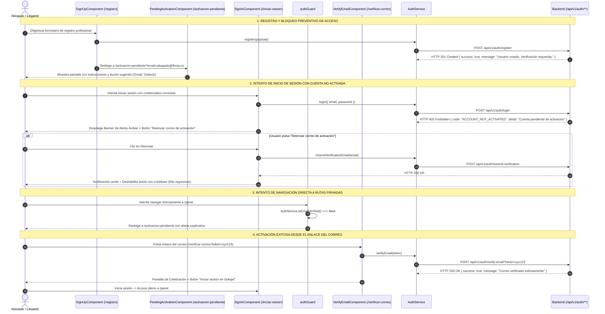

# 📖 Historia de Usuario: HU-19 - Activación Obligatoria de Cuenta por Verificación de Correo, Bloqueo de Acceso y Gestión de Reenvío de Enlace

---

## 📌 1. Información General de la Historia

| Metadato | Detalle |
| :--- | :--- |
| **Identificador** | `HU-19` |
| **Código Equivalente Backend** | `US-003-AUTH-ACTIVATION` (o `US-018-ACCOUNT-ACTIVATION`) |
| **Título** | Activación Obligatoria de Cuenta por Verificación de Correo Electrónico, Bloqueo Preventivo de Acceso a la Plataforma y Gestión de Reenvío de Enlace |
| **Épica** | Autenticación, Seguridad y Onboarding de Litigantes |
| **Módulo / Rutas Angular** | `src/app/features/auth/` (`/registro`, `/iniciar-sesion`, `/verificar-correo`, `/activacion-pendiente`) |
| **Estado** | `📝 Lista para Desarrollo` |
| **Prioridad** | `Alta (Core de Seguridad y Prevención de Cuentas Falsas)` |
| **Tipo** | `Seguridad y Experiencia de Usuario (Security & UX)` |
| **Actor Principal** | Abogado Litigante / Administrador de Firma / Nuevo Usuario Registrado |

---

## 🎯 2. Narrativa de Negocio y Experiencia de Usuario (User Story Narrative)

> **Como** abogado litigante, asesor jurídico o administrador de firma en **Dokqet**,  
> **Quiero** que al registrarme en la plataforma mi cuenta quede en estado pendiente de activación hasta que confirme mi dirección de correo electrónico institucional o profesional, impidiendo el ingreso al despacho judicial hasta haber validado mi identidad digital,  
> **Para** evitar la suplantación de identidad profesional, garantizar que las alertas procesales y novedades de términos judiciales lleguen efectivamente a mi bandeja de entrada, y disponer de una experiencia guiada con opción de reenvío inmediato en caso de que el enlace expire o no sea recibido.

---

## 🔍 2.1. Diagnóstico del Estado Actual y Justificación de Seguridad

1. **Ingreso Prematuro al Panel Tras Registro:**
   En `src/app/features/auth/sign-up/sign-up.component.ts:160-165`, cuando la petición de registro responde satisfactoriamente, el cliente ejecuta:
   ```typescript
   this.authService.register(registerPayload).subscribe({
     next: () => {
       this.loading.set(false);
       const returnUrl = this.route.snapshot.queryParams['returnUrl'] || '/panel';
       this.router.navigateByUrl(returnUrl);
     }
   });
   ```
   Esto permite que un usuario con correo sin verificar (o incluso con un correo inexistente o mal digitado) acceda directamente al panel de procesos `/panel`, vigilando radicados sin haber certificado la titularidad de su buzón.
2. **Tratamiento Indiferenciado en Inicio de Sesión ante Cuenta Inactiva:**
   En `src/app/features/auth/sign-in/sign-in.component.ts:150-200`, cuando el backend rechaza el inicio de sesión con `HTTP 403 Forbidden` (`ACCOUNT_NOT_ACTIVATED` / `EMAIL_NOT_VERIFIED`), el cliente muestra un mensaje genérico de error de autenticación. El usuario desconoce que sus credenciales son válidas y que solo debe activar su cuenta pulsando el enlace recibido en su correo, ni se le ofrece un botón directo para reenviar el enlace.
3. **Falta de Validación de Activación en `authGuard`:**
   En `src/app/core/auth/auth.guard.ts:5-14`, el guard únicamente valida `authService.isAuthenticated()`. Si una cuenta posee tokens en caché pero su propiedad `emailVerified` es `false`, el sistema permite el libre tránsito por rutas protegidas (`/panel`, `/procesos/**`, `/organizacion`).
4. **Ausencia de Temporizador Anti-Spam (Cooldown):**
   Aunque `AuthService` posee el método `resendVerificationEmail(email)`, no existe control de tasa en el cliente para evitar que el usuario pulse repetidamente el botón y sature los servidores SMTP o active bloqueos de seguridad del proveedor de correos. Se requiere un cooldown regresivo visible de 60 segundos.

---

## 🧭 2.2. Flujo de Navegación y Ciclo de Vida de Activación (Mermaid)



---

## 🧱 3. Modelos de Datos en Cliente y Contratos API (`TypeScript`)

### 3.1. Interfaces y Tipos de Activación (`src/app/core/models/user.model.ts`)

```typescript
// [MODIFICADO / POR EXTENDER] Extensión del modelo User para reflejar el estado de verificación
export interface User {
  id: string;
  email: string;
  name: string;
  firstName: string;
  middleName?: string | null;
  lastName: string;
  secondLastName?: string | null;
  documentType: DocumentType | string;
  documentNumber: string;
  genderCode?: string | null;
  cityId?: string | null;
  emailVerified: boolean; // Bandera crítica para gobierno de acceso
  isSuperAdmin: boolean;
  failedLoginAttempts?: number;
  lockedUntil?: string | null;
  lastFailedLoginAt?: string | null;
  lockReason?: string | null;
  isLocked?: boolean;
}

// [NUEVO / POR CREAR] Estructura ProblemDetail RFC 9457 cuando el login es rechazado por cuenta inactiva
export interface ProblemDetailAccountNotActivated {
  type: string;
  title: string;
  status: 403;
  detail: string;
  code: 'ACCOUNT_NOT_ACTIVATED' | 'EMAIL_NOT_VERIFIED' | string;
  email?: string;
  instance?: string;
  timestamp?: string;
}

// [NUEVO / POR CREAR] DTO para solicitar reenvío del correo de activación
export interface ResendVerificationRequest {
  email: string;
}

// [NUEVO / POR CREAR] DTO para el resultado de verificación
export interface VerifyEmailResult {
  success: boolean;
  message: string;
  verifiedEmail?: string;
  activatedAt?: string;
}
```

---

## ⚖️ 4. Reglas de Negocio en Frontend (RN-FE)

- **RN-FE-01 (Bloqueo Preventivo Post-Registro e Invitación a la Activación):**  
  Al registrarse exitosamente en `SignUpComponent`, el usuario **bajo ninguna circunstancia** debe ser autenticado automáticamente ni redirigido a `/panel`. El cliente debe navegar a la ruta `/activacion-pendiente?email={email}` desplegando la tarjeta informativa de confirmación pendiente.
- **RN-FE-02 (Captura Específica de Error HTTP 403 `ACCOUNT_NOT_ACTIVATED` en Login):**  
  En `SignInComponent`, si la autenticación responde con `HTTP 403` y código de error de cuenta no activada o detalle correspondiente:
  - NO se computa como intento fallido de contraseña errónea ni descuenta del límite de 5 intentos.
  - Se muestra una alerta contextual ámbar (`<app-form-alert type="warning">`) indicando: *"Tu cuenta aún no ha sido activada. Por favor confirma tu correo electrónico antes de ingresar."*
  - Se visualiza de inmediato el botón de acción rápida *"Reenviar correo de activación"*.
- **RN-FE-03 (Blindaje de Rutas con `authGuard` por Estado de Verificación):**  
  En `authGuard`, para autorizar el acceso a `/panel`, `/procesos/**`, `/organizacion` o `/perfil`, se debe verificar:
  ```typescript
  if (authService.isAuthenticated()) {
    if (!authService.isEmailVerified()) {
      return router.parseUrl('/activacion-pendiente');
    }
    return true;
  }
  return router.parseUrl('/iniciar-sesion');
  ```
  Esto previene que sesiones persistidas con `emailVerified === false` accedan al despacho.
- **RN-FE-04 (Mecanismo Anti-Spam y Temporizador Regresivo de Reenvío - Cooldown de 60s):**  
  Al pulsar *"Reenviar correo de activación"*, el botón pasa a estado de carga, dispara `authService.resendVerificationEmail(email)` y, tras la confirmación exitosa, se desactiva durante 60 segundos, mostrando una cuenta regresiva dinámica (`"Reenviar en 59s..."`). Se emite un mensaje verde indicando: *"Hemos enviado un nuevo enlace a tu correo. Revisa también tu carpeta de spam."*
- **RN-FE-05 (Atajos de Apertura Rápida de Webmail):**  
  En la pantalla `/activacion-pendiente`, el sistema detecta el dominio del correo registrado (`@gmail.com`, `@outlook.com`, `@hotmail.com`, `@yahoo.com`) y ofrece un botón de acceso directo: *"Abrir Gmail"*, *"Abrir Outlook"*, acelerando la tasa de conversión y activación.
- **RN-FE-06 (Manejo de Enlace Expirado o Token Inválido en `/verificar-correo`):**  
  Si el token expiró (validez estándar de 24 horas) o ya fue utilizado, la pantalla de verificación muestra un estado de advertencia con un campo de correo editable para solicitar un nuevo token de activación sin tener que reiniciar el registro.

---

## 🧪 5. Criterios de Aceptación (Escenarios en Formato Gherkin)

```gherkin
# language: es
Característica: HU-19 - Activación Obligatoria de Cuenta, Bloqueo de Acceso y Gestión de Reenvío de Enlace
  Como Abogado Litigante o Administrador de Firma
  Quiero que mi cuenta exija confirmación de correo electrónico antes de acceder a la plataforma
  Para garantizar la seguridad del despacho y asegurar la recepción de alertas judiciales

  Antecedentes:
    Dado que el usuario navega en la plataforma web de Dokqet

  # =========================================================================
  # REGLA: FLUJO POST-REGISTRO Y BLOQUEO PREVENTIVO
  # =========================================================================
  Escenario: Usuario completa el registro y es dirigido a la pantalla de activación pendiente
    Dado que el usuario diligencia correctamente el formulario en "/registro" con el correo "litigante@dokqet.com"
    Cuando presiona el botón "Crear cuenta"
    Y el servidor responde con código HTTP 201 Created
    Entonces el sistema NO debe iniciar sesión automáticamente
    Y NO debe redirigir al tablero "/panel"
    Y debe navegar a la ruta "/activacion-pendiente?email=litigante%40dokqet.com"
    Y la pantalla debe mostrar el mensaje "Revisa tu bandeja de entrada para activar tu cuenta"
    Y debe mostrar el correo "litigante@dokqet.com" destacado

  # =========================================================================
  # REGLA: INTENTO DE LOGIN CON CUENTA NO ACTIVADA (HTTP 403)
  # =========================================================================
  Escenario: Usuario intenta iniciar sesión con credenciales correctas pero cuenta sin activar
    Dado que el usuario se encuentra en la pantalla "/iniciar-sesion"
    Cuando ingresa el correo "litigante@dokqet.com" y su contraseña correcta
    Y presiona "Iniciar sesión"
    Y el servidor responde con error HTTP 403 Forbidden y código "ACCOUNT_NOT_ACTIVATED"
    Entonces el sistema no debe otorgar acceso
    Y debe mostrar una alerta de advertencia indicando "Tu cuenta aún no ha sido activada"
    Y debe mostrar el botón "Reenviar correo de activación"
    Y el contador de intentos fallidos por contraseña errónea NO debe incrementarse

  # =========================================================================
  # REGLA: REENVÍO DE CORREO Y COOLDOWN ANTI-SPAM (60 SEGUNDOS)
  # =========================================================================
  Escenario: Usuario solicita el reenvío del correo de activación y se activa el temporizador
    Dado que el usuario visualiza el mensaje de cuenta no activada en el inicio de sesión
    Cuando presiona el botón "Reenviar correo de activación"
    Entonces el sistema debe invocar "POST /api/v1/auth/resend-verification" con el correo "litigante@dokqet.com"
    Y debe mostrar una confirmación verde "Enlace de activación enviado exitosamente"
    Y el botón debe quedar inhabilitado mostrando la cuenta regresiva "Reenviar en 60s"
    Y el temporizador debe decrementar segundo a segundo hasta llegar a cero

  # =========================================================================
  # REGLA: BLINDAJE DE RUTAS PRIVADAS CON AUTHGUARD
  # =========================================================================
  Esquema del escenario: Usuario no verificado intenta acceder directamente a rutas protegidas
    Dado que existe una sesión con un usuario cuya propiedad "emailVerified" es false
    Cuando intenta navegar a la ruta "<rutaProtegida>"
    Entonces el "authGuard" debe interceptar la navegación
    Y debe bloquear el acceso a la vista
    Y debe redirigir al usuario a la ruta "/activacion-pendiente"

    Ejemplos:
      | rutaProtegida       |
      | /panel              |
      | /procesos/nuevo     |
      | /organizacion       |
      | /perfil             |

  # =========================================================================
  # REGLA: ACTIVACIÓN EXITOSA MEDIANTE TOKEN
  # =========================================================================
  Escenario: Usuario pulsa sobre el enlace de activación válido recibido en su correo
    Dado que el usuario recibe un correo con el enlace "/verificar-correo?token=token-valido-123"
    Cuando abre dicho enlace en el navegador
    Entonces la vista debe mostrar un skeleton o spinner de verificación en progreso
    Y el sistema debe invocar "POST /api/v1/auth/verify-email?token=token-valido-123"
    Y al responder satisfactoriamente debe mostrar el encabezado "¡Correo electrónico verificado!"
    Y debe ofrecer el botón principal "Iniciar sesión" para ingresar a la plataforma

  # =========================================================================
  # REGLA: TOKEN EXPIRADO O INVÁLIDO
  # =========================================================================
  Escenario: Usuario intenta activar su cuenta con un enlace expirado
    Dado que el usuario accede a "/verificar-correo?token=token-vencido-999"
    Cuando el servidor responde con error HTTP 400 Bad Request indicando token expirado
    Entonces la vista debe mostrar el mensaje "El enlace de verificación no es válido o ya ha expirado"
    Y debe presentar un formulario para ingresar su correo y solicitar un nuevo enlace
```

---

## 🏗️ 6. Mapeo a la Arquitectura Angular (Clasificación de Componentes)

### 6.1. Componentes y Vistas
- **`[MODIFICADO / POR EXTENDER]` Componente de Registro:**  
  `src/app/features/auth/sign-up/sign-up.component.ts`  
  *Modifica el handler del submit para redirigir a `/activacion-pendiente` en lugar de `/panel`.*
- **`[MODIFICADO / POR EXTENDER]` Componente de Inicio de Sesión:**  
  `src/app/features/auth/sign-in/sign-in.component.ts`  
  *Captura el error HTTP 403 `ACCOUNT_NOT_ACTIVATED`, despliega alerta ámbar y botón de reenvío con temporizador de 60s.*
- **`[NUEVO / POR CREAR]` Componente de Espera y Activación:**  
  `src/app/features/auth/pending-activation/pending-activation.component.ts` (con `.html` y `.spec.ts`)  
  *Vista de onboarding que explica los pasos a seguir, detecta webmails populares y permite solicitar reenvío con cooldown.*
- **`[MODIFICADO / POR EXTENDER]` Componente de Verificación de Correo:**  
  `src/app/features/auth/verify-email/verify-email.component.ts`  
  *Añade formulario de reenvío si el token expira.*

### 6.2. Seguridad, Guards y Servicios
- **`[MODIFICADO / POR EXTENDER]` Guard de Autenticación:**  
  `src/app/core/auth/auth.guard.ts`  
  *Valida adicionalmente `authService.isEmailVerified()`. Si no cumple, redirige a `/activacion-pendiente`.*
- **`[MODIFICADO / POR EXTENDER]` Servicio de Autenticación:**  
  `src/app/core/auth/auth.service.ts`  
  *Añade el Signal reactivo `isEmailVerified = computed(() => !!this.currentUserSignal()?.emailVerified)`.*
- **`[MODIFICADO / POR EXTENDER]` Enrutador Principal:**  
  `src/app/app.routes.ts`  
  *Registra la ruta `/activacion-pendiente` como accesible sin requerir verificación previa.*

### 6.3. Modelos y UI Compartida
- **`[MODIFICADO / POR EXTENDER]` Modelo de Usuario:**  
  `src/app/core/models/user.model.ts`  
  *Tipos `ProblemDetailAccountNotActivated` y `ResendVerificationRequest`.*
- **`[EXISTENTE - REUTILIZADO]` Componentes UI:**  
  `src/app/shared/components/ui/` (`ButtonComponent`, `CardComponent`, `FormAlertComponent`, `LogoComponent`).

---

## 🚀 7. Guía y Ejemplos Prácticos de Prueba (Testing Guide)

### 7.1. Pruebas Unitarias Automatizadas (Jasmine / Karma)

```typescript
describe('HU-19 - Activación Obligatoria de Cuenta', () => {
  // 1. authGuard
  it('authGuard debe redirigir a /activacion-pendiente si el usuario está autenticado pero emailVerified es false', () => {
    // Configura authService.isAuthenticated = true y authService.isEmailVerified = false
    // Espera redirección a /activacion-pendiente
  });

  // 2. SignUpComponent
  it('SignUpComponent debe navegar a /activacion-pendiente tras registro exitoso', () => {
    // Simula registro exitoso y valida que el router navega a /activacion-pendiente?email=...
  });

  // 3. SignInComponent
  it('SignInComponent debe capturar HTTP 403 ACCOUNT_NOT_ACTIVATED y habilitar botón de reenvío', () => {
    // Simula error 403 y valida que el banner de cuenta no activada se renderice
  });
});
```

### 7.2. Comandos de Verificación
```bash
# Compilar proyecto y verificar integridad tipada
npm run build

# Ejecutar pruebas unitarias de autenticación
npx ng test --include="src/app/features/auth/**/*.spec.ts" --no-watch
```

### 7.3. Checklist de Verificación Manual
1. Ir a `/registro`, crear una cuenta nueva y confirmar que la pantalla siguiente sea `/activacion-pendiente` y **no** el panel principal.
2. Intentar ingresar a `/iniciar-sesion` con la cuenta recién creada y validar que se visualice la advertencia de cuenta no activada con el botón de reenvío.
3. Presionar "Reenviar correo de activación" y comprobar que el botón se bloquee durante 60 segundos con contador regresivo.
4. Intentar ingresar a `/panel` escribiendo la URL directamente y verificar que `authGuard` redirija a `/activacion-pendiente`.
5. Abrir el enlace de activación `/verificar-correo?token=...` y confirmar el cambio a estado verificado.
