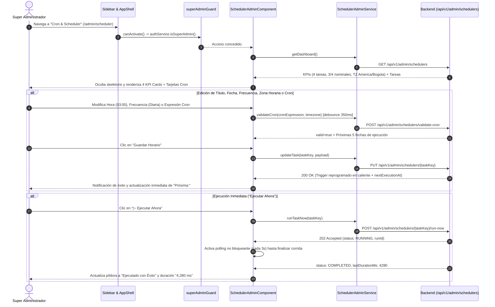

# 📖 Historia de Usuario: HU-19 - Consola de Cron & Scheduler: Planificación Dinámica, Zona Horaria, Telemetría y Ejecución Inmediata para Super Administrador

* **ID de Historia:** `HU-19`
* **Código Equivalente Backend:** `US-018` (`Gestión Dinámica, Observabilidad y Control Operativo de Tareas Cron / Scheduler para Super Administrador`)
* **Épica:** Backoffice Técnico, Gobernanza Operativa y Observabilidad de Procesos en Segundo Plano
* **Prioridad:** Alta (Core Operativo y Continuidad de Vigilancia Judicial)
* **Estado:** ✅ Completada
* **Fecha:** Octubre 2026

---

## 📌 1. Información General de la Historia

| Metadato | Detalle |
| :--- | :--- |
| **Identificador** | `HU-19` |
| **Código Equivalente Backend** | `US-018` |
| **Título** | Consola de Cron & Scheduler: Planificación Dinámica, Zona Horaria, Telemetría y Ejecución Inmediata para Super Administrador |
| **Módulo / Rutas Angular** | `src/app/features/admin/scheduler` (`/admin/scheduler`) |
| **Estado** | `✅ Completada` |
| **Prioridad** | `Alta (Core Operativo / Backoffice)` |
| **Tipo** | `Funcionalidad y Experiencia de Usuario Operativa (Feature & UX/UI)` |
| **Actor Principal** | `Super Administrador (SUPER_ADMIN - Área Técnica de Dokqet)` |

---

## 🎯 2. Narrativa de Negocio y Experiencia de Usuario (User Story Narrative)

**Como** Super Administrador (`SUPER_ADMIN`) del área técnica de **Dokqet**,  
**Quiero** contar en el panel de administración global con una consola interactiva de **Cron & Scheduler** donde pueda visualizar todas las tareas configuradas y activas del backend, monitorear sus métricas de salud y alertas en tiempo real, inspeccionar y configurar la zona horaria del servidor y de cada proceso, asignar un título propio descriptivo, fecha, hora, frecuencia y expresión Cron con validación previa, consultar la última fecha de ejecución, el tiempo exacto que tardó (`ms`) y la próxima corrida programada, además de ejecutar cualquier proceso de inmediato (`Ejecutar Ahora`), pausarlo, detenerlo e inspeccionar su historial y auditoría,  
**Para** ejercer control operativo total sobre las rondas de vigilancia judicial ante la Rama Judicial y los trabajos de mantenimiento del sistema sin intervención manual en servidores ni reinicios del backend.

---

## 🔍 2.1. Diagnóstico UX y Arquitectura Visual del Módulo

1. **Integración en la Navegación Exclusiva `Super Admin`:**
   Dentro del bloque `@if (authService.isSuperAdmin())` del menú lateral (`app.component.html`), junto a *Organizaciones* (`/admin/organizaciones`) y *Catálogos Maestros* (`/admin/catalogos`), se incorpora el acceso **Cron & Scheduler** (`/admin/scheduler`) acompañado de una insignia reactiva de alerta (`1 Alerta` / `N Alertas` en tono destructivo) cuando al menos una tarea haya reportado error o interrupción en su última corrida.
2. **Encabezado del Centro de Administración y 4 Tarjetas KPI Superiores:**
   - Barra superior con título **Centro de Administración Global — Cron & Scheduler**, botón **`↻ Actualizar Estado`** y botón **`⏸ Pausa Global`** (para ventanas de mantenimiento).
   - Cuatro tarjetas de resumen operativo:
     1. **`TOTAL TAREAS CRON`**: Conteo total de tareas configuradas (ej. `4 configuradas`, desglose `activas / pausadas`) e indicador `Scheduler activo` (verde) o `Pausa global activa` (ámbar).
     2. **`ESTADO DE EJECUCIÓN`**: Relación de salud `3 / 4 nominales` (resaltada en rojo si existen fallas, verde si todas están nominales) y subtítulo `1 tarea reportó error` o `Todas las tareas operativas`.
     3. **`ZONA HORARIA SERVIDOR`**: Visualización `UTC-5 (America/Bogota)` con opción de edición rápida de zona horaria predeterminada y subtítulo `Sincronizado con NTP · Reloj JVM`.
     4. **`MOTOR DE SCHEDULER`**: Identificación `Spring TaskScheduler (Java 21)` y estado `Worker daemon activo` (mostrando conteo de hilos en ejecución activa).
3. **Contenedor Principal `PLANIFICADOR DE TAREAS DEL BACKEND (CRON JOBS)`:**
   - Barra de filtros rápidos por píldoras: `Todas (N)`, `Activas (N)`, `En Ejecución (N)`, `Exitosas (N)` y `Con Error (N)` más buscador instantáneo por título o clave técnica.
   - Tarjetas individuales de configuración y control para cada Cron, estructuradas en tres franjas ergonómicas:
     - **Franja Superior (Identidad y Estado):** Título propio editable del proceso, insignia de estado de última corrida (`● Ejecutado con Éxito`, `● Ejecutando...`, `● Con Error`, `● Detenido`), descripción funcional e interruptor accesible `Activa / Pausada` (`role="switch"`).
     - **Franja Central (Programación Interactiva):** Controles sincronizados reactivamente para **Hora / Fecha de Ejecución** (incluyendo selector de fecha `YYYY-MM-DD` para corridas en fecha específica o inicio diferido), **Frecuencia / Intervalo**, **Zona Horaria IANA**, **Expresión Cron** (con vista previa de próximas 5 ejecuciones) y botón primario **`💾 Guardar Horario`**.
     - **Franja Inferior (Telemetría y Acciones Inmediatas):** Indicadores con cifras tabulares (`Última corrida`, `Duración: 4,280 ms`, `Próxima: Mañana a las 03:00:00`) a la izquierda, y botones **`📜 Historial y Auditoría`**, **`⏹ Detener`** (cuando está `RUNNING`) y **`▷ Ejecutar Ahora`** a la derecha.



---

## 🧱 3. Modelos de Datos en Cliente y Contratos API (`TypeScript`)

> [!IMPORTANT]
> **Auditoría de Código Preexistente (Cero Duplicación):**  
> Los envoltorios genéricos `AdminApiResponse<T>` y `PageResponse<T>` **ya existen** en `src/app/core/models/super-admin.model.ts` (`[EXISTENTE - REUTILIZADO]`), por lo que se importan directamente sin redeclararlos. Se crea únicamente el archivo especializado `src/app/core/models/scheduler-admin.model.ts` (`[NUEVO / POR CREAR]`) para tipar estrictamente el dominio del planificador.

### 3.1. Interfaces Reutilizadas (`src/app/core/models/super-admin.model.ts` — `[EXISTENTE - REUTILIZADO]`)
- `AdminApiResponse<T>`
- `PageResponse<T>`

### 3.2. Nuevas Interfaces del Planificador (`src/app/core/models/scheduler-admin.model.ts` — `[NUEVO / POR CREAR]`)

```typescript
export type ScheduleFrequencyType =
  | 'INTERVAL_MINUTES'
  | 'HOURLY'
  | 'DAILY'
  | 'TWICE_DAILY'
  | 'WEEKDAYS'
  | 'WEEKLY'
  | 'MONTHLY'
  | 'ONCE_AT_DATE'
  | 'CUSTOM_CRON';

export type ScheduledTaskRunStatus =
  | 'RUNNING'
  | 'COMPLETED'
  | 'STOPPED'
  | 'INTERRUPTED'
  | 'FAILED';

export type ScheduleTriggerType = 'SCHEDULED' | 'MANUAL';

export type SchedulerFilterTab = 'ALL' | 'ACTIVE' | 'RUNNING' | 'SUCCESS' | 'ERROR';

export interface TimezoneOptionDto {
  zoneId: string;        // Ej: 'America/Bogota'
  utcOffset: string;     // Ej: 'UTC-05:00'
  displayName: string;   // Ej: 'UTC-5 (America/Bogota)'
}

export interface SchedulerOverviewKpiDto {
  totalTasks: number;
  activeTasks: number;
  pausedTasks: number;
  runningTasks: number;
  nominalTasks: number;
  errorTasks: number;
  alertCount: number;
  serverTimezone: string;
  serverUtcOffset: string;
  ntpSynchronized: boolean;
  engineName: string;
  workerActive: boolean;
  globalPaused: boolean;
  pauseReason: string | null;
}

export interface ScheduledTaskDto {
  id: string;
  taskKey: string;
  title: string;
  description: string;
  frequencyType: ScheduleFrequencyType;
  cronExpression: string;
  displayCronExpression: string;
  timezone: string;
  utcOffset: string;
  executionTime: string | null;      // Formato 'HH:mm:ss' o 'HH:mm'
  scheduledDate: string | null;      // Formato ISO 'YYYY-MM-DD'
  intervalMinutes: number | null;
  daysOfWeek: string | null;         // Ej: 'MON,WED,FRI' o 'SUN'
  dayOfMonth: number | null;
  enabled: boolean;
  preventOverlap: boolean;
  timeoutSeconds: number;
  notifyOnFailure: boolean;
  alertEmails: string | null;
  lastRunId: string | null;
  lastExecutionAt: string | null;    // ISO 8601 UTC
  lastDurationMs: number | null;
  lastStatus: ScheduledTaskRunStatus | null;
  lastErrorMessage: string | null;
  isStaleRunning?: boolean;          // true si RUNNING supera TTL de heartbeat (15 min)
  nextExecutionAt: string | null;    // ISO 8601 UTC
  updatedAt: string;
  updatedBy: string | null;
}

export interface SchedulerDashboardResponseDto {
  overview: SchedulerOverviewKpiDto;
  tasks: ScheduledTaskDto[];
  availableTimezones: TimezoneOptionDto[];
}

export interface UpdateScheduledTaskPayload {
  title: string;
  description: string;
  frequencyType: ScheduleFrequencyType;
  executionTime: string | null;
  scheduledDate: string | null;
  intervalMinutes: number | null;
  daysOfWeek: string | null;
  dayOfMonth: number | null;
  cronExpression: string;
  timezone: string;
  preventOverlap: boolean;
  timeoutSeconds: number;
  notifyOnFailure: boolean;
  alertEmails: string | null;
}

export interface CronValidationRequestDto {
  cronExpression: string;
  timezone: string;
  scheduledDate?: string | null;
}

export interface CronValidationResponseDto {
  valid: boolean;
  normalizedCron: string | null;
  humanDescription: string;
  nextExecutions: string[];
  errorMessage?: string | null;
}

export interface ScheduledTaskRunDto {
  runId: string;
  taskKey: string;
  kind: string;
  status: ScheduledTaskRunStatus;
  triggerType: ScheduleTriggerType;
  triggeredByEmail: string | null;
  startedAt: string;
  finishedAt: string | null;
  durationMs: number | null;
  total: number;
  checked: number;
  withChanges: number;
  errors: number;
  instancesFound: number;
  note: string | null;
  errorDetail: string | null;
}

export interface ScheduledTaskAuditDto {
  id: string;
  taskKey: string | null;
  action: string;
  previousStateJson: string | null;
  newStateJson: string | null;
  reason: string | null;
  performedByEmail: string;
  ipAddress: string | null;
  createdAt: string;
}

// Estructura estándar de Error RFC 9457 (ProblemDetail)
export interface ProblemDetailSchedulerError {
  type: string;
  title: string;
  status: number;
  detail: string;
  instance?: string;
  errors?: Record<string, string>;
}
```

---

## ⚖️ 4. Reglas de Negocio en Frontend (RN-FE)

- **RN-FE-01 (Protección Exclusiva de Ruta y Visibilidad en Sidebar):**
  La ruta `/admin/scheduler` debe estar protegida por `[authGuard, superAdminGuard]`. En `app.component.html`, el ítem **"Cron & Scheduler"** solo se renderiza cuando `authService.isSuperAdmin()` es `true`. Si `schedulerAlertCount() > 0`, el ítem del menú muestra una insignia roja compacta (`1 Alerta` o `N Alertas`).

- **RN-FE-02 (Sincronización Reactiva Bidireccional de Hora, Fecha, Frecuencia y Expresión Cron):**
  Cada tarjeta de tarea mantiene un estado de edición aislado basado en Signals:
  1. Al seleccionar una **Frecuencia** (`Diaria`, `Dos veces al día`, `Días hábiles`, `Semanal`, `Mensual`, `Cada N minutos`, `Fecha única específica`) o cambiar la **Hora de Ejecución** (`HH:mm`), la interfaz recalcula instantáneamente la `cronExpression` sugerida.
  2. Si el administrador edita manualmente el campo **Expresión Cron**, el selector de frecuencia cambia automáticamente a `Expresión Cron Personalizada` (`CUSTOM_CRON`) sin sobrescribir lo escrito.
  3. Cuando se elige `Fecha única específica` (`ONCE_AT_DATE`), se despliega como obligatorio el selector de fecha (`scheduledDate` con mínimo igual a la fecha actual en la zona horaria elegida); en frecuencias recurrentes, se permite desplegar opcionalmente `"Asignar fecha de inicio"`.

- **RN-FE-03 (Edición de Título Propio y Configuración Avanzada por Tarea):**
  Cada tarjeta muestra prominentemente su **Título** (`title`), su clave técnica inmutable (`taskKey`) y su descripción. El administrador puede editar el título (5 a 160 caracteres), la descripción (10 a 600 caracteres) y desplegar las opciones avanzadas de control operativo (`Evitar ejecuciones superpuestas`, `Timeout en segundos`, `Notificar fallas por correo vía Kafka` y `Correos de alerta`) guardándolas junto con el horario.

- **RN-FE-04 (Validación en Tiempo Real y Vista Previa de Próximas 5 Ejecuciones):**
  Al modificar la expresión Cron o la zona horaria (con `debounce` de 350 ms), la interfaz valida el formato local (5 o 6 campos Cron) y consulta `POST /api/v1/admin/schedulers/validate-cron`, mostrando debajo del campo la traducción legible en español (ej. *"Todos los días a las 03:00 a. m. (America/Bogota)"*) y un panel desplegable con las **próximas 5 fechas de ejecución**. Si la expresión es inválida, marca el borde en error, explica la causa y deshabilita **`Guardar Horario`**.

- **RN-FE-05 (Indicador de Cambios Pendientes y Guardado Atómico por Tarjeta):**
  Cuando una tarjeta presenta modificaciones respecto al estado persistido (`isDirty === true`), muestra una etiqueta sutil `"Cambios sin guardar"` y habilita el botón **`Guardar Horario`** (además de un botón secundario `"Descartar"` para restaurar los valores originales). Mientras se guarda, el botón muestra estado de progreso individual sin bloquear las demás tarjetas del panel.

- **RN-FE-06 (Ejecución Inmediata `"▷ Ejecutar Ahora"`, Polling No Bloqueante y `"⏹ Detener"`):**
  1. Al pulsar **`▷ Ejecutar Ahora`**, se invoca `POST /api/v1/admin/schedulers/{taskKey}/run-now`. Al recibir `202 Accepted`, la píldora de estado cambia inmediatamente a `● Ejecutando...` y el botón primario muta o habilita **`⏹ Detener`**.
  2. Mientras exista al menos una tarea con `lastStatus === 'RUNNING'`, el componente activa un refresco silencioso en segundo plano cada 3 segundos (limpiado estrictamente mediante `DestroyRef`) para actualizar progreso (`checked / total`), duración y estado final sin provocar parpadeos ni recargar formularios con cambios sin guardar (`isDirty`).
  3. Si una corrida quedó huérfana (`isStaleRunning === true`), la tarjeta habilita la acción **`🔓 Liberar bloqueo huérfano`**.

- **RN-FE-07 (Interruptor Activa / Pausada y Pausa Maestra Global):**
  1. El switch `Activa / Pausada` de cada tarjeta invoca `PATCH /api/v1/admin/schedulers/{taskKey}/status`. Cuando pasa a `Pausada`, el indicador `Próxima:` muestra `"Pausada manualmente"` conservando visibles todos sus campos de horario.
  2. El botón superior **`⏸ Pausa Global`** abre un modal solicitando el motivo de mantenimiento (ej. *"Ventana de mantenimiento Rama Judicial"*). Mientras `globalPaused === true`, se despliega un banner ámbar destacado en la parte superior con el motivo registrado y el botón directo **`▶ Reanudar Planificador Global`**.

- **RN-FE-08 (Configuración de Zona Horaria del Servidor y por Tarea):**
  La tarjeta KPI **`ZONA HORARIA SERVIDOR`** exhibe el offset y nombre IANA (`UTC-5 (America/Bogota)`) y permite abrir un selector para actualizar la zona horaria predeterminada del servidor (`PUT /api/v1/admin/schedulers/server-timezone`). Adicionalmente, cada tarea permite elegir su propia zona horaria IANA independiente, formateando `Última corrida:` y `Próxima:` con `Intl.DateTimeFormat('es-CO', { timeZone })` y tipografía `tabular-nums`.

- **RN-FE-09 (Filtros Rápidos e Inspección de Historial y Pista de Auditoría):**
  Las píldoras de filtro (`Todas`, `Activas`, `En Ejecución`, `Exitosas`, `Con Error`) y el buscador filtran reactivamente mediante `computed()` sin peticiones redundantes. El botón **`📜 Historial y Auditoría`** de cada tarjeta abre `<app-modal>` con dos pestañas paginadas: **Ejecuciones** (`startedAt`, `durationMs`, `triggerType`, `triggeredByEmail`, `checked/total`, `withChanges`, `errors`, `errorDetail`) y **Auditoría de Cambios** (`action`, usuario, IP, fecha y valores anterior/nuevo).

- **RN-FE-10 (Estados de Carga con Skeletons Contextuales — Cero Spinners Bloqueantes):**
  Durante la carga inicial de `/admin/scheduler`, se renderiza `<app-skeleton-card-grid>` para las 4 tarjetas KPI y siluetas `<app-skeleton>` con la altura exacta de las tarjetas de tareas Cron (manteniendo `CLS < 0.1`), prohibiendo el uso de spinners globales de pantalla completa.

- **RN-FE-11 (Manejo de Errores RFC 9457 `ProblemDetail`):**
  Ante respuestas `400 Bad Request` (cron/fecha/TZ inválida), `409 Conflict` (tarea ya en ejecución al pulsar `Ejecutar Ahora`) o `500 Internal Server Error`, la interfaz extrae `error.error?.detail` del objeto `ProblemDetail`, presenta una alerta contextual `<app-form-alert type="error">` o toast informativo mediante `NotificationService` y conserva intactos los datos editados por el administrador.

- **RN-FE-12 (Accesibilidad WCAG 2.1 AA, Modo Oscuro `#021b1e` y Diseño Responsivo):**
  Todos los switches poseen `role="switch"`, `aria-checked` y `aria-label` descriptivo (ej. `"Activar o pausar tarea Sincronización de Actuaciones Judiciales"`). Los números de telemetría (`4,280 ms`, contadores KPI y fechas) emplean `tabular-nums`. La cuadrícula de controles se adapta fluidamente desde móvil (`grid-cols-1`, áreas táctiles $\ge 44\text{px}$) hasta escritorio (`lg:grid-cols-12`) garantizando contraste AA tanto en tema claro como en tema oscuro corporativo.

---

## 🧪 5. Criterios de Aceptación (Escenarios en Formato Gherkin)

```gherkin
# language: es
Característica: HU-19 - Consola de Cron & Scheduler y Administración Dinámica de Tareas del Backend
  Como Super Administrador del Área Técnica de Dokqet
  Quiero gestionar visualmente las tareas del planificador Cron, su zona horaria, frecuencia, fechas, títulos y ejecución inmediata
  Para controlar y supervisar todos los procesos automatizados del backend con visibilidad en tiempo real y trazabilidad completa

  Antecedentes:
    Dado que el usuario ha iniciado sesión con una cuenta de rol "SUPER_ADMIN"
    Y navega a la consola "/admin/scheduler"

  # =========================================================================
  # REGLA: CAMINO FELIZ — RENDERIZADO DE KPIS, ZONA HORARIA Y TARJETAS CRON
  # =========================================================================
  Escenario: Visualización inicial de métricas globales, zona horaria, alertas y tarjetas de tareas configuradas
    Dado que el backend retorna 4 tareas configuradas donde 3 finalizaron con éxito y 1 reportó error
    Y la zona horaria del servidor es "America/Bogota" con offset "UTC-05:00"
    Cuando la pantalla "/admin/scheduler" completa la carga inicial
    Entonces los skeletons contextuales desaparecen sin desplazamiento brusco del diseño
    Y el enlace "Cron & Scheduler" en el menú lateral muestra la insignia de alerta "1 Alerta"
    Y se muestran las 4 tarjetas KPI superiores con la información:
      | Tarjeta               | Valor Principal               | Subtítulo Operativo           |
      | TOTAL TAREAS CRON     | 4 configuradas                | Scheduler activo              |
      | ESTADO DE EJECUCIÓN   | 3 / 4 nominales               | 1 tarea reportó error         |
      | ZONA HORARIA SERVIDOR | UTC-05:00 (America/Bogota)    | Sincronizado con NTP          |
      | MOTOR DE SCHEDULER    | Spring TaskScheduler (Java 21)| Worker daemon activo          |
    Y cada tarjeta de tarea muestra su título propio, estado de última corrida, interruptor "Activa", selectores de hora/fecha, frecuencia, zona horaria, expresión cron, última fecha de ejecución, duración en milisegundos, próxima ejecución y el botón "Ejecutar Ahora"

  # =========================================================================
  # REGLA: SINCRONIZACIÓN INTERACTIVA Y GUARDADO DE HORARIO, FECHA Y TÍTULO
  # =========================================================================
  Escenario: Modificar el título, la hora, la frecuencia y guardar la nueva programación de un cron
    Dado que el Super Administrador visualiza la tarjeta de la tarea "ORG_INVITATIONS_EXPIRY"
    Cuando actualiza el título a "Expiración Nocturna de Invitaciones Pendientes"
    Y selecciona la frecuencia "Diaria", la hora de ejecución "03:00" y la zona horaria "America/Bogota"
    Entonces el campo "Expresión Cron" se actualiza reactivamente a "0 3 * * *"
    Y se visualiza la vista previa con las próximas 5 fechas de ejecución validadas
    Cuando presiona el botón "Guardar Horario" y el servidor confirma con HTTP 200
    Entonces se muestra una notificación de confirmación indicando que el horario fue reprogramado en caliente
    Y el indicador "Próxima:" de la tarjeta se actualiza con la nueva fecha y hora calculada

  Escenario: Asignar una fecha específica de ejecución única para un proceso programado
    Dado que el Super Administrador interactúa con la tarjeta de "RAMA_INSTANCES_SYNC"
    Cuando cambia el selector "Frecuencia / Intervalo" a la opción "Fecha única específica"
    Entonces la tarjeta despliega el campo obligatorio "Fecha programada"
    Cuando selecciona una fecha futura válida, define la hora "22:15" y presiona "Guardar Horario"
    Entonces el horario queda guardado mostrando la fecha y hora exacta en el indicador "Próxima:"

  # =========================================================================
  # REGLA: VALIDACIÓN REACTIVA DE EXPRESIONES CRON Y CAMPOS OBLIGATORIOS
  # =========================================================================
  Esquema del escenario: Bloqueo de guardado ante expresión cron o metadatos inválidos
    Dado que el Super Administrador edita la tarjeta de la tarea "RAMA_ACTUACIONES_SYNC"
    Cuando ingresa en el campo "<campo>" el valor inválido "<valorInvalido>" y desenfoca el control
    Entonces el control resalta su estado de error y presenta el mensaje "<mensajeError>"
    Y el botón "Guardar Horario" de esa tarjeta permanece deshabilitado

    Ejemplos:
      | campo          | valorInvalido | mensajeError                                                 |
      | cronExpression | 99 75 * * *   | La expresión Cron no es válida. Verifique minutos y horas.   |
      | title          | ABC           | El título identificativo debe tener al menos 5 caracteres.   |

  # =========================================================================
  # REGLA: EJECUCIÓN INMEDIATA ("EJECUTAR AHORA"), SOLAPAMIENTO Y DETENCIÓN
  # =========================================================================
  Escenario: Ejecutar de inmediato un proceso en segundo plano y visualizar su duración al concluir
    Dado que la tarea "RAMA_ACTUACIONES_SYNC" se encuentra en estado "Ejecutado con Éxito"
    Cuando el Super Administrador hace clic en el botón "Ejecutar Ahora"
    Y el servidor acepta el disparo inmediato con código HTTP 202
    Entonces la píldora de estado de la tarjeta cambia a "Ejecutando..."
    Y la tarjeta habilita el botón "Detener" mientras monitorea automáticamente el avance
    Cuando el monitoreo detecta que la corrida finalizó con estado "COMPLETED" y duración "4280" ms
    Entonces la píldora cambia a "Ejecutado con Éxito" y el indicador "Duración:" muestra "4,280 ms"

  Escenario: Mostrar alerta contextual RFC 9457 cuando se intenta ejecutar una tarea que ya está corriendo
    Dado que otra sesión administrativa acaba de iniciar la tarea "RAMA_ACTUACIONES_SYNC"
    Cuando el Super Administrador presiona "Ejecutar Ahora" y el backend responde HTTP 409 con ProblemDetail
    Entonces la interfaz presenta una alerta contextual informando que ya existe una ejecución activa en curso
    Y sincroniza el estado visual de la tarjeta a "Ejecutando..."

  # =========================================================================
  # REGLA: PAUSA INDIVIDUAL, PAUSA GLOBAL, FILTROS E HISTORIAL DE AUDITORÍA
  # =========================================================================
  Escenario: Pausar una tarea con el interruptor y filtrar tareas con error
    Cuando el Super Administrador desactiva el interruptor "Activa" de la tarea "RAMA_INSTANCES_SYNC"
    Entonces el estado del interruptor cambia a "Pausada" y "Próxima:" indica "Tarea pausada"
    Cuando hace clic en la píldora de filtro "Con Error (1)"
    Entonces el listado muestra únicamente la tarea cuyo último resultado fue fallido o interrumpido
    Cuando hace clic en "Historial y Auditoría" sobre dicha tarea
    Entonces se abre un modal con el detalle del error de las corridas anteriores y la bitácora de quién modificó su configuración

  # =========================================================================
  # REGLA: SEGURIDAD DE RUTAS — BLOQUEO A USUARIOS NO SUPER_ADMIN
  # =========================================================================
  Escenario: Redirección inmediata si un litigante o administrador de firma intenta acceder a la URL del scheduler
    Dado que el usuario autenticado posee el rol "ADMIN" de firma o "LAWYER"
    Cuando intenta navegar directamente a "/admin/scheduler"
    Entonces el guard "superAdminGuard" bloquea la navegación y redirige a "/panel"
    Y se despliega una notificación advirtiendo que la sección está restringida al área técnica

  # =========================================================================
  # REGLA: ESTADOS DE CARGA ASÍNCRONA (SKELETON LOADERS SIN SALTOS CLS)
  # =========================================================================
  Escenario: Renderizado de siluetas esqueléticas durante la consulta inicial del tablero
    Dado que la petición inicial a "GET /api/v1/admin/schedulers" se encuentra pendiente en la red
    Cuando se monta la vista "/admin/scheduler"
    Entonces se visualizan siluetas esqueléticas para las 4 tarjetas KPI y para la lista de tareas Cron sin spinners de pantalla completa
    Y al resolverse la petición el contenido reemplaza los skeletons manteniendo estable el layout
```

---

## 🏗️ 6. Mapeo a la Arquitectura Angular (Clasificación de Componentes)

### 6.1. Modelos y Contratos TypeScript
- **`[EXISTENTE - REUTILIZADO]` Modelo Base Admin:** `src/app/core/models/super-admin.model.ts` *(`AdminApiResponse<T>` y `PageResponse<T>`).*
- **`[NUEVO / POR CREAR]` Modelo del Scheduler:** `src/app/core/models/scheduler-admin.model.ts` *(interfaces de KPIs, tareas Cron, frecuencias, zonas horarias, validación dry-run, corridas, auditoría y `ProblemDetailSchedulerError`).*

### 6.2. Servicios, Autenticación y Guards
- **`[NUEVO / POR CREAR]` Servicio de Dominio:** `src/app/core/services/scheduler-admin.service.ts` *(cliente HTTP con `HttpClient` + Signal `alertCount` compartido con el Sidebar: `getDashboard()`, `updateTask()`, `toggleTaskStatus()`, `runTaskNow()`, `stopTask()`, `unlockStaleTask()`, `validateCron()`, `pauseGlobal()`, `resumeGlobal()`, `updateServerTimezone()`, `getTaskRuns()`, `getTaskAuditLogs()`).*
- **`[EXISTENTE - REUTILIZADO]` Servicio de Notificaciones:** `src/app/core/services/notification.service.ts`
- **`[EXISTENTE - REUTILIZADO]` Guardias de Ruta:** `src/app/core/auth/auth.guard.ts` y `src/app/core/auth/super-admin.guard.ts`
- **`[EXISTENTE - REUTILIZADO]` Servicio de Autenticación:** `src/app/core/auth/auth.service.ts` (`isSuperAdmin`).

### 6.3. Componentes Standalone y Subcomponentes Especializados
- **`[NUEVO / POR CREAR]` Componente Principal de Página:**  
  `src/app/features/admin/scheduler/scheduler-admin.component.ts` (+ `.html` y `.spec.ts`) *(orquesta las 4 tarjetas KPI, banner de pausa global, filtros reactivos, polling con `DestroyRef` y modales de zona horaria / historial).*
- **`[NUEVO / POR CREAR]` Subcomponente de Tarjeta Cron Interactiva:**  
  `src/app/features/admin/scheduler/components/scheduler-task-card.component.ts` (+ `.html` y `.spec.ts`) *(encapsula el formulario reactivo/Signals por tarea, sincronización bidireccional Hora/Fecha ↔ Frecuencia ↔ Expresión Cron, preview de próximas 5 corridas, switch `Activa/Pausada` y botones `Guardar Horario`, `Ejecutar Ahora` y `Detener`).*
- **`[NUEVO / POR CREAR]` Subcomponente Modal de Historial y Auditoría:**  
  `src/app/features/admin/scheduler/components/scheduler-history-modal.component.ts` (+ `.html`) *(pestañas paginadas de corridas `update_runs` y bitácora inmutable `scheduled_task_audit_logs`).*
- **`[EXISTENTES - REUTILIZADOS]` Componentes UI Compartidos (`src/app/shared/components/ui/`):**  
  `StatCardComponent`, `BadgeComponent`, `ButtonComponent`, `ModalComponent`, `FormAlertComponent`, `EmptyStateComponent`, `SkeletonComponent`, `SkeletonCardGridComponent` y `SkeletonTableComponent`.

### 6.4. Enrutamiento y Shell Principal
- **`[MODIFICADA]` Configuración de Enrutamiento:** `src/app/app.routes.ts` *(registra `{ path: 'admin/scheduler', title: 'Cron & Scheduler · Dokqet', canActivate: [authGuard, superAdminGuard], loadComponent: ... }`).*
- **`[MODIFICADO / POR EXTENDER]` Shell y Menú Lateral:** `src/app/app.component.ts` y `src/app/app.component.html` *(agrega enlace `"Cron & Scheduler"` con icono de reloj e insignia reactiva `N Alerta(s)` dentro del bloque `@if (authService.isSuperAdmin())`).*

---

## 🚀 7. Guía y Ejemplos Prácticos de Prueba (Testing Guide)

### 7.1. Pruebas Unitarias Automatizadas (Jasmine / Karma `TestBed`)
```typescript
describe('SchedulerAdminComponent', () => {
  let component: SchedulerAdminComponent;
  let fixture: ComponentFixture<SchedulerAdminComponent>;
  let schedulerServiceSpy: jasmine.SpyObj<SchedulerAdminService>;

  beforeEach(async () => {
    schedulerServiceSpy = jasmine.createSpyObj('SchedulerAdminService', [
      'getDashboard',
      'updateTask',
      'toggleTaskStatus',
      'runTaskNow',
      'stopTask',
      'validateCron'
    ]);

    await TestBed.configureTestingModule({
      imports: [SchedulerAdminComponent],
      providers: [
        provideHttpClient(),
        provideHttpClientTesting(),
        { provide: SchedulerAdminService, useValue: schedulerServiceSpy }
      ]
    }).compileComponents();

    fixture = TestBed.createComponent(SchedulerAdminComponent);
    component = fixture.componentInstance;
  });

  it('debe renderizar skeletons contextuales mientras espera la carga inicial del dashboard', () => {
    schedulerServiceSpy.getDashboard.and.returnValue(NEVER);
    fixture.detectChanges();

    expect(component.isLoading()).toBeTrue();
    const compiled = fixture.nativeElement as HTMLElement;
    expect(compiled.querySelector('app-skeleton-card-grid')).not.toBeNull();
  });

  it('debe filtrar tareas con error y reflejar el conteo nominal 3 / 4 en los KPIs', () => {
    schedulerServiceSpy.getDashboard.and.returnValue(of(MOCK_SCHEDULER_DASHBOARD));
    fixture.detectChanges();

    expect(component.overview()?.nominalTasks).toBe(3);
    expect(component.overview()?.totalTasks).toBe(4);

    component.selectedFilter.set('ERROR');
    expect(component.filteredTasks().length).toBe(1);
    expect(component.filteredTasks()[0].lastStatus).toBe('FAILED');
  });

  it('debe manejar error HTTP 409 ProblemDetail al intentar Ejecutar Ahora una tarea en curso', () => {
    schedulerServiceSpy.getDashboard.and.returnValue(of(MOCK_SCHEDULER_DASHBOARD));
    schedulerServiceSpy.runTaskNow.and.returnValue(
      throwError(() => ({
        status: 409,
        error: {
          title: 'Conflict',
          status: 409,
          detail: 'La tarea ya tiene una ejecución activa en curso.'
        }
      }))
    );
    fixture.detectChanges();

    component.onRunNow('RAMA_ACTUACIONES_SYNC');
    expect(component.actionError()).toContain('ejecución activa en curso');
  });
});
```

### 7.2. Ejecución de Verificación y Pruebas con CLI
```bash
# Validar tipado estricto de modelos, servicios, componentes y specs
npx tsc -p tsconfig.spec.json --noEmit

# Compilar bundle de producción Angular verificando lazy-loading de /admin/scheduler
npm run build

# Ejecutar pruebas unitarias del módulo scheduler (cuando el runner Karma/ChromeHeadless esté activo)
npx ng test --include="src/app/features/admin/scheduler/**/*.spec.ts" --no-watch --browsers=ChromeHeadless
```

### 7.3. Checklist de Verificación Manual de UI
1. Iniciar sesión con `admin@dokqet.com` (`SUPER_ADMIN`) y verificar en el menú lateral el enlace **Cron & Scheduler** con su insignia roja de alertas si alguna tarea falló.
2. Navegar a `http://localhost:4200/admin/scheduler` y comprobar que las 4 tarjetas KPI superiores (`TOTAL TAREAS CRON`, `ESTADO DE EJECUCIÓN`, `ZONA HORARIA SERVIDOR`, `MOTOR DE SCHEDULER`) carguen con transición suave desde skeletons (`CLS < 0.1`).
3. Modificar el título identificativo, hora/fecha, frecuencia y zona horaria de una tarjeta; confirmar que la expresión Cron y la vista previa de próximas 5 ejecuciones se actualicen automáticamente antes de pulsar **Guardar Horario**.
4. Pulsar **`▷ Ejecutar Ahora`** en una tarea y confirmar la transición visual inmediata a `Ejecutando...`, la aparición del botón **`⏹ Detener`** y la actualización automática de `Última corrida` y `Duración (ms)` al finalizar.
5. Activar y desactivar el tema oscuro (`#021b1e`) y navegar mediante teclado (`Tab`, `Space` en `role="switch"`, `Enter` en botones) validando contraste WCAG 2.1 AA y responsividad en móvil y escritorio.
