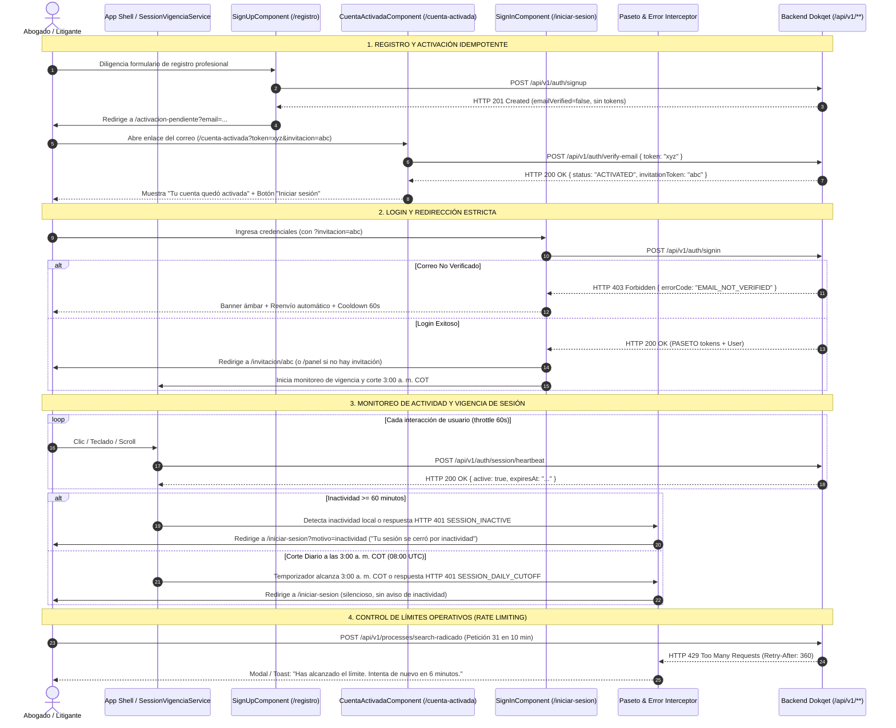

# 📖 Historia de Usuario: HU-20 - Vigencia de Sesión por Inactividad y Corte Diario, Activación Idempotente sin Auto-Login, Blindaje de Perfil y Manejo de Límites Operativos por Usuario

---

## 📌 1. Información General de la Historia

| Metadato | Detalle |
| :--- | :--- |
| **Identificador** | `HU-20` (Equivalente: `HU-20-AUTH-VIGENCIA-LIMITS`) |
| **Código Equivalente Backend** | [`US-019`](file:///E:/Workspace%20Spring%20Boot/dokqet-backend/docs/stories/US-019-vigencia-sesion-activacion-cuenta-limites-usuario.md) (`HU-19-AUTH-LIMITS`) |
| **Título** | Vigencia de Sesión por Inactividad y Corte Diario a las 3:00 a. m. COT, Activación Idempotente en `/cuenta-activada` sin Auto-Login, Blindaje de Perfil y Gestión de Límites Operativos (HTTP 429) |
| **Épica** | Seguridad de Sesiones PASETO, Gobernanza de Identidad, Onboarding Seguro y Protección contra Abuso |
| **Módulos / Rutas Angular** | `src/app/core/auth/`, `src/app/core/interceptors/`, `src/app/features/auth/` (`/registro`, `/iniciar-sesion`, `/cuenta-activada`, `/activacion-pendiente`), `src/app/features/profile/` |
| **Estado** | `📝 Lista para Desarrollo` |
| **Prioridad** | `Alta (Core de Seguridad y Estabilidad Operativa)` |
| **Tipo** | `Seguridad, Arquitectura de Sesiones y Experiencia de Usuario (Security & UX)` |
| **Actor Principal** | `Abogado Litigante / Administrador de Firma / Super Administrador / Nuevo Usuario Registrado` |
| **Referencias de Origen (`piloto`)** | Fase `8.4.5` (`lib/limites.ts`), Mejora `9.1` (`lib/sesion-vigencia.ts`), Mejora `9.2` (`lib/cuenta-activada.ts`), Mejora `9.16` |

---

## 🎯 2. Narrativa de Negocio y Experiencia de Usuario

> **Como** litigante, administrador de firma o super administrador de **Dokqet**,  
> **Quiero** que la aplicación web cierre automáticamente mi sesión tras 1 hora de inactividad o a las 3:00 a. m. (hora de Colombia), que el registro requiera verificación obligatoria de correo en `/cuenta-activada` antes de otorgar acceso sin auto-login previo, que el inicio de sesión redirija siempre a `/panel` (salvo que provenga de una invitación vigente), que las ediciones de perfil mantengan las mismas reglas de validación estricta del registro y que las operaciones con límite de cuota (búsquedas, registro de procesos, invitaciones) informen con claridad el tiempo de espera restante,  
> **Para** proteger la confidencialidad de los expedientes judiciales en equipos compartidos, evitar el ingreso de buzones no certificados o suplantados, impedir desvíos arbitrarios de navegación post-login y comprender de manera amigable cuándo y por cuántos minutos se ha alcanzado una cuota operativa de seguridad.

---

## 🔍 2.1. Diagnóstico del Estado Actual en `dokqet-frontend` y Brechas de Integración

1. **Auto-Login Indebido y Pérdida de Control tras Registro (`Mejora 9.2`):**
   - Actualmente `SignUpComponent` asume que el backend retorna tokens en `registerPayload`. Sin embargo, `POST /api/v1/auth/signup` ahora devuelve [`SignUpResponse`](file:///E:/Workspace%20Spring%20Boot/dokqet-backend/src/main/java/com/dokqet/plataforma/auth/dto/SignUpResponse.java) con `emailVerified = false` sin tokens PASETO. El cliente debe navegar a `/activacion-pendiente?email={email}` desplegando instrucciones claras y detección de webmail.
2. **Inexistencia de la Ruta y Flujo Idempotente `/cuenta-activada` (`Mejora 9.2`):**
   - El correo enviado por el backend enlaza a `/cuenta-activada?token={token}` (y opcionalmente `&invitacion={invToken}`). El frontend debe consumir `POST /api/v1/auth/verify-email` enviando `{ token }` y responder de forma idempotente ante los tres estados devueltos: `ACTIVATED`, `EXPIRED` e `INVALID`. Si viene con parámetro de invitación, debe conservarse hasta la pantalla de login.
3. **Manejo Específico de Error 403 `EMAIL_NOT_VERIFIED` en Login (`Mejora 9.2`):**
   - Si el usuario intenta iniciar sesión con contraseña correcta pero cuenta no verificada, el backend responde HTTP 403 `EMAIL_NOT_VERIFIED`. El formulario de login no debe computar intento fallido de contraseña errónea (no bloquea por intentos) y debe desplegar un banner contextual ámbar con el botón de reenvío y un cooldown regresivo visible de 60 segundos.
4. **Ausencia de Control de Inactividad (1 Hora) y Corte Diario (3:00 a. m. COT) (`Mejora 9.1`):**
   - El frontend mantiene tokens en caché sin monitorizar inactividad del usuario ni sincronizar con el corte diario de las 3:00 a. m. en Colombia (`08:00 UTC`).
   - Se requiere un servicio reactivo `SessionVigenciaService` que:
     - Escuche eventos globales de actividad (`pointerdown`, `keydown`, `scroll`, `touchstart`, `focus`).
     - Mantenga un latido periódico (`POST /api/v1/auth/session/heartbeat`) cada 60 segundos si hubo actividad reciente.
     - Calcule el temporizador de cierre a las 3:00 a. m. COT (`America/Bogota`).
5. **Diferenciación de Mensajes en Cierre de Sesión (401) (`Mejora 9.1`):**
   - En `pasetoInterceptor`, si una petición responde con HTTP 401 y `errorCode = "SESSION_INACTIVE"`, se debe limpiar la sesión y navegar a `/iniciar-sesion?motivo=inactividad`, mostrando el aviso: *"Tu sesión se cerró por inactividad."*
   - Si responde con `errorCode = "SESSION_DAILY_CUTOFF"`, se debe limpiar la sesión y navegar a `/iniciar-sesion` **sin mostrar aviso** de inactividad (cierre rutinario de mantenimiento diario).
6. **Redirección Post-Login Segura (`Mejora 9.1`):**
   - Tras login exitoso, navegar **siempre** a `/panel`. Solo si la URL contiene `?invitacion={token}`, navegar a `/invitacion/{token}`. Queda prohibido respetar parámetros arbitrarios `returnUrl` de terceros.
7. **Blindaje de Perfil y Cambio de Contraseña (`Mejora 9.16`):**
   - `ProfileComponent`: Normalización automática de nombres a MAYÚSCULAS NFC conservando tildes y Ñ; captura de error HTTP 409 Conflict (`ProblemDetail`) mostrando mensaje neutro: *"No fue posible actualizar los datos con la información ingresada"*.
   - `ChangePasswordComponent`: Validación en formulario de contraseña con mínimo 10 caracteres; confirmación al usuario de que las demás sesiones abiertas fueron cerradas.
8. **Manejo Amigable de Límites Operativos (HTTP 429 Too Many Requests con `Retry-After`) (`Fase 8.4.5`):**
   - Cuando el usuario supera cuotas de búsqueda en la Rama (30/10 min), registro de procesos (20/1 h) o invitaciones (20/1 h), el backend emite HTTP 429 con cabecera `Retry-After`. Se requiere interceptar este código y desplegar una notificación o modal con la cuenta regresiva en minutos sin romper la interfaz.

---

## 🧭 2.2. Diagrama de Secuencia y Navegación (Mermaid)



---

## 🧱 3. Modelos de Datos en Cliente y Contratos API (`TypeScript`)

### 3.1. Respuestas de Registro y Activación (`src/app/core/models/user.model.ts`)

```typescript
// [NUEVO / POR CREAR] Respuesta de registro sin tokens PASETO
export interface SignUpResponse {
  userId: string;
  email: string;
  emailVerified: boolean;
  message: string;
}

// [NUEVO / POR CREAR] Respuesta de verificación idempotente de correo
export interface VerifyEmailResponse {
  status: 'ACTIVATED' | 'EXPIRED' | 'INVALID';
  message: string;
  email?: string;
  invitationToken?: string;
}

// [NUEVO / POR CREAR] Respuesta de Heartbeat de sesión
export interface SessionHeartbeatResponse {
  sessionId: string;
  active: boolean;
  lastActiveAt: string;
  expiresAt: string;
}

// [MODIFICADO / POR EXTENDER] Detalle de error ProblemDetail (RFC 7807 / RFC 9457)
export interface ProblemDetailResponse {
  type: string;
  title: string;
  status: number;
  detail: string;
  instance?: string;
  errorCode?: 'EMAIL_NOT_VERIFIED' | 'SESSION_INACTIVE' | 'SESSION_DAILY_CUTOFF' | 'RATE_LIMIT_EXCEEDED' | string;
  retryAfterSeconds?: number;
}
```

---

## ⚖️ 4. Reglas de Negocio en Frontend (RN-FE)

1. **`RN-FE-01` — Flujo Post-Registro y Redirección a Espera de Activación:**
   - Al registrarse exitosamente en `SignUpComponent`, el cliente **bajo ninguna circunstancia** almacena tokens ni navega a `/panel`.
   - Navega a `/activacion-pendiente?email={email}` mostrando la tarjeta informativa con detección de buzón webmail (Gmail, Outlook, Yahoo) y botón de reenvío con cooldown de 60 segundos.

2. **`RN-FE-02` — Pantalla Idempotente `/cuenta-activada` y Preservación de Invitación:**
   - La ruta `/cuenta-activada` captura los parámetros de consulta `?token={token}` y `?invitacion={invToken}`.
   - Envía `POST /api/v1/auth/verify-email` con body `{ token }`.
   - Evalúa el campo `status`:
     - `ACTIVATED`: Despliega pantalla de éxito (*"¡Tu cuenta quedó activada!"*) y botón principal *"Iniciar sesión"* (que conserva `?invitacion={invToken}` si venía de una invitación).
     - `EXPIRED`: Despliega pantalla de advertencia (*"El enlace venció"*) con opción de reenviar enlace ingresando el correo o iniciar sesión.
     - `INVALID`: Despliega pantalla de error (*"El enlace no es válido"*) con botón para ir al inicio de sesión.

3. **`RN-FE-03` — Tratamiento Específico de `EMAIL_NOT_VERIFIED` en Login con Cooldown:**
   - Si `POST /api/v1/auth/signin` responde HTTP `403 Forbidden` con `errorCode = "EMAIL_NOT_VERIFIED"`:
     - NO computa como intento fallido ni descuenta del umbral de bloqueo de 5 intentos.
     - Muestra un banner ámbar explicativo: *"Tu cuenta aún no ha sido activada. Hemos enviado un correo de verificación a tu bandeja de entrada."*
     - Ofrece el botón *"Reenviar correo de verificación"* con un temporizador regresivo de 60 segundos (`"Reenviar en 59s..."`).

4. **`RN-FE-04` — Vigencia de Sesión por Inactividad (1 Hora) y Corte Diario (3:00 a. m. COT):**
   - El servicio `SessionVigenciaService` monitoriza la actividad de la pestaña mediante eventos nativos con throttle de 60 segundos.
   - Si transcurren 60 minutos continuos sin interacción local, o si una petición al backend responde con HTTP `401 Unauthorized` y `errorCode = "SESSION_INACTIVE"`:
     - Limpia el estado de autenticación en memoria y `localStorage`.
     - Redirige a `/iniciar-sesion?motivo=inactividad`.
     - `SignInComponent` despliega un banner informativo: *"Tu sesión se cerró por inactividad."*
   - Calcula diariamente el próximo corte de las **3:00 a. m. hora de Colombia (`08:00 UTC`)**. Si el reloj alcanza esa hora o si el backend responde con `errorCode = "SESSION_DAILY_CUTOFF"`:
     - Limpia la sesión inmediatamente.
     - Redirige a `/iniciar-sesion` **sin mostrar aviso de inactividad**.
   - Cada 60 segundos de interacción dispara `POST /api/v1/auth/session/heartbeat` en segundo plano sin interrumpir la experiencia.

5. **`RN-FE-05` — Redirección Post-Login Restringida a `/panel` o `/invitacion/{token}`:**
   - Al completar el login exitosamente, el enrutador **siempre** redirige a `/panel`.
   - Se ignora cualquier valor arbitrario proveniente de `returnUrl` o enlaces externos.
   - **Única excepción permitida:** Si la URL contiene `?invitacion={token}` (alfanumérico con guiones), redirige a `/invitacion/{token}` para completar la aceptación de la membresía.

6. **`RN-FE-06` — Blindaje de Perfil, Contraseñas y Manejo de Límites 429:**
   - En `ProfileComponent`:
     - Nombres y apellidos se transforman automáticamente a MAYÚSCULAS respetando tildes y Ñ (`NFC`).
     - Ante respuesta HTTP `409 Conflict`, muestra el mensaje neutro: *"No fue posible actualizar los datos con la información ingresada"*.
   - En `ChangePasswordComponent`:
     - Exige validación reactiva de mínimo 10 caracteres.
     - Tras cambio exitoso, notifica que las demás sesiones abiertas del usuario fueron invalidadas por seguridad.
   - En peticiones con HTTP `429 Too Many Requests`:
     - Lee la cabecera `Retry-After` (segundos restantes).
     - Muestra un toast/modal contextual con los minutos restantes: *"Has alcanzado el límite de consultas permitidas. Por favor espera {minutos} minutos antes de intentar de nuevo."*

---

## 🧪 5. Criterios de Aceptación (Escenarios en Formato Gherkin)

```gherkin
# language: es
Característica: HU-20 - Vigencia de Sesión, Activación Idempotente, Blindaje de Perfil y Manejo de Límites por Usuario
  Como Abogado Litigante o Administrador de Firma en Dokqet
  Quiero que la interfaz gestione la vigencia de sesión, la activación de cuenta y los límites operativos con precisión
  Para garantizar la seguridad del despacho y tener una experiencia clara ante restricciones de seguridad

  Antecedentes:
    Dado que la aplicación web de Dokqet está iniciada en el navegador

  # =========================================================================
  # REGLA 1: REGISTRO SIN AUTO-LOGIN Y ESPERA DE ACTIVACIÓN
  # =========================================================================
  Escenario: Registro exitoso no inicia sesión y redirige a activación pendiente
    Dado que el usuario diligencia el formulario en "/registro" con el correo "litigante@firma.co"
    Cuando presiona el botón "Crear cuenta"
    Y el backend responde HTTP 201 Created con "emailVerified: false"
    Entonces el sistema no debe almacenar tokens de sesión
    Y debe navegar a "/activacion-pendiente?email=litigante%40firma.co"
    Y la pantalla debe mostrar instrucciones de revisión de buzón y botón de reenvío

  # =========================================================================
  # REGLA 2: PANTALLA IDEMPOTENTE /CUENTA-ACTIVADA
  # =========================================================================
  Escenario: Usuario abre enlace de activación vigente y con invitación
    Dado que el usuario navega a "/cuenta-activada?token=token-valido-123&invitacion=inv-abc"
    Cuando la vista envía "POST /api/v1/auth/verify-email" con "{ token: 'token-valido-123' }"
    Y el backend responde HTTP 200 OK con "{ status: 'ACTIVATED', invitationToken: 'inv-abc' }"
    Entonces la vista debe mostrar "Tu cuenta quedó activada"
    Y debe presentar el botón "Iniciar sesión" con enlace a "/iniciar-sesion?invitacion=inv-abc"

  Escenario: Usuario abre enlace de activación ya expirado
    Dado que el usuario navega a "/cuenta-activada?token=token-vencido-999"
    Cuando la vista envía "POST /api/v1/auth/verify-email" con "{ token: 'token-vencido-999' }"
    Y el backend responde HTTP 200 OK con "{ status: 'EXPIRED' }"
    Entonces la vista debe mostrar "El enlace venció"
    Y debe ofrecer la opción de reenviar el enlace o ingresar a iniciar sesión

  # =========================================================================
  # REGLA 3: LOGIN CON CUENTA NO VERIFICADA (HTTP 403 EMAIL_NOT_VERIFIED)
  # =========================================================================
  Escenario: Rechazo de login por correo no verificado con temporizador de 60s
    Dado que el usuario está en "/iniciar-sesion"
    Cuando ingresa credenciales válidas de un usuario con "email_verified = false"
    Y el servidor responde HTTP 403 Forbidden con "errorCode: EMAIL_NOT_VERIFIED"
    Entonces la vista debe desplegar una alerta ámbar "Tu cuenta aún no ha sido activada"
    Y el contador de intentos fallidos por contraseña NO debe incrementarse
    Y el botón "Reenviar correo de verificación" debe iniciar un conteo regresivo de 60 segundos

  # =========================================================================
  # REGLA 4: CIERRE POR INACTIVIDAD VS CORTE DIARIO A LAS 3:00 A. M. COT
  # =========================================================================
  Escenario: Cierre de sesión automático tras 60 minutos de inactividad
    Dado que el usuario tiene una sesión activa en la plataforma
    Cuando transcurren 60 minutos sin eventos de teclado, ratón o scroll
    O el interceptor captura HTTP 401 con "errorCode: SESSION_INACTIVE"
    Entonces el cliente debe borrar los tokens de la memoria y localStorage
    Y debe redirigir a "/iniciar-sesion?motivo=inactividad"
    Y la vista de login debe mostrar el aviso "Tu sesión se cerró por inactividad"

  Escenario: Cierre de sesión por corte diario a las 3:00 a. m. hora de Colombia
    Dado que el usuario tiene una sesión activa a las 2:59 a. m. hora de Colombia
    Cuando el reloj alcanza las 3:00 a. m. COT (08:00:00 UTC)
    O el interceptor captura HTTP 401 con "errorCode: SESSION_DAILY_CUTOFF"
    Entonces el cliente debe limpiar la sesión inmediatamente
    Y debe redirigir a "/iniciar-sesion"
    Y NO debe mostrar el mensaje de cierre por inactividad

  # =========================================================================
  # REGLA 5: REDIRECCIÓN POST-LOGIN ESTRICTA
  # =========================================================================
  Escenario: Login exitoso sin parámetro de invitación redirige a /panel
    Dado que el usuario inicia sesión desde "/iniciar-sesion?returnUrl=https://sitio-externo.com"
    Cuando la autenticación es exitosa
    Entonces el enrutador debe ignorar el parámetro "returnUrl"
    Y debe redirigir estrictamente a "/panel"

  Escenario: Login exitoso con parámetro de invitación redirige a la invitación
    Dado que el usuario inicia sesión desde "/iniciar-sesion?invitacion=tok-firma-legal"
    Cuando la autenticación es exitosa
    Entonces el enrutador debe redirigir a "/invitacion/tok-firma-legal"

  # =========================================================================
  # REGLA 6: MANEJO DE LÍMITES OPERATIVOS (HTTP 429)
  # =========================================================================
  Escenario: Usuario excede límite de búsquedas en la Rama Judicial
    Dado que el usuario realiza múltiples búsquedas de procesos en corto tiempo
    Cuando el backend responde HTTP 429 Too Many Requests con cabecera "Retry-After: 480"
    Entonces el interceptor global debe capturar el error
    Y debe desplegar un aviso visual informando "Has alcanzado el límite. Por favor espera 8 minutos antes de intentar de nuevo."
    Y la interfaz no debe bloquearse ni recargarse
```

---

## 🏗️ 6. Mapeo a la Arquitectura Angular (`dokqet-frontend`)

### 6.1. Componentes y Vistas
- **`[NUEVO / POR CREAR]` Pantalla de Activación Idempotente:**  
  `src/app/features/auth/cuenta-activada/cuenta-activada.component.ts` (con `.html`, `.scss` y `.spec.ts`).  
  *Maneja los 3 estados (`ACTIVATED`, `EXPIRED`, `INVALID`), captura `?invitacion` y guía al usuario.*
- **`[MODIFICADO / POR EXTENDER]` Pantalla de Espera Post-Registro:**  
  `src/app/features/auth/pending-activation/pending-activation.component.ts`  
  *Detección de buzones webmail populares y temporizador de reenvío con cooldown de 60s.*
- **`[MODIFICADO / POR EXTENDER]` Formulario de Inicio de Sesión:**  
  `src/app/features/auth/sign-in/sign-in.component.ts`  
  *Captura `motivo=inactividad`, captura 403 `EMAIL_NOT_VERIFIED` con reenvío de 60s, y aplica redirección a `/panel` o `/invitacion/{token}`.*
- **`[MODIFICADO / POR EXTENDER]` Formulario de Registro:**  
  `src/app/features/auth/sign-up/sign-up.component.ts`  
  *Adapta el submit para recibir `SignUpResponse` (sin tokens) y navegar a `/activacion-pendiente`.*
- **`[MODIFICADO / POR EXTENDER]` Edición de Perfil y Cambio de Contraseña:**  
  `src/app/features/profile/profile.component.ts`  
  *Normalización a MAYÚSCULAS NFC, captura de 409 Conflict neutro y validación de contraseña de 10 caracteres.*

### 6.2. Seguridad, Interceptores y Servicios
- **`[NUEVO / POR CREAR]` Servicio de Vigencia de Sesión y Heartbeat:**  
  `src/app/core/auth/session-vigencia.service.ts` (con `.spec.ts`).  
  *Gestión de inactividad de 60 min, cálculo de 3:00 a. m. COT (`08:00 UTC`), listeners con throttle y llamada a `POST /api/v1/auth/session/heartbeat`.*
- **`[MODIFICADO / POR EXTENDER]` Interceptor PASETO y Manejo de Errores 401/429:**  
  `src/app/core/interceptors/paseto.interceptor.ts`  
  *Reconoce `SESSION_INACTIVE`, `SESSION_DAILY_CUTOFF`, no reintenta refresh ante sesiones vencidas en BD, y delega HTTP 429 con `Retry-After` al servicio de notificaciones.*
- **`[MODIFICADO / POR EXTENDER]` Servicio Principal de Autenticación:**  
  `src/app/core/auth/auth.service.ts`  
  *Integración de `verifyEmail`, `sendHeartbeat`, `resendVerificationEmail` y métodos de limpieza de sesión diferenciada.*
- **`[MODIFICADO / POR EXTENDER]` Enrutador Principal:**  
  `src/app/app.routes.ts`  
  *Registro de `/cuenta-activada` y `/activacion-pendiente` como rutas públicas sin guard.*

---

## 🚀 7. Guía y Ejemplos Prácticos de Prueba (Testing Guide)

### 7.1. Comandos de Verificación en Frontend
```bash
# Compilar y validar contratos de tipos TypeScript
npm run build

# Ejecutar pruebas unitarias de autenticación y vigencia
npx ng test --include="src/app/core/auth/**/*.spec.ts" --no-watch
npx ng test --include="src/app/features/auth/**/*.spec.ts" --no-watch
```

### 7.2. Checklist de Verificación Manual
1. **Registro:** Ir a `/registro`, crear una cuenta nueva y confirmar que navega a `/activacion-pendiente` sin tokens en `localStorage`.
2. **Activación:** Acceder a `/cuenta-activada?token={token}` con un token emitido por el backend; confirmar estado *"Tu cuenta quedó activada"*. Recargar la página y verificar que mantenga el estado exitoso (idempotencia).
3. **Login Bloqueado:** Intentar login con cuenta no verificada; verificar alerta ámbar, ausencia de incremento de intentos fallidos y botón con cuenta regresiva de 60 segundos.
4. **Inactividad:** Dejar la sesión abierta sin tocar mouse/teclado y verificar que al vencer la inactividad o recibir 401 `SESSION_INACTIVE` redirija a `/iniciar-sesion?motivo=inactividad` mostrando *"Tu sesión se cerró por inactividad"*.
5. **Corte Diario:** Validar que al simular las 3:00 a. m. COT (`08:00 UTC`) o recibir 401 `SESSION_DAILY_CUTOFF` redirija a `/iniciar-sesion` **sin** mensaje de inactividad.
6. **Límites 429:** Provocar un límite en búsquedas de la Rama y comprobar que aparezca el modal/toast indicando los minutos restantes conforme a la cabecera `Retry-After`.
