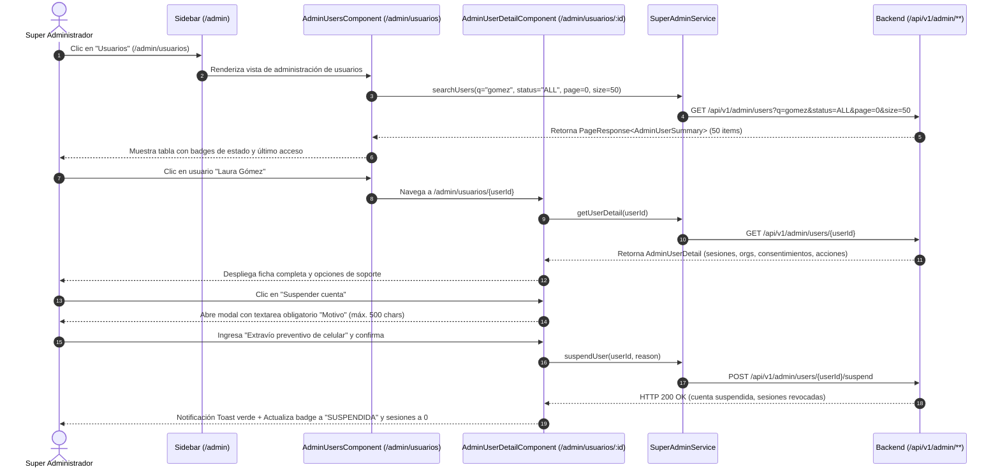
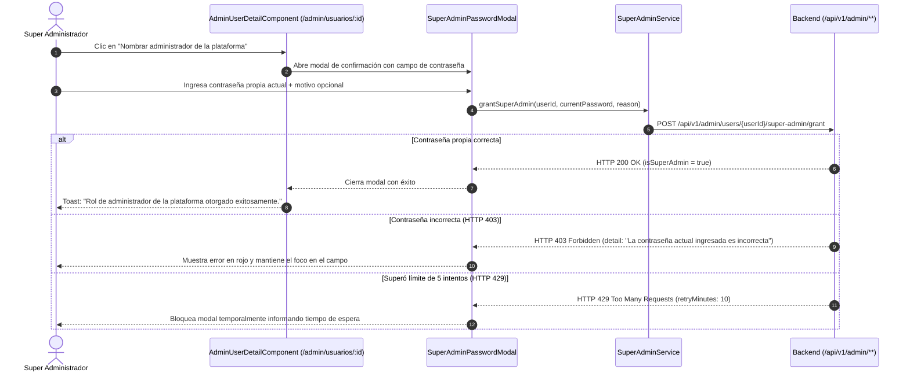

# 📖 Historia de Usuario: HU-21 - Consola de Super Administrador: Gestión de Cuentas, Suspensión y Reactivación con Cierre de Sesiones, Asignación de Administradores con Confirmación de Clave, Enlaces de Soporte y Auditoría Inmutable

---

## 📌 1. Información General de la Historia

| Metadato | Detalle |
| :--- | :--- |
| **Identificador** | `HU-21` (Equivalente: `HU-21-ADMIN-USERS-SUSPENSION-SUPPORT-AUDIT`) |
| **Código Equivalente Backend** | [`US-020`](file:///E:/Workspace%20Spring%20Boot/dokqet-backend/docs/stories/US-020-administracion-cuentas-suspension-soporte-auditoria.md) (`HU-20-ADMIN-SUSPENSION-SUPPORT`) |
| **Título** | Consola de Super Administrador: Buscador `unaccent`, Ficha de Soporte de Usuario, Suspensión/Reactivación con Motivo, Gestión de Super Admins con Contraseña Propia, Enlaces de Soporte y Registro Inmutable de Acciones (`AdminAction`) |
| **Épica** | Backoffice de Plataforma (`/admin`), Gobernanza de Cuentas, Soporte Técnico al Usuario y Auditoría Inmutable |
| **Módulos / Rutas Angular** | `src/app/core/models/super-admin.model.ts`, `src/app/core/services/super-admin.service.ts`, `src/app/core/interceptors/paseto.interceptor.ts`, `src/app/features/auth/sign-in/`, `src/app/features/admin/users/`, `src/app/features/admin/actions/`, `src/app/app.routes.ts`, `src/app/app.component.html` |
| **Estado** | `📝 Lista para Desarrollo` |
| **Prioridad** | `Alta (Gobernanza, Seguridad y Soporte Operativo)` |
| **Tipo** | `Funcionalidad / Backoffice / Seguridad / UX (Angular 19+ Standalone Components)` |
| **Actor Principal** | `Super Administrador (SUPER_ADMIN)` |
| **Referencias de Origen (`piloto`)** | Mejora `9.3` (`lib/suspension.ts`, `lib/plataforma/acciones.ts`, `lib/plataforma/administradores.ts`, `lib/plataforma/soporte.ts`, `lib/plataforma/index.ts`) |
| **Historias Relacionadas en `dokqet-frontend`** | Extiende y preserva `HU-18` (Observabilidad de Organizaciones y Catálogos), `HU-19` (Cron & Schedulers) y `HU-20` (Vigencia de Sesiones y Límites de Usuario) |

---

## 🎯 2. Narrativa de Negocio y Experiencia de Usuario

> **Como** Super Administrador (`SUPER_ADMIN`) de la plataforma **Dokqet**,  
> **Quiero** disponer en el panel `/admin` de un buscador rápido de usuarios insensible a tildes y mayúsculas, una ficha de soporte consolidada con las sesiones activas, organizaciones, consentimientos de Ley 1581 e historial de auditoría, modales interactivos para suspender o reactivar cuentas con motivo obligatorio, la capacidad de otorgar o revocar el rol de Super Administrador validando mi propia contraseña actual, y botones seguros para enviar enlaces de recuperación o activación,  
> **Para** responder con inmediatez a solicitudes de soporte, resolver extravíos de dispositivos mediante el cierre instantáneo de sesiones, prevenir abusos de la plataforma y conservar una trazabilidad legal inmutable de cada decisión administrativa tomada sobre los usuarios.

---

## 🔍 2.1. Diagnóstico del Estado Actual en `dokqet-frontend` y Brechas de Integración

1. **Ausencia de Vistas de Gestión de Usuarios y Auditoría en `/admin` (`Mejora 9.3`):**
   - Actualmente, la sección "Super Admin" en el sidebar (`src/app/app.component.html`) solo ofrece enlaces a `/admin/organizaciones`, `/admin/scheduler` y `/admin/catalogos`.
   - No existen rutas ni componentes para listar usuarios (`/admin/usuarios`), inspeccionar su ficha de soporte (`/admin/usuarios/:id`), ni consultar el historial de auditoría inmutable (`/admin/acciones`).
2. **Desconexión con el Buscador `unaccent` y Filtros de Estado del Backend (`US-020`):**
   - El backend expone `GET /api/v1/admin/users?q=&status=ALL|ACTIVE|UNVERIFIED|SUSPENDED&page=0&size=50` con coincidencia insensible a tildes (ej. `"Gómez"` encuentra `"gomez"` y `"GOMEZ"`). El frontend requiere una interfaz reactiva con debounce de 300 ms, tabs o badges de estado y paginador estándar de 50 registros por página.
3. **Inexistencia de la Ficha Integral de Soporte (`/admin/usuarios/:id`):**
   - Los administradores no tienen visibilidad de:
     - Conteo de sesiones activas abiertas (`openSessionsCount`) ni último inicio de sesión (`lastSignInAt`).
     - Firmas jurídicas u organizaciones personales a las que pertenece el usuario y su rol (`ADMIN`, `LAWYER`).
     - Trazabilidad de consentimientos de Habeas Data (Ley 1581) con versión, IP de aceptación y fecha.
     - Historial de acciones administrativas previas (`AdminAction`) ejecutadas sobre esa cuenta.
4. **Falta de Modales de Confirmación con Reglas de Negocio:**
   - **Suspensión / Reactivación:** Exige captura obligatoria de `reason` (entre 1 y 500 caracteres). Al suspender, debe notificarse que se revocaron de inmediato todas las sesiones activas del usuario. Prohíbe suspenderse a sí mismo o suspender a otro `SUPER_ADMIN`.
   - **Otorgar / Revocar `SUPER_ADMIN`:** Exige confirmación obligatoria de la contraseña propia del administrador autenticado (`currentPassword`) para prevenir escalada no autorizada en sesiones desatendidas. En caso de fallo (HTTP 403), debe mostrarse el conteo de intentos fallidos antes de bloqueo temporal (`admin-pwd`, 5 intentos / 10 min).
   - **Enlaces de Soporte:** Botones con validación de estado:
     - *"Enviar enlace para restablecer la contraseña"*: Habilitado exclusivamente si la cuenta está verificada (`emailVerified = true`) y no suspendida.
     - *"Reenviar correo de activación"*: Habilitado exclusivamente si la cuenta no está verificada (`emailVerified = false`) y no suspendida.
     - Ambos botones deben capturar HTTP 429 (`RATE_LIMIT_EXCEEDED`) desplegando notificación con los minutos de espera restantes (`admin-reset` / `admin-verify`, 1 solicitud / 5 min).
5. **Comportamiento en Login e Interceptor ante Cuentas Suspendidas:**
   - **Pantalla de Login (`/iniciar-sesion`):** Si el usuario ingresa su contraseña correcta pero su cuenta está suspendida, el backend emite HTTP 403 `ACCOUNT_SUSPENDED`. El formulario debe capturar este error RFC 9457 y desplegar un banner rojo de alerta:  
     > *"Tu cuenta ha sido suspendida y no es posible iniciar sesión. Contacta al administrador."*  
     (sin computar intentos fallidos en el cliente ni alterar el cooldown de contraseñas).
   - **Interceptor PASETO (`paseto.interceptor.ts`):** Si una petición en curso de un usuario o super admin suspendido responde con HTTP 401 `ACCOUNT_SUSPENDED`, debe cerrarse la sesión en el cliente, limpiarse el estado y redirigir a `/iniciar-sesion?motivo=cuenta_suspendida`.

---

## 🧭 2.2. Diagramas de Secuencia y Arquitectura de Navegación (Mermaid)

### Flujo A: Búsqueda, Ficha de Usuario y Suspensión de Cuenta



### Flujo B: Gestión de Super Administrador con Confirmación de Contraseña



---

## 🧱 3. Modelos y Contratos de Datos (`TypeScript`)

### 3.1. Clasificación de Interfaces y Tipos

* **`[EXISTENTE - REUTILIZADO]`**:
  * `AdminPlatformOverview`, `AdminOrganizationSummary`, `AdminOrganizationDetail`, `AdminMember`, `PageResponse`, `AdminApiResponse` en `src/app/core/models/super-admin.model.ts`.
* **`[MODIFICADO / POR EXTENDER]`**:
  * `AdminUserSummary` en `src/app/core/models/super-admin.model.ts`: incorporar campos de suspensión (`isSuspended`, `suspendedAt`, `suspensionType`), `lastSignInAt`, `isSuperAdmin`, `isAccountLocked`.
* **`[NUEVO / POR CREAR]`**:
  * `AdminUserDetail`, `AdminUserOrganization`, `AdminUserConsent`, `AdminAction`, `AdminActionType`, `AdminUserStatusFilter`, `AdminUserReasonRequest`, `AdminSuperAdminRoleRequest`.

### 3.2. Especificación TypeScript (`src/app/core/models/super-admin.model.ts`)

```typescript
export type AdminUserStatusFilter = 'ALL' | 'ACTIVE' | 'UNVERIFIED' | 'SUSPENDED';

export type AdminActionType =
  | 'SUSPEND_USER'
  | 'REACTIVATE_USER'
  | 'GRANT_PLATFORM_ADMIN'
  | 'REVOKE_PLATFORM_ADMIN'
  | 'SEND_PASSWORD_RESET'
  | 'RESEND_VERIFICATION';

export interface AdminUserSummary {
  id: string;
  email: string;
  name: string;
  firstName: string;
  lastName: string;
  documentType: string;
  documentNumber: string;
  cityId: string | null;
  emailVerified: boolean;
  isSuperAdmin: boolean;
  isAccountLocked: boolean;
  isSuspended: boolean;
  suspendedAt: string | null; // ISO 8601 UTC
  suspensionType: 'MANUAL' | null;
  lastSignInAt: string | null; // ISO 8601 UTC
  createdAt: string; // ISO 8601 UTC
}

export interface AdminUserOrganization {
  membershipId: string;
  organizationId: string;
  organizationName: string;
  personType: 'NATURAL' | 'JURIDICA';
  isPersonal: boolean;
  role: 'SUPER_ADMIN' | 'ADMIN' | 'LAWYER';
  status: 'ACTIVE' | 'SUSPENDED';
  joinedAt: string;
  lastUsedAt: string | null;
}

export interface AdminUserConsent {
  id: string;
  type: 'TERMS' | 'PRIVACY';
  version: string;
  acceptedAt: string;
  ipAddress: string | null;
}

export interface AdminAction {
  id: string;
  type: AdminActionType;
  viaCommand: boolean;
  actorId: string | null;
  actorEmail: string | null;
  targetId: string | null;
  targetEmail: string;
  reason: string | null;
  createdAt: string;
}

export interface AdminUserDetail {
  id: string;
  email: string;
  name: string;
  firstName: string;
  middleName: string | null;
  lastName: string;
  secondLastName: string | null;
  documentType: string;
  documentNumber: string;
  genderCode: string | null;
  cityId: string | null;
  status: 'ACTIVE' | 'UNVERIFIED' | 'SUSPENDED';
  emailVerified: boolean;
  isSuperAdmin: boolean;
  isAccountLocked: boolean;
  lockedUntil: string | null;
  isSuspended: boolean;
  suspendedAt: string | null;
  suspensionType: 'MANUAL' | null;
  openSessionsCount: number;
  lastSignInAt: string | null;
  createdAt: string;
  organizations: AdminUserOrganization[];
  consents: AdminUserConsent[];
  adminActions: AdminAction[];
}

export interface AdminUserReasonRequest {
  reason: string;
}

export interface AdminSuperAdminRoleRequest {
  currentPassword: string;
  reason?: string;
}
```

---

## ⚖️ 4. Reglas de Negocio Explícitas para el Frontend (RN)

1. **`RN-HU21-01` — Búsqueda Insensible a Acentos y Mayúsculas (`unaccent`) y Paginación:**
   - La caja de búsqueda en `/admin/usuarios` debe aplicar `debounceTime(300)` y `distinctUntilChanged()`.
   - La paginación predeterminada es de **50 usuarios por página** para coincidir con la cuota del backend.
   - El selector de estado ofrece: `Todas` (`ALL`), `Activas` (`ACTIVE`), `Sin verificar` (`UNVERIFIED`) y `Suspendidas` (`SUSPENDED`). Al cambiar de filtro, se resetea la página a 0.

2. **`RN-HU21-02` — Ficha de Soporte Consolidada (`/admin/usuarios/:id`):**
   - Debe exhibir de forma destacada:
     - Badge de estado principal: `ACTIVA` (verde), `SIN VERIFICAR` (ámbar), `SUSPENDIDA` (rojo).
     - Badge de rol: `SUPER ADMIN` (morado/índigo) si `isSuperAdmin === true`.
     - Indicador numérico de sesiones activas abiertas. Si es `0`, badge neutral; si es `> 0`, badge azul.
     - Fecha y hora formateada en hora de Colombia (`America/Bogota`) de `lastSignInAt`. Si es `null`, mostrar *"Sin registros de acceso"*.
     - Tabla/Listado de firmas u organizaciones vinculadas con tipo de persona (`NATURAL` / `JURIDICA`) y rol.
     - Tabla de consentimientos Ley 1581 con versión, fecha y dirección IP de captura.
     - Historial descendente de acciones administrativas (`adminActions`) sobre la cuenta.

3. **`RN-HU21-03` — Modal de Suspensión y Reactivación:**
   - **Suspender:**
     - Botón deshabilitado si el usuario objetivo es el mismo administrador autenticado (`user.id === authService.currentUser()?.id`).
     - Botón deshabilitado con tooltip si el usuario objetivo es otro `SUPER_ADMIN` (*"Primero debes quitarle el rol de Super Administrador"*).
     - Modal requiere obligatoriamente `reason` no vacío con longitud entre 1 y 500 caracteres (contador visible `45/500`).
     - Al confirmar con éxito, actualiza reactivamente el estado local del usuario a `SUSPENDIDA` y reduce `openSessionsCount` a 0.
   - **Reactivar:**
     - Requiere motivo obligatorio (1 a 500 caracteres). Al confirmar, restaura el estado a `ACTIVE` o `UNVERIFIED` según `emailVerified`.

4. **`RN-HU21-04` — Modal de Otorgamiento y Revocación de `SUPER_ADMIN` con Contraseña Propia:**
   - Modal solicita la **contraseña propia actual** del super administrador que está operando y un campo opcional de motivo.
   - Si se intenta revocar a sí mismo, la interfaz deshabilita la opción con la advertencia: *"No puedes quitarte el rol de administrador a ti mismo"*.
   - No permite nombrar a un usuario suspendido o no verificado (`!emailVerified`).
   - Manejo de respuestas de error RFC 9457:
     - `403 Forbidden` (`detail`): despliega mensaje de error en el modal: *"La contraseña actual ingresada es incorrecta"*.
     - `429 Too Many Requests`: despliega advertencia de límite de 5 intentos fallidos cada 10 minutos.

5. **`RN-HU21-05` — Botones de Soporte (Enlaces de Activación y Recuperación):**
   - **"Enviar enlace para restablecer la contraseña":** Solo visible/habilitado si `emailVerified === true` y `isSuspended === false`.
   - **"Reenviar el correo de activación":** Solo visible/habilitado si `emailVerified === false` y `isSuspended === false`.
   - Al pulsar cualquiera de los botones, se despliega confirmación y, en caso de respuesta `429`, se muestra el tiempo de espera restante (5 minutos) provisto en `retryMinutes` o cabecera `Retry-After`.

6. **`RN-HU21-06` — Tabla de Auditoría Inmutable (`/admin/acciones`):**
   - Lista paginada (50 elementos) de todas las acciones ejecutadas en la plataforma, filtrable por `AdminActionType`.
   - Muestra columnas: Fecha/Hora (COT), Acción (con badge semántico), Administrador (actor), Cuenta de Destino (target), Motivo y Canal (`vía comando` o `web`).

7. **`RN-HU21-07` — Manejo Global en Login e Interceptor PASETO:**
   - En `SignInComponent`, si el login responde `403` con `errorCode = "ACCOUNT_SUSPENDED"`, mostrar banner de advertencia:  
     > *"Tu cuenta ha sido suspendida y no es posible iniciar sesión. Contacta al administrador."*  
     (sin activar contadores de intentos fallidos de clave incorrecta).
   - En `paseto.interceptor.ts`, si cualquier petición devuelve `401` con `errorCode = "ACCOUNT_SUSPENDED"`, limpiar credenciales y redirigir a `/iniciar-sesion?motivo=cuenta_suspendida`.

---

## ✅ 5. Criterios de Aceptación BDD (Gherkin)

```gherkin
# language: es
Característica: Consola de Super Administrador para gestión de usuarios, suspensión y soporte auditado (HU-21)
  Como Super Administrador de la plataforma Dokqet
  Quiero buscar usuarios por coincidencia insensible a tildes, suspender/reactivar cuentas con motivo obligatorio, nombrar administradores confirmando mi contraseña y auditar cada acción
  Para garantizar la seguridad, gobernanza y soporte transparente de la plataforma

  Escenario: 1. Búsqueda insensible a tildes y mayúsculas en el listado de usuarios de /admin
    Dado que el Super Administrador "admin@dokqet.com" navega a la sección "/admin/usuarios"
    Cuando escribe "gomez" en la caja de búsqueda con el filtro de estado "ALL"
    Entonces la aplicación invoca "GET /api/v1/admin/users?q=gomez&status=ALL&page=0&size=50"
    Y la tabla presenta a los usuarios "María José Gómez" y "Carlos Gomez Peña"
    Y cada fila muestra su correo, rol, badges de verificación y fecha de último inicio de sesión

  Escenario: 2. Suspensión de cuenta de usuario con motivo obligatorio y actualización inmediata en UI
    Dado que el Super Administrador visualiza la ficha "/admin/usuarios/usr-100" de "abogado@firma.co"
    Y la cuenta tiene 2 sesiones activas abiertas
    Cuando presiona "Suspender cuenta", ingresa el motivo "Solicitud de bloqueo preventivo por extravío de dispositivo" y confirma el modal
    Entonces la aplicación envía "POST /api/v1/admin/users/usr-100/suspend" con el motivo ingresado
    Y el servidor responde HTTP 200 OK
    Y la interfaz actualiza inmediatamente el badge de estado a "SUSPENDIDA"
    Y el contador de sesiones activas se actualiza a 0
    Y se agrega el registro "SUSPEND_USER" al historial de auditoría visible en la misma ficha

  Escenario: 3. Intento de inicio de sesión con cuenta suspendida exhibe banner explicativo sin contar intento fallido de clave
    Dado que el usuario "suspendido@firma.co" tiene su cuenta suspendida
    Cuando diligencia su correo y su contraseña correcta en el formulario de "/iniciar-sesion"
    Y el servidor responde con código HTTP 403 Forbidden y errorCode "ACCOUNT_SUSPENDED"
    Entonces la pantalla de login muestra un banner rojo con el mensaje "Tu cuenta ha sido suspendida y no es posible iniciar sesión. Contacta al administrador."
    Y el formulario no muestra advertencia de intentos restantes de contraseña

  Escenario: 4. Interceptor expulsa sesión activa si la cuenta fue suspendida en el backend
    Dado que un usuario tiene abierta una sesión en la aplicación web
    Y su cuenta es suspendida por un Super Administrador en el backend
    Cuando el usuario realiza cualquier navegación o petición HTTP que responde HTTP 401 con errorCode "ACCOUNT_SUSPENDED"
    Entonces el interceptor limpia el token PASETO y el estado de sesión
    Y redirige automáticamente al usuario a "/iniciar-sesion?motivo=cuenta_suspendida"
    Y la vista de login exhibe el mensaje de cuenta suspendida

  Escenario: 5. Nombrar Super Administrador exige confirmación de contraseña propia del actor
    Dado que el Super Administrador visualiza la ficha de "lider@dokqet.co" (cuenta activa y verificada)
    Cuando presiona "Nombrar administrador de la plataforma"
    Y en el modal ingresa su contraseña propia "ClaveAdmin2026*" y el motivo "Ingreso al equipo técnico"
    Entonces la aplicación envía "POST /api/v1/admin/users/{id}/super-admin/grant"
    Y tras recibir HTTP 200 OK cierra el modal, muestra notificación de éxito y asigna el badge "SUPER ADMIN" al usuario

  Escenario: 6. Enlaces de soporte respetan cuotas de seguridad y manejan HTTP 429 amigablemente
    Dado que el Super Administrador presiona "Enviar enlace para restablecer la contraseña" en una cuenta verificada
    Y la primera solicitud se procesa exitosamente registrando la acción "SEND_PASSWORD_RESET"
    Cuando presiona nuevamente el botón dentro de la ventana de 5 minutos
    Y el servidor responde HTTP 429 Too Many Requests con retryMinutes en 5
    Entonces la aplicación despliega una notificación de advertencia informando que debe esperar 5 minutos antes de generar otro enlace
```

---

## 🏛️ 6. Mapeo a la Arquitectura Angular (`dokqet-frontend`)

### 6.1. Clasificación de Archivos y Componentes

| Archivo / Módulo | Clasificación | Propósito y Cambios |
| :--- | :--- | :--- |
| `src/app/core/models/super-admin.model.ts` | `[MODIFICADO / POR EXTENDER]` | Incorporar `isSuspended`, `suspendedAt`, `suspensionType`, `lastSignInAt` en `AdminUserSummary`; crear `AdminUserDetail`, `AdminUserOrganization`, `AdminUserConsent`, `AdminAction`, `AdminActionType`, `AdminUserStatusFilter`, `AdminUserReasonRequest`, `AdminSuperAdminRoleRequest`. |
| `src/app/core/services/super-admin.service.ts` | `[MODIFICADO / POR EXTENDER]` | Agregar métodos: `searchUsers(q, status, page, size)`, `getUserDetail(id)`, `suspendUser(id, reason)`, `reactivateUser(id, reason)`, `grantSuperAdmin(id, pwd, reason)`, `revokeSuperAdmin(id, pwd, reason)`, `sendPasswordResetSupportLink(id)`, `resendVerificationSupportLink(id)`, `getAdminActions(type, page, size)`. |
| `src/app/core/interceptors/paseto.interceptor.ts` | `[MODIFICADO / POR EXTENDER]` | Capturar HTTP 401 con `errorCode === 'ACCOUNT_SUSPENDED'`, limpiar credenciales en `AuthService` y redirigir a `/iniciar-sesion?motivo=cuenta_suspendida`. |
| `src/app/features/auth/sign-in/sign-in.component.ts` | `[MODIFICADO / POR EXTENDER]` | Capturar HTTP 403 con `errorCode === 'ACCOUNT_SUSPENDED'` para mostrar banner sin activar contadores de intentos fallidos; leer query param `?motivo=cuenta_suspendida`. |
| `src/app/features/admin/users/admin-users.component.ts` | `[NUEVO / POR CREAR]` | Componente Standalone: buscador `unaccent` con debounce, tabs de filtro de estado (`ALL`, `ACTIVE`, `UNVERIFIED`, `SUSPENDED`), tabla paginada de 50 usuarios con badges y enlaces a la ficha. |
| `src/app/features/admin/users/admin-users.component.html` | `[NUEVO / POR CREAR]` | Plantilla responsiva con Tailwind CSS, Skeleton Loaders y estados vacíos. |
| `src/app/features/admin/users/detail/admin-user-detail.component.ts` | `[NUEVO / POR CREAR]` | Ficha completa: resumen, sesiones abiertas, organizaciones, consentimientos Ley 1581, modales para suspensión/reactivación y rol Super Admin, botones de soporte y tabla de acciones. |
| `src/app/features/admin/users/detail/admin-user-detail.component.html` | `[NUEVO / POR CREAR]` | Plantilla de la ficha de soporte con badges de estado, modales integrados y tarjetas de auditoría. |
| `src/app/features/admin/actions/admin-actions.component.ts` | `[NUEVO / POR CREAR]` | Pestaña "Registro de acciones": listado paginado (50 por página) de auditoría inmutable (`admin_actions`) con filtro por tipo. |
| `src/app/features/admin/actions/admin-actions.component.html` | `[NUEVO / POR CREAR]` | Tabla de acciones administrativas con badges semánticos por tipo de evento. |
| `src/app/app.routes.ts` | `[MODIFICADO / POR EXTENDER]` | Registrar rutas protegidas por `[authGuard, superAdminGuard]`: `/admin/usuarios`, `/admin/usuarios/:id`, `/admin/acciones`. |
| `src/app/app.component.html` | `[MODIFICADO / POR EXTENDER]` | En la sección `@if (authService.isSuperAdmin())`, incorporar enlaces de navegación para "Usuarios" y "Registro de acciones". |

---

## 🧪 7. Guía y Ejemplos Prácticos de Prueba (Testing Guide)

### 7.1. Pruebas Unitarias de Servicios y Componentes (Jasmine / Karma)

```bash
# Ejecutar pruebas del servicio de Super Administrador extendido
npm test -- --include src/app/core/services/super-admin.service.spec.ts

# Ejecutar pruebas del interceptor de autenticación ante cuenta suspendida
npm test -- --include src/app/core/interceptors/paseto.interceptor.spec.ts

# Ejecutar pruebas del componente de inicio de sesión con cuenta suspendida
npm test -- --include src/app/features/auth/sign-in/sign-in.component.spec.ts

# Ejecutar pruebas de los componentes de administración de usuarios
npm test -- --include src/app/features/admin/users/admin-users.component.spec.ts
npm test -- --include src/app/features/admin/users/detail/admin-user-detail.component.spec.ts
npm test -- --include src/app/features/admin/actions/admin-actions.component.spec.ts
```

### 7.2. Verificaciones Manuales E2E (Checklist de Aceptación)

1. **Búsqueda insensible a tildes (`unaccent`):**
   - Ingresar a `/admin/usuarios` y buscar `"carlos"`, `"GÓMEZ"`, `"maria"`. Verificar que el backend responde con los registros sin importar diacríticos o mayúsculas.
2. **Suspensión y Revocación de Sesiones:**
   - Iniciar sesión en un navegador secundario con una cuenta de abogado litigante.
   - En la ficha `/admin/usuarios/{id}`, verificar que `openSessionsCount` marca al menos `1`.
   - Pulsar *"Suspender cuenta"*, diligenciar el motivo obligatorio y confirmar.
   - En el navegador secundario, hacer clic en cualquier enlace del panel. Verificar que el interceptor captura HTTP 401 y expulsa la sesión inmediatamente redirigiendo a login.
3. **Login con Cuenta Suspendida:**
   - En `/iniciar-sesion`, ingresar las credenciales de la cuenta recién suspendida:
     - Con contraseña incorrecta: debe mostrar *"Credenciales incorrectas"*.
     - Con contraseña correcta: debe mostrar *"Tu cuenta ha sido suspendida y no es posible iniciar sesión. Contacta al administrador."*.
4. **Asignación de Super Administrador:**
   - En la ficha de un usuario activo y verificado, abrir el modal para otorgar el rol.
   - Probar contraseña incorrecta: debe mostrarse el mensaje de error en el modal sin cerrarlo.
   - Ingresar la contraseña correcta: debe cerrarse el modal y actualizar el rol a `SUPER_ADMIN`.
5. **Enlaces de Soporte y Cuotas:**
   - Pulsar *"Enviar enlace para restablecer la contraseña"*. Confirmar el envío.
   - Pulsar inmediatamente de nuevo el botón. Verificar que se despliega la advertencia con los minutos de espera restantes sin romper la interfaz.
