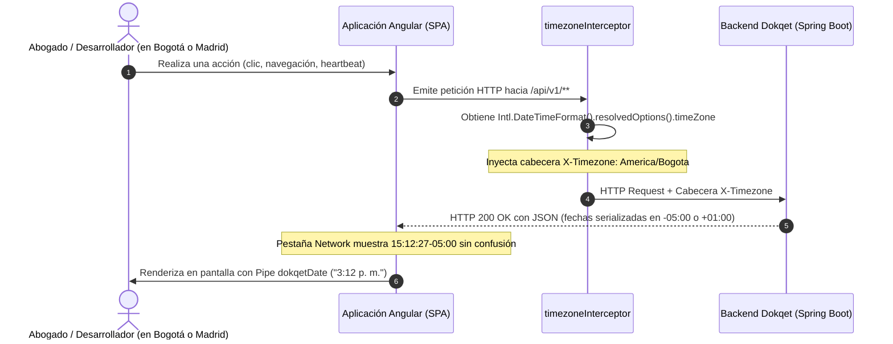

# 📖 Historia de Usuario: HU-22 - Propagación Dinámica de Zona Horaria Cliente vía Interceptor HTTP y Visualización Localizada

---

## 📌 1. Información General de la Historia

| Metadato | Detalle |
| :--- | :--- |
| **Identificador** | `HU-22` (Equivalente: `HU-22-TIMEZONE-INTERCEPTOR-UI`) |
| **Código Equivalente Backend** | [`US-027`](file:///E:/Workspace%20Spring%20Boot/dokqet-backend/docs/stories/US-027-gestion-centralizada-zonas-horarias-filtro-serializacion-dinamica.md) |
| **Título** | Propagación Dinámica de Zona Horaria del Cliente vía Cabecera HTTP `X-Timezone` y Renderizado Localizado en Interfaz |
| **Épica** | Gobernanza de Identidad, Experiencia de Usuario y Estándares de Fecha/Hora |
| **Módulos / Rutas Angular** | `src/app/core/interceptors/`, `src/app/core/utils/`, `src/app/shared/pipes/`, `src/app/app.config.ts` |
| **Estado** | `📝 Lista para Desarrollo` |
| **Prioridad** | `Media-Alta (Transversal a todas las llamadas API y Experiencia de Debug)` |
| **Tipo** | `Arquitectura de Red, Observabilidad y Formateo UI (Network & UX)` |
| **Actor Principal** | `Abogado Litigante / Desarrollador / Auditor de Sistema / Operador Judicial` |
| **Referencias Técnicas** | [`.agents/skills/datetime-standards/SKILL.md`](file:///E:/Workspace%20Angular/dokqet-frontend/.agents/skills/datetime-standards/SKILL.md), ISO 8601, RFC 3339 |

---

## 🎯 2. Narrativa de Negocio y Experiencia de Usuario

> **Como** litigante, administrador o desarrollador que utiliza o inspecciona **Dokqet**,  
> **Quiero** que el cliente web transmita automáticamente en cada solicitud HTTP la zona horaria del navegador en la cabecera `X-Timezone` y que la interfaz visual presente todas las estampas de tiempo en la hora local correspondiente a mi ubicación física (o en Hora Legal de Colombia para actuaciones procesales),  
> **Para** que las respuestas de red inspeccionadas en la pestaña *Network* reflejen de inmediato la hora exacta de mi región con su huso numérico (ej: `-05:00` en Colombia, `+01:00` en España) sin cálculos mentales confusos, garantizando absoluta concordancia entre los datos que viajan por el cable y los que se renderizan en pantalla.

---

## 🔍 2.1. Diagnóstico del Estado Actual y Justificación

1. **Inexistencia de Notificación de Zona Horaria en el Cable HTTP:**  
   Actualmente el frontend realiza llamadas REST a `/api/v1/**` sin declarar explícitamente el huso horario del cliente. Por defecto, el backend asume UTC o la zona por defecto del contenedor servidor.
2. **Confusión en Tareas de Depuración y Auditoría Técnica:**  
   Al abrir la pestaña *Network* de DevTools, respuestas críticas como el Heartbeat (`lastActiveAt: 2026-11-01T20:12:27Z`) muestran la hora universal con `Z` (Greenwich), lo cual desorienta a desarrolladores y auditores que esperan visualizar las 3:12 p. m. de su jornada laboral.
3. **Desacoplamiento entre Ubicación Física y Despliegue en la Nube:**  
   El backend puede ejecutarse en regiones de AWS o Google Cloud en EE. UU. (`us-east-1`, UTC-4/UTC-5) o Europa (`eu-west-1`), mientras el usuario navega desde Bogotá, Cali o Medellín (`America/Bogota`, UTC-5). El cliente debe enviar su zona IANA de forma dinámica y no invasiva.

---

## 🧭 2.2. Diagrama de Secuencia e Intercepción (Mermaid)



---

## 🧱 3. Modelos de Datos en Cliente y Contratos API (`TypeScript`)

### 3.1. Estructuras de Soporte (`src/app/core/utils/datetime.utils.ts`)

```typescript
// [EXISTENTE - REUTILIZADO] Constantes de referencia
export const COLOMBIA_TIMEZONE = 'America/Bogota';
export const DEFAULT_LOCALE = 'es-CO';

// [EXISTENTE - REUTILIZADO] Tipos de formateo admitidos
export type DokqetDateFormat = 'time' | 'date' | 'datetime' | 'full' | 'relative' | 'legal';

// [MODIFICADO / POR EXTENDER] Verificación de validez de zona horaria IANA
export function isValidTimeZone(timeZone: string): boolean {
  try {
    Intl.DateTimeFormat(undefined, { timeZone });
    return true;
  } catch {
    return false;
  }
}
```

---

## ⚖️ 4. Reglas de Negocio en Frontend (RN-FE)

1. **`RN-FE-01` — Inyección Universal de Cabecera `X-Timezone`:**  
   - Todas las solicitudes HTTP salientes dirigidas a endpoints de Dokqet (`/api/v1/**`) deben incorporar la cabecera `X-Timezone` con el identificador IANA del navegador (`Intl.DateTimeFormat().resolvedOptions().timeZone`).
   - Si el navegador no expone `timeZone` o arroja excepción, debe usar como fallback predeterminado `'America/Bogota'`.

2. **`RN-FE-02` — No Invasión de Peticiones a Terceros:**  
   - La cabecera `X-Timezone` **no debe inyectarse** en solicitudes a servicios o CDNs externos de terceros (ej: fuentes de Google, APIs de mapas, buckets públicos S3) para evitar problemas de CORS o fuga de metadatos.

3. **`RN-FE-03` — Parsing y Tolerancia Transparente de Fechas:**  
   - Los componentes y el pipe [`DokqetDatePipe`](file:///E:/Workspace%20Angular/dokqet-frontend/src/app/shared/pipes/dokqet-date.pipe.ts) deben procesar indistintamente fechas recibidas en formato UTC con `Z` (`2026-11-01T20:12:27.489Z`) o en formato ISO-8601 con offset (`2026-11-01T15:12:27.489-05:00`). Ambos valores deben resolverse al mismo instante numérico.

4. **`RN-FE-04` — Regla de Trato Diferenciado Legal (Hora Legal COT):**  
   - Para actuaciones procesales y términos de juzgados colombianos (Rama Judicial), el formateo visual debe utilizar el modificador `'legal'`, garantizando que siempre se indique el huso oficial de Colombia con sufijo `COT`, independientemente de dónde se encuentre físicamente el usuario.

---

## 🧪 5. Criterios de Aceptación (Escenarios en Formato Gherkin)

```gherkin
# language: es
Característica: HU-22 - Inyección Automática de X-Timezone y Formateo Localizado
  Como Abogado Litigante o Desarrollador de Dokqet
  Quiero que el cliente web comunique su zona horaria y presente las fechas con claridad
  Para eliminar discrepancias de hora en la pestaña de red y en la interfaz de usuario

  Antecedentes:
    Dado que la aplicación web de Dokqet está iniciada en el navegador

  # =========================================================================
  # REGLA 1: INYECCIÓN DE CABECERA X-TIMEZONE
  # =========================================================================
  Escenario: Interceptor adjunta zona horaria local a peticiones del backend
    Dado que el usuario se encuentra en la zona horaria "America/Bogota"
    Cuando la aplicación emite una petición HTTP hacia "/api/v1/auth/session/heartbeat"
    Entonces la solicitud HTTP debe incluir la cabecera "X-Timezone: America/Bogota"

  Escenario: Interceptor aplica fallback si el navegador no entrega zona horaria
    Dado que el entorno de ejecución no soporta la detección de zona horaria IANA
    Cuando se emite una petición hacia "/api/v1/users/me"
    Entonces la solicitud debe incluir la cabecera "X-Timezone: America/Bogota" por defecto

  # =========================================================================
  # REGLA 2: NO INYECCIÓN EN SERVICIOS EXTERNOS
  # =========================================================================
  Escenario: Peticiones a dominios externos no reciben la cabecera X-Timezone
    Cuando la aplicación descarga un recurso externo desde "https://fonts.googleapis.com/css"
    Entonces la solicitud saliente NO debe incluir la cabecera "X-Timezone"

  # =========================================================================
  # REGLA 3: FORMATEO VISUAL SIN CONFUSIÓN
  # =========================================================================
  Escenario: Visualización de fecha y hora local mediante DokqetDatePipe
    Dado que el backend responde con la estampa "2026-11-01T15:12:27.489-05:00"
    Cuando se formatea la fecha en una plantilla usando "dokqetDate:'time'"
    Entonces el texto presentado en la interfaz debe ser "3:12 p. m."
    Y en la pestaña Network de DevTools la respuesta debe mostrarse con el offset "-05:00"

  Escenario: Visualización de término judicial forzando hora legal colombiana
    Dado que un abogado en Madrid (Europe/Madrid) consulta una actuación judicial
    Con estampa "2026-11-01T20:12:27Z"
    Cuando se formatea con "dokqetDate:'legal'"
    Entonces la vista debe presentar "1 nov 2026, 3:12 p. m. COT"
```

---

## 🏗️ 6. Mapeo a la Arquitectura Angular (`dokqet-frontend`)

### 6.1. Interceptores y Configuración
- **`[NUEVO / POR CREAR]` Interceptor de Zona Horaria:**  
  `src/app/core/interceptors/timezone.interceptor.ts` (con `.spec.ts`).  
  *Inyecta `X-Timezone: <userTimeZone>` a todas las peticiones con prefijo `/api/v1/`.*
- **`[MODIFICADO / POR EXTENDER]` Registro en Proveedores Globales:**  
  `src/app/app.config.ts`  
  *Registra `timezoneInterceptor` dentro de `withInterceptors([..., timezoneInterceptor])`.*

### 6.2. Utilidades y Pipes
- **`[EXISTENTE - REUTILIZADO]` Utilidades de Fecha y Hora:**  
  `src/app/core/utils/datetime.utils.ts`  
  *Provee `getUserTimeZone()`, `formatLocalDate()`, `formatRelativeTime()`.*
- **`[EXISTENTE - REUTILIZADO]` Pipe Angular Standalone:**  
  `src/app/shared/pipes/dokqet-date.pipe.ts`  
  *Consumible en cualquier vista Standalone para traducción de ISO a hora local o legal.*

---

## 🚀 7. Guía y Ejemplos Prácticos de Prueba (Testing Guide)

```bash
# Validar tipos TypeScript de la historia
npx tsc -p tsconfig.spec.json --noEmit

# Compilar la aplicación completa
npm run build
```
