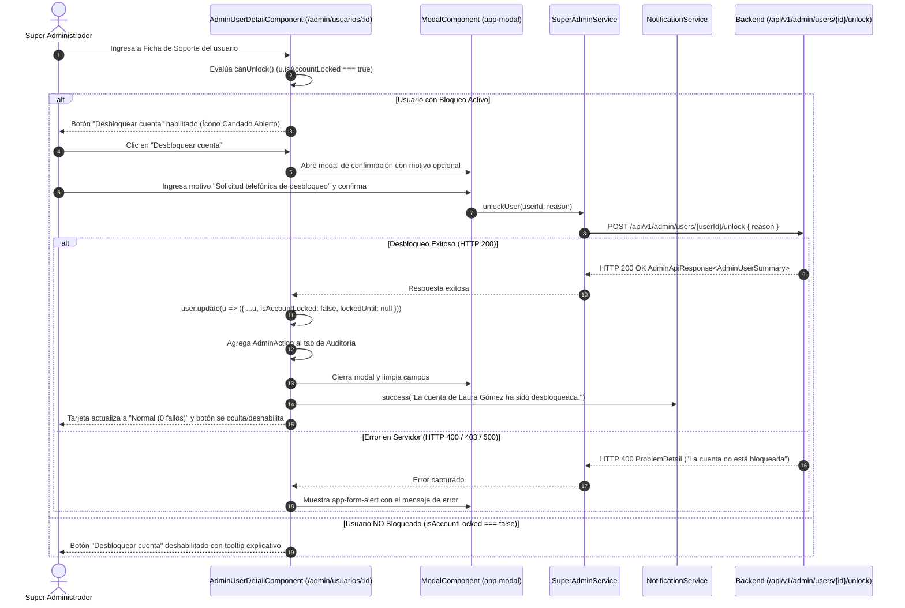

# 📖 Historia de Usuario: HU-23 - Ficha de Soporte Super Admin: Desbloqueo Administrativo de Cuentas por Intentos Fallidos de Inicio de Sesión y Trazabilidad en Auditoría

---

## 📌 1. Información General de la Historia

| Metadato | Detalle |
| :--- | :--- |
| **Identificador** | `HU-23` (Equivalente: `HU-23-ADMIN-UNLOCK-FAILED-ATTEMPTS-SUPPORT`) |
| **Código Equivalente Backend** | `US-028` (`US-028-desbloqueo-administrativo-cuentas-intentos-fallidos-auditoria.md`) |
| **Título** | Ficha de Soporte Super Admin: Desbloqueo Administrativo de Cuentas Bloqueadas por Intentos Fallidos con Modal de Confirmación y Registro Inmutable de Auditoría |
| **Épica** | Backoffice de Plataforma (`/admin`), Ficha de Soporte Técnico, Gobernanza de Cuentas y Auditoría Inmutable |
| **Módulos / Rutas Angular** | `src/app/core/models/super-admin.model.ts`, `src/app/core/services/super-admin.service.ts`, `src/app/features/admin/users/detail/admin-user-detail.component.{ts,html}`, `src/app/features/admin/users/admin-users.component.{ts,html}` |
| **Estado** | `📝 Lista para Desarrollo` |
| **Prioridad** | `Alta (Soporte Operativo, Seguridad y Continuidad del Servicio)` |
| **Tipo** | `Funcionalidad / Backoffice / Seguridad / UX (Angular 19+ Standalone Components)` |
| **Actor Principal** | `Super Administrador (SUPER_ADMIN)` |
| **Historias Relacionadas** | Extiende `HU-17` (Bloqueo de Cuentas por Intentos Fallidos HTTP 423) y `HU-21` (Consola Super Admin y Ficha de Soporte) |

---

## 🎯 2. Narrativa de Negocio y Experiencia de Usuario

> **Como** Super Administrador (`SUPER_ADMIN`) de la plataforma **Dokqet**,  
> **Quiero** disponer en la ficha de soporte del usuario (`/admin/usuarios/:id`) de un botón interactivo y modal seguro para remover el bloqueo preventivo por intentos fallidos de inicio de sesión,  
> **Para** restablecer de forma inmediata el acceso a litigantes y administradores de firmas que bloquearon su cuenta por equivocación de contraseña, registrar el motivo de soporte en la auditoría inmutable de la plataforma y evitar que el usuario deba esperar pasivamente los 15 minutos de penalización.

---

## 🔍 2.1. Diagnóstico del Estado Actual en `dokqet-frontend` y Justificación UX / Seguridad

1. **Visibilidad sin Capacidad de Acción en la Ficha de Soporte (`HU-21`):**
   - Actualmente, en la Ficha de Usuario (`admin-user-detail.component.html`), se visualiza la tarjeta de estado:
     * *Bloqueo por Contraseña:* Muestra `Bloqueada preventivamente` (si `isAccountLocked = true`) o `Normal (0 fallos)`.
   - Sin embargo, en la barra superior de acciones (`Action Toolbar`), solo existen botones para:
     * Suspender / Reactivar cuenta.
     * Nombrar / Quitar rol de Super Admin.
     * Enviar enlace para restablecer contraseña.
     * Reenviar correo de activación.
   - **Brecha:** No existe ningún botón ni modal que permita al Super Administrador accionar el desbloqueo directo de la cuenta bloqueada por intentos fallidos sin forzar un cambio de contraseña.

2. **Diferenciación Clave entre Suspensión y Bloqueo de Seguridad:**
   * **Suspensión Administrativa (`isSuspended`):** Acción disciplinaria o preventiva por abuso/extravío. Bloquea el login con HTTP 403 `ACCOUNT_SUSPENDED`.
   * **Bloqueo por Intentos Fallidos (`isAccountLocked`):** Regulación automática contra ataques de fuerza bruta (5 intentos erróneos, HTTP 423 `Locked` por 15 minutos).
   * Cuando un usuario contacta a soporte porque olvidó su clave o se equivocó al digitarla en su dispositivo móvil, el Super Administrador debe poder desbloquearlo inmediatamente con un solo clic confirmado.

3. **Requerimiento de Trazabilidad y Auditoría:**
   - Todo desbloqueo administrativo debe registrarse obligatoriamente en el historial inmutable de acciones (`AdminActionType.UNLOCK_USER`) con el motivo de soporte capturado, el correo del administrador actuante y la marca temporal ISO 8601 UTC.

---

## 🧭 2.2. Diagramas de Secuencia y Flujo de Interacción (Mermaid)



---

## 🧱 3. Modelos de Datos en Cliente y Contratos API (`TypeScript`)

### 3.1. Extensión de Tipos de Auditoría (`[MODIFICADO]`)
**Archivo:** `src/app/core/models/super-admin.model.ts`

```typescript
export type AdminActionType =
  | 'SUSPEND_USER'
  | 'REACTIVATE_USER'
  | 'GRANT_PLATFORM_ADMIN'
  | 'REVOKE_PLATFORM_ADMIN'
  | 'SEND_PASSWORD_RESET'
  | 'RESEND_VERIFICATION'
  | 'UNLOCK_USER'; // [NUEVO] Tipo de acción administrativa para desbloqueo
```

### 3.2. Payload de Desbloqueo Administrativo (`[REUTILIZADO]`)
**Archivo:** `src/app/core/models/super-admin.model.ts`

```typescript
// Se reutiliza la interfaz AdminUserReasonRequest existente
export interface AdminUserReasonRequest {
  reason: string;
}
```

### 3.3. Contrato de Servicio Backend (`[MODIFICADO]`)
**Archivo:** `src/app/core/services/super-admin.service.ts`

```typescript
/**
 * Desbloquea administrativamente una cuenta bloqueada por intentos fallidos (HU-23)
 * Endpoint: POST /api/v1/admin/users/{id}/unlock
 */
unlockUser(id: string, reason?: string): Observable<AdminApiResponse<AdminUserSummary>> {
  const payload: AdminUserReasonRequest = {
    reason: reason?.trim() || 'Desbloqueo administrativo de seguridad por soporte técnico'
  };
  return this.http.post<AdminApiResponse<AdminUserSummary>>(
    `${this.API_URL}/users/${id}/unlock`,
    payload
  );
}
```

---

## 📋 4. Reglas de Negocio en Frontend (RN-FE)

| Código | Regla | Descripción |
| :--- | :--- | :--- |
| **RN-FE-01** | **Visibilidad y Habilitación del Botón** | El botón *"Desbloquear cuenta"* en la barra de herramientas de la ficha de soporte solo debe estar habilitado si `user.isAccountLocked === true` o si `lockedUntil != null && new Date(lockedUntil) > new Date()`. Si el usuario no tiene bloqueo activo, el botón debe mostrarse deshabilitado con el tooltip *"La cuenta no presenta bloqueo por intentos fallidos."*. |
| **RN-FE-02** | **Modal de Confirmación Obligatorio** | Al hacer clic en *"Desbloquear cuenta"*, el sistema NUNCA debe ejecutar la petición de inmediato. Debe abrir un modal de diálogo accesible (`app-modal`) informando el nombre y correo del usuario, el tiempo de bloqueo registrado y un campo de texto para registrar el motivo de soporte (opcional con valor por defecto o máx. 500 caracteres). |
| **RN-FE-03** | **Estado de Carga y Prevención de Doble Envío** | Durante la llamada HTTP `unlockUser`, el botón de confirmación en el modal debe deshabilitarse, mostrar un spinner de carga (`animate-spin`) y bloquear el botón cancelar o tecla Escape para evitar condiciones de carrera. |
| **RN-FE-04** | **Actualización Reactiva Local Inmediata (Sin Recarga)** | Tras recibir respuesta exitosa (HTTP 200), el componente debe actualizar reactivamente su señal local `user`: `isAccountLocked = false`, `lockedUntil = null`. La tarjeta de resumen *"Bloqueo por Contraseña"* debe cambiar inmediatamente a *"Normal (0 fallos)"* con estilo neutro/muted. |
| **RN-FE-05** | **Inserción en Pestaña de Auditoría** | La nueva acción administrativa devuelta debe agregarse al inicio de la lista reactiva `user().adminActions` para que, si el Super Admin consulta la pestaña *"Historial de Acciones"*, el evento `UNLOCK_USER` aparezca de inmediato sin requerir recarga total de la página. |
| **RN-FE-06** | **Tratamiento de Errores RFC 9457** | Si el backend rechaza la acción con HTTP 400 (ej. *"La cuenta ya fue desbloqueada o el tiempo expiró"*), se debe mostrar un componente `<app-form-alert type="warning">` dentro del modal sin cerrar la vista. |
| **RN-FE-07** | **Accesibilidad WCAG 2.1 AA** | El modal debe contar con `role="dialog"`, `aria-labelledby`, foco inicial en el botón de confirmación o textarea, y atajo de teclado `Escape` para cancelar cuando no esté en estado de carga. |

---

## 🥒 5. Criterios de Aceptación (BDD - Gherkin)

```gherkin
# language: es
Característica: Desbloqueo administrativo de cuentas bloqueadas por intentos fallidos en la Ficha de Soporte

  Antecedentes:
    Dado que el usuario autenticado tiene rol "SUPER_ADMIN"
    Y se encuentra navegando en el módulo "Administración del Sistema"
    Y accede a la ficha de soporte del usuario "carlos.mendoza@abogados.co" con ID "usr-987"

  # =========================================================================
  # ESCENARIO 1: HABILITACIÓN DEL BOTÓN CUANDO LA CUENTA ESTÁ BLOQUEADA
  # =========================================================================
  Escenario: Visualización y habilitación del botón de desbloqueo cuando la cuenta está bloqueada
    Dado que la cuenta del usuario tiene "isAccountLocked" en verdadero
    Y el campo "lockedUntil" tiene una fecha futura de 10 minutos
    Entonces el botón "Desbloquear cuenta" debe mostrarse visible y habilitado en la barra de herramientas
    Y la tarjeta de estado "Bloqueo por Contraseña" debe mostrar el texto "Bloqueada preventivamente" en color rojo

  # =========================================================================
  # ESCENARIO 2: BOTÓN DESHABILITADO CUANDO LA CUENTA ESTÁ NORMAL
  # =========================================================================
  Escenario: Botón deshabilitado cuando el usuario no presenta bloqueo
    Dado que la cuenta del usuario tiene "isAccountLocked" en falso
    Y el campo "lockedUntil" es nulo
    Entonces el botón "Desbloquear cuenta" debe estar deshabilitado
    Y debe mostrar el tooltip "La cuenta no presenta bloqueo por intentos fallidos."
    Y la tarjeta de estado "Bloqueo por Contraseña" debe mostrar "Normal (0 fallos)"

  # =========================================================================
  # ESCENARIO 3: FLUJO EXITOSO DE DESBLOQUEO DESDE EL MODAL
  # =========================================================================
  Escenario: Desbloqueo exitoso de la cuenta con confirmación y motivo
    Dado que el botón "Desbloquear cuenta" está habilitado
    Cuando el Super Administrador hace clic en el botón "Desbloquear cuenta"
    Entonces se debe abrir el modal con título "Desbloquear Cuenta de Usuario"
    Y debe mostrar el mensaje "Se restablecerá el contador de intentos fallidos para carlos.mendoza@abogados.co"
    Cuando el administrador ingresa el motivo "Abogado se comunicó vía telefónica para desbloqueo urgente"
    Y presiona el botón "Confirmar Desbloqueo"
    Entonces el sistema debe enviar una solicitud POST a "/api/v1/admin/users/usr-987/unlock" con:
      | reason | Abogado se comunicó vía telefónica para desbloqueo urgente |
    Y al responder el servidor con código HTTP 200 exitoso:
      | success | true |
    Entonces el modal debe cerrarse automáticamente
    Y se debe mostrar una notificación Toast de éxito: "La cuenta de Carlos Mendoza ha sido desbloqueada exitosamente."
    Y la tarjeta "Bloqueo por Contraseña" debe actualizarse a "Normal (0 fallos)"
    Y el botón "Desbloquear cuenta" debe cambiar a estado deshabilitado
    Y en la pestaña "Historial de Acciones" debe listarse el evento "UNLOCK_USER" con el motivo ingresado

  # =========================================================================
  # ESCENARIO 4: MANEJO DE ERROR CUANDO LA CUENTA YA NO ESTÁ BLOQUEADA
  # =========================================================================
  Escenario: Intento de desbloqueo cuando el bloqueo expiró concurrentemente
    Dado que el modal de desbloqueo se encuentra abierto
    Cuando el Super Administrador confirma la acción
    Pero el servidor responde con código HTTP 400 ProblemDetail:
      | title  | Solicitud inválida                                            |
      | detail | La cuenta del usuario no se encuentra bloqueada actualmente. |
    Entonces el modal debe permanecer abierto
    Y debe desplegar una alerta visual de tipo advertencia con el mensaje del servidor
    Y el botón de confirmación debe volver a habilitarse para permitir cancelar
```

---

## 🏛️ 6. Mapeo a la Arquitectura Angular (`Frontend`)

### 6.1. Componentes y Servicios Impactados

| Archivo | Clasificación | Propósito / Cambios |
| :--- | :--- | :--- |
| `src/app/core/models/super-admin.model.ts` | `[MODIFICADO]` | Agregar `'UNLOCK_USER'` a la unión `AdminActionType`. |
| `src/app/core/services/super-admin.service.ts` | `[MODIFICADO]` | Implementar método `unlockUser(id: string, reason?: string)`. |
| `src/app/features/admin/users/detail/admin-user-detail.component.ts` | `[MODIFICADO]` | Agregar señales `isUnlockModalOpen`, `unlockReason`, `unlockLoading`, `unlockError`, y método `confirmUnlockUser()`. |
| `src/app/features/admin/users/detail/admin-user-detail.component.html` | `[MODIFICADO]` | Agregar botón *"Desbloquear cuenta"* en la barra de herramientas superior y el modal `<app-modal>` correspondiente. |
| `src/app/features/admin/users/detail/admin-user-detail.component.spec.ts` | `[MODIFICADO]` | Añadir pruebas unitarias para el flujo de desbloqueo, estados reactivos y manejo de errores. |

---

## 🧪 7. Guía y Ejemplos Prácticos de Prueba (`Testing`)

### 7.1. Ejemplo de Prueba Unitaria Jasmine en `admin-user-detail.component.spec.ts`

```typescript
it('debe ejecutar unlockUser y actualizar el estado local al confirmar en el modal', () => {
  // Configurar usuario con cuenta bloqueada
  component.user.set({
    ...mockAdminUserDetail,
    isAccountLocked: true,
    lockedUntil: '2026-11-01T20:00:00Z'
  });

  expect(component.canUnlock()).toBeTrue();

  // Abrir modal
  component.openUnlockModal();
  expect(component.isUnlockModalOpen()).toBeTrue();

  component.unlockReason.set('Soporte telefónico');

  spyOn(superAdminService, 'unlockUser').and.returnValue(of({
    success: true,
    data: mockAdminUserSummary,
    message: 'Usuario desbloqueado con éxito'
  }));

  component.confirmUnlockUser();

  expect(superAdminService.unlockUser).toHaveBeenCalledWith(
    mockAdminUserDetail.id,
    'Soporte telefónico'
  );
  expect(component.isUnlockModalOpen()).toBeFalse();
  expect(component.user()?.isAccountLocked).toBeFalse();
  expect(component.user()?.lockedUntil).toBeNull();
  expect(component.canUnlock()).toBeFalse();
});
```
