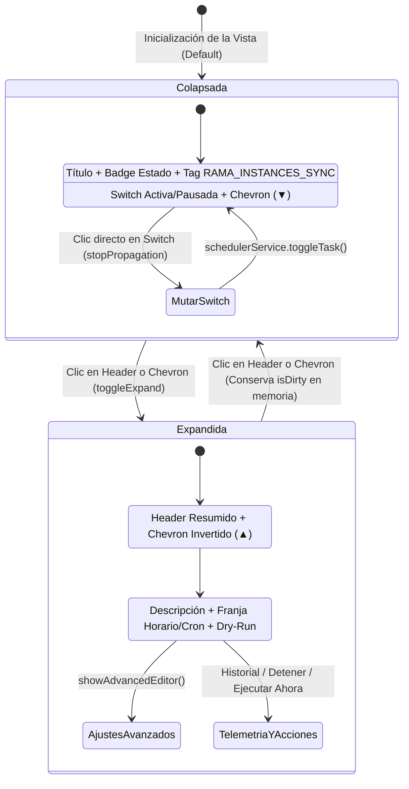
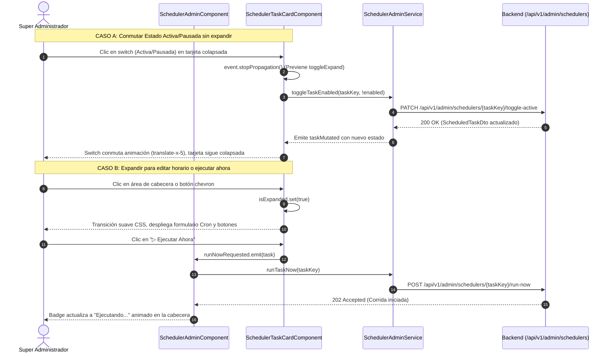

# 📖 Historia de Usuario: HU-24 - Consola Cron & Scheduler: Vista de Tarjetas Colapsibles / Acordeón con Resumen Operativo de Identificadores, Estado de Ejecución y Conmutación Rápida

---

## 📌 1. Información General de la Historia

| Metadato | Detalle |
| :--- | :--- |
| **Identificador** | `HU-24` (Equivalente: `HU-24-CRON-SCHEDULER-COLLAPSIBLE-CARDS-VIEW`) |
| **Código Equivalente Backend** | `N/A - Exclusivo Frontend (UX/UI Backoffice Super Admin)` (Extiende funcionalmente `HU-19` / `US-018`) |
| **Título** | Consola Cron & Scheduler: Rediseño de Vista de Tarjetas Colapsibles / Acordeón con Resumen Operativo (Título, Tag de Estado, Tag Técnico `RAMA_INSTANCES_SYNC` y Switch de Activar/Pausar) sin Despliegue Obligatorio |
| **Épica** | Backoffice Técnico (`/admin/scheduler`), Observabilidad Operativa y Ergonomía de Gestión de Procesos en Segundo Plano |
| **Módulos / Rutas Angular** | `src/app/features/admin/scheduler/components/scheduler-task-card.component.{ts,html}`, `src/app/features/admin/scheduler/scheduler-admin.component.{ts,html}`, `src/app/core/models/scheduler-admin.model.ts` (`/admin/scheduler`) |
| **Estado** | `🚀 Implementada / Verificada` |
| **Prioridad** | `Alta (Ergonomía Operativa, Productividad y Densidad de Información UX)` |
| **Tipo** | `Experiencia de Usuario (UX/UI) / Refactor Componente / Standalone Angular 19+` |
| **Actor Principal** | `Super Administrador (SUPER_ADMIN - Área Técnica y de Infraestructura de Dokqet)` |
| **Historias Relacionadas** | Extiende `HU-19` (Consola de Cron & Scheduler: Planificación Dinámica, Telemetría y Ejecución Inmediata) |

---

## 🎯 2. Narrativa de Negocio y Experiencia de Usuario (User Story Narrative)

> **Como** Super Administrador (`SUPER_ADMIN`) de la plataforma **Dokqet**,  
> **Quiero** que en la vista de tarjetas del Centro de Administración de **Cron & Scheduler** (`/admin/scheduler`) las tarjetas de cada tarea programada sean colapsibles (comportamiento tipo acordeón independiente), mostrando en su cabecera minimizada la información esencial consolidada (nombre del proceso, etiqueta del estado de última corrida, etiqueta de identificación técnica como `RAMA_INSTANCES_SYNC`, indicador de cambios pendientes y el interruptor para activar o pausar la tarea en caliente),  
> **Para** supervisar panorámicamente todas las tareas del backend sin desplazamientos verticales extensos, activar o desactivar procesos rápidamente con un solo clic sin necesidad de desplegar el detalle, y expandir únicamente la tarea que requiero calibrar conservando intacta su configuración horaria, expresión Cron, telemetría y botones de ejecución inmediata.

---

## 🔍 2.1. Diagnóstico del Estado Actual en `dokqet-frontend` y Justificación de Diseño UX

1. **Limitación de Densidad y Sobrecarga Visual en la Vista Actual (`HU-19`):**
   - Actualmente, en `/admin/scheduler`, el usuario puede alternar entre la vista **Tabla** (`TABLE`) y la vista **Tarjetas** (`CARDS`).
   - Si bien el diseño de cada tarjeta (`app-scheduler-task-card`) es visualmente elegante y completo (incluye selectores de hora, frecuencia, cron manual, panel desplegable avanzado, telemetría tabular y 4 botones de acción), **cada tarjeta permanece 100% expandida permanentemente**.
   - Con múltiples tareas programadas en el backend (ej. `RAMA_INSTANCES_SYNC`, `EXPEDIENTES_ACTUACIONES_SYNC`, `AUDITORIA_ARCHIVADO_SYNC`, `MAILING_NOTIFICACIONES_CRON`), la página adquiere una altura excesiva (más de 3,500 píxeles verticales), obligando al Super Administrador a realizar *scroll* continuo y dificultando la supervisión rápida de la salud general del sistema.

2. **Propuesta de Ergonomía Operativa (Tarjetas Colapsibles con Resumen de Alto Impacto):**
   - **Estado Minimizado / Colapsado (Default o Interactivo):**
     * **Título del Proceso:** Nombre legible del trabajo en segundo plano (ej. *Sincronización Diaria de Instancias Judiciales*).
     * **Badge de Estado de Última Corrida:** Píldora cromática idéntica a la actual (`● Ejecutado con Éxito`, `● Ejecutando...`, `● Con Error`, `● Interrumpido`, `● Detenido`, `● Sin corridas previas`).
     * **Badge de Clave Técnica:** Píldora monoespaciada de identificación interna del backend (ej. `RAMA_INSTANCES_SYNC`, `RAMA_ACTUACIONES_SYNC`).
     * **Badge de Cambios sin Guardar (`isDirty`):** Advertencia contextual en tono ámbar si el usuario editó parámetros y colapsó la tarjeta.
     * **Telemetría Compacta (Visible en pantallas medianas/grandes):** Próxima ejecución estimada (ej. `Próx: 03:00`) o última duración para monitoreo instantáneo.
     * **Interruptor Switch Activa / Pausada:** Switch accesible `role="switch"` (`task.enabled`) completamente interactivo en la cabecera colapsada, con aislamiento estricto de eventos (`event.stopPropagation()`) para alternar la activación sin forzar la apertura de la tarjeta.
     * **Control de Expansión (Chevron):** Indicador rotatorio interactivo (`rotate-0` a `rotate-180`) con soporte para accesibilidad `aria-expanded`.
   - **Estado Expandido:**
     * Al hacer clic en la cabecera o en el botón chevron, la tarjeta se expande fluidamente revelando el diseño exacto preexistente:
       1. Descripción operativa completa del proceso.
       2. Alerta de último error si la corrida anterior falló (`task.lastErrorMessage`).
       3. Franja central de 3 cajas: Selector de Hora/Fecha, Frecuencia/Intervalo, Expresión Cron y Botón `Guardar Horario`.
       4. Sub-selectores dinámicos para frecuencias Semanal/Mensual y vista previa Dry-Run de próximas 5 ejecuciones.
       5. Panel de Ajustes Avanzados (Zona horaria IANA, título editable, correos de alerta, descripción, flags de solapamiento y Kafka).
       6. Franja inferior de Telemetría (`Última corrida`, `Duración ms`, `Próxima ejecución`) y botones operativos (`Ajustes avanzados`, `Historial y Auditoría`, `Detener`, `Liberar Bloqueo`, `Ejecutar Ahora`).

3. **Control Global de la Vista:**
   - Adición en la barra superior de filtros de un botón toggle **«Expandir todas» / «Colapsar todas»** cuando la vista activa sea `CARDS`, permitiendo al operador técnico alternar masivamente el estado visual con un solo clic.

---

## 🧭 2.2. Diagramas de Interacción y Arquitectura de Estados (Mermaid)

### 2.2.1. Diagrama de Estados de la Tarjeta Colapsible



### 2.2.2. Diagrama de Secuencia de Interacción sin Expansión vs. con Expansión



---

## 🧱 3. Modelos de Datos en Cliente y Contratos API (`TypeScript`)

> [!IMPORTANT]
> **Auditoría de Código Preexistente (Cero Duplicación):**  
> Todos los contratos DTO de tareas y respuestas del servidor en `src/app/core/models/scheduler-admin.model.ts` **ya existen** y se mantienen (`[EXISTENTE - REUTILIZADO]`). No se altera ningún contrato REST del backend. Se incorpora únicamente una interfaz auxiliar de estado visual para coordinar la reactividad del acordeón en cliente (`[MODIFICADO / POR EXTENDER]`).

### 3.1. Estado de Interfaz en Cliente (`src/app/core/models/scheduler-admin.model.ts`)

```typescript
// [EXISTENTE - REUTILIZADO]: Contrato principal de tarea del backend
export interface ScheduledTaskDto {
  id: string;
  taskKey: string;             // Ej: 'RAMA_INSTANCES_SYNC', 'RAMA_ACTUACIONES_SYNC'
  title: string;               // Ej: 'Sincronización Diaria de Instancias Judiciales'
  description: string;
  frequencyType: ScheduleFrequencyType;
  cronExpression: string;
  displayCronExpression: string;
  timezone: string;
  utcOffset: string;
  executionTime: string | null;
  scheduledDate: string | null;
  intervalMinutes: number | null;
  daysOfWeek: string | null;
  dayOfMonth: number | null;
  enabled: boolean;            // Conmutada por el switch en cabecera
  preventOverlap: boolean;
  timeoutSeconds: number;
  notifyOnFailure: boolean;
  alertEmails: string | null;
  lastRunId: string | null;
  lastExecutionAt: string | null;
  lastDurationMs: number | null;
  lastStatus: ScheduledTaskRunStatus | null; // 'COMPLETED' | 'RUNNING' | 'FAILED' | 'STOPPED' | 'INTERRUPTED'
  lastErrorMessage: string | null;
  isStaleRunning?: boolean;
  nextExecutionAt: string | null;
  updatedAt: string;
  updatedBy: string | null;
}

// [MODIFICADO / POR EXTENDER]: Interfaz auxiliar para control de acordeón en Frontend
export interface SchedulerCardExpansionState {
  taskKey: string;
  isExpanded: boolean;
}
```

---

## ⚖️ 4. Reglas de Negocio en Frontend (RN-FE)

- **RN-FE-01 ([Estado Inicial Colapsado y Control Independiente por Tarjeta]):**  
  En la vista de tarjetas (`CARDS`), cada tarjeta `app-scheduler-task-card` debe gestionar su propio estado reactivo de apertura mediante una señal nativa (`isExpanded = signal<boolean>(false)` o entrada sincronizable `model<boolean>()`). Por defecto, al cargar la pantalla, todas las tarjetas se inicializan colapsadas para garantizar una visión panorámica y concisa de los procesos.
- **RN-FE-02 ([Contenido Obligatorio del Encabezado Resumido]):**  
  La cabecera colapsada debe desplegar de manera inmediata y legible, sin requerir interacción previa del usuario:
  1. **Título del Proceso (`title()`):** Texto destacado en negrita con corte elíptico en móviles si supera el ancho disponible.
  2. **Badge de Estado de Última Corrida:** Indicador con punto de color (`●`) y texto según `lastStatus`:
     - `COMPLETED`: Verde esmeralda (*Ejecutado con Éxito*).
     - `RUNNING`: Azul vibrante con animación de pulso (*Ejecutando...*).
     - `FAILED` / `INTERRUPTED`: Rojo destructivo (*Con Error* / *Interrumpido*).
     - `STOPPED`: Ámbar (*Detenido*).
     - `null`: Gris neutral (*Sin corridas previas*).
  3. **Badge Técnico (`taskKey`):** Etiqueta en tipografía monoespaciada con borde y fondo sutil (ej. `RAMA_INSTANCES_SYNC`), permitiendo la correlación unívoca con los logs y microservicios del backend.
  4. **Badge de Cambios Pendientes:** Si el usuario ha editado campos dentro de la tarjeta (`isDirty() === true`), se debe mostrar la insignia ámbar `Cambios sin guardar` en el encabezado aun cuando la tarjeta se encuentre colapsada.
  5. **Switch Activa / Pausada:** Interruptor accesible con `role="switch"` y estados visuales verde (`bg-primary`) o gris apagado (`bg-muted`), reflejando `task.enabled`.
  6. **Chevron de Acordeón:** Ícono SVG rotatorio que indica si la tarjeta está plegada (`rotate-0`) o desplegada (`rotate-180`).
- **RN-FE-03 ([Aislamiento Estricto de Clics y Prevención de Propagación - Event Bubbling]):**  
  Al hacer clic en el switch de activación (`Activa / Pausada`) o en cualquier botón interactivo dentro del encabezado (ej. tooltips o enlaces), se debe ejecutar obligatoriamente `event.stopPropagation()` para invocar la conmutación de estado sin disparar la expansión o colapso de la tarjeta.
- **RN-FE-04 ([Integridad de Datos en Memoria durante el Colapso]):**  
  Colapsar una tarjeta que contiene modificaciones no guardadas (`isDirty() === true`) **no debe resetear ni perder** los valores ingresados en los inputs de horario, zona horaria o cron. El estado se conserva intacto en las señales locales del componente hasta que el usuario presione *«Guardar Horario»* o *«Descartar cambios»*.
- **RN-FE-05 ([Transición Fluida y Prevención de Saltos de Diseño - CLS < 0.1]):**  
  La animación de apertura y cierre del acordeón debe implementarse utilizando técnicas de transición CSS modernas (CSS Grid con `grid-template-rows: 0fr -> 1fr` y opacidad progresiva), garantizando 60 FPS sin provocar saltos bruscos en el scroll ni elevar el *Cumulative Layout Shift* (`CLS < 0.1`).
- **RN-FE-06 ([Acción Masiva «Expandir Todas / Colapsar Todas»]):**  
  En la barra de herramientas del Planificador, cuando el modo activo sea `CARDS`, se debe disponer de un botón de control masivo que conmute simultáneamente el estado de todas las tarjetas visibles que coincidan con los filtros aplicados.
- **RN-FE-07 ([Accesibilidad WCAG 2.1 AA para Acordeones]):**  
  La cabecera de la tarjeta debe actuar como un botón interactivo accesible:
  - Atributo `aria-expanded="true|false"` vinculado al estado reactivo de la tarjeta.
  - Atributo `aria-controls` apuntando al `id` unívoco del contenedor del cuerpo colapsable (`card-body-{taskKey}`).
  - Soporte de teclado: al enfocar la cabecera mediante `Tab`, presionar `Enter` o `Espacio` debe abrir o cerrar la tarjeta.
  - Enfoque claro con anillo visible (`focus-visible:ring-2 focus-visible:ring-ring`).

---

## 🧪 5. Criterios de Aceptación (Escenarios en Formato Gherkin)

```gherkin
# language: es
Característica: HU-24 - Tarjetas Colapsibles y Resumen Operativo en Consola Cron & Scheduler
  Como Super Administrador de Dokqet
  Quiero visualizar las tarjetas de tareas programadas en formato colapsible tipo acordeón con resumen operativo en la cabecera
  Para monitorear rápidamente el estado de cada proceso y activar o pausar tareas sin desplegar pantallas extensas

  Antecedentes:
    Dado que el usuario autenticado posee el rol "SUPER_ADMIN"
    Y navega a la consola de administración en "/admin/scheduler"
    Y selecciona el modo de visualización "Tarjetas"

  # =========================================================================
  # REGLA: CAMINO FELIZ - RENDERIZADO INICIAL COLAPSADO CON INFORMACIÓN RESUMIDA
  # =========================================================================
  Escenario: Las tarjetas se renderizan inicialmente colapsadas mostrando nombre, badges y switch
    Dado que el backend responde con la tarea técnica "RAMA_INSTANCES_SYNC" con título "Sincronización Diaria de Instancias Judiciales" y estado "COMPLETED"
    Cuando la vista de tarjetas finaliza la carga
    Entonces la tarjeta se renderiza en estado colapsado
    Y se visualiza en la cabecera el título "Sincronización Diaria de Instancias Judiciales"
    Y se visualiza la píldora de estado "● Ejecutado con Éxito" en tono esmeralda
    Y se visualiza la etiqueta de clave técnica "RAMA_INSTANCES_SYNC" en tipografía monoespaciada
    Y se visualiza el interruptor switch en estado "Activa"
    Y el cuerpo con los campos de expresión Cron y configuración avanzada permanece oculto
    Y el ícono chevron se orienta apuntando hacia abajo con "aria-expanded" en "false"

  # =========================================================================
  # REGLA: INTERACCIÓN CON SWITCH EN CABECERA SIN EXPANDIR LA TARJETA
  # =========================================================================
  Escenario: Conmutación de activación de tarea directamente desde la tarjeta colapsada
    Dado que la tarea "RAMA_INSTANCES_SYNC" se encuentra colapsada y en estado "Activa"
    Cuando el Super Administrador hace clic directamente sobre el interruptor switch de la cabecera
    Entonces se detiene la propagación del evento evitando que la tarjeta se expanda
    Y se emite la petición al backend para pausar la tarea
    Y la tarjeta permanece en estado colapsado
    Y la etiqueta del interruptor cambia a "Pausada" con el switch desplazado a la izquierda

  # =========================================================================
  # REGLA: EXPANSIÓN Y ACCESO A LA CONFIGURACIÓN DETALLADA
  # =========================================================================
  Escenario: Expansión de la tarjeta al hacer clic en la cabecera para ver el diseño completo
    Dado que la tarjeta "RAMA_INSTANCES_SYNC" se encuentra colapsada
    Cuando el usuario hace clic en el área de la cabecera o en el botón chevron
    Entonces la tarjeta ejecuta una transición suave de apertura
    Y el ícono chevron rota 180 grados indicando el estado expandido con "aria-expanded" en "true"
    Y se despliega la descripción operativa completa del proceso
    Y se visualizan las 3 cajas de configuración: Hora de Ejecución, Frecuencia/Intervalo y Expresión Cron
    Y se visualiza el botón "Guardar Horario"
    Y se despliega la franja inferior con la telemetría detallada y los botones "Historial", "Ajustes avanzados" y "Ejecutar Ahora"

  # =========================================================================
  # REGLA: PRESERVACIÓN DE CAMBIOS EN MEMORIA AL COLAPSAR UNA TARJETA SUCIA
  # =========================================================================
  Escenario: Al colapsar una tarjeta con ediciones pendientes se preservan los datos y se muestra indicador de advertencia
    Dado que la tarjeta "RAMA_INSTANCES_SYNC" está expandida
    Y el usuario modifica la hora de ejecución a "04:30" marcando el formulario como sucio
    Cuando el usuario hace clic en la cabecera para colapsar la tarjeta
    Entonces la tarjeta se pliega ocultando los campos de edición
    Y se muestra en la cabecera colapsada el badge de advertencia "Cambios sin guardar"
    Y al volver a expandir la tarjeta, el campo de hora conserva el valor "04:30" sin haberse reseteado

  # =========================================================================
  # REGLA: CONTROL MASIVO EXPANDIR TODAS / COLAPSAR TODAS
  # =========================================================================
  Escenario: Uso del botón de acción masiva para expandir o colapsar todas las tarjetas
    Dado que se listan 4 tareas programadas en estado colapsado
    Cuando el Super Administrador presiona el botón "Expandir todas" en la barra superior
    Entonces las 4 tarjetas realizan la transición de apertura simultáneamente
    Y el botón de la barra superior actualiza su texto a "Colapsar todas"
    Cuando el usuario presiona "Colapsar todas"
    Entonces todas las tarjetas regresan a su estado minimizado mostrando su resumen operativo

  # =========================================================================
  # REGLA: ACCESIBILIDAD Y NAVEGACIÓN POR TECLADO (WCAG 2.1 AA)
  # =========================================================================
  Escenario: Operación accesible del acordeón mediante el teclado
    Dado que el usuario navega utilizando la tecla "Tab" hasta enfocar la cabecera de la tarjeta
    Cuando presiona la tecla "Enter" o la barra espaciadora
    Entonces la tarjeta conmuta su estado de expansión
    Y el lector de pantalla anuncia el cambio de estado a través del atributo "aria-expanded"
    Y al tabular nuevamente, el foco se transfiere de forma secuencial a los controles internos de la tarjeta
```

---

## 🏗️ 6. Mapeo a la Arquitectura Angular (Clasificación de Componentes)

### 6.1. Componentes y Plantillas Modificadas / Por Extender

- **`[MODIFICADO / POR EXTENDER]` Componente de Tarjeta de Tarea:**  
  `src/app/features/admin/scheduler/components/scheduler-task-card.component.ts`  
  *Adiciones requeridas:*
  * Señal local o modelo de dos vías: `readonly isExpanded = signal<boolean>(false);` (o entrada opcional para sincronización masiva).
  * Método interactivo: `toggleExpand(): void` conmutando `isExpanded.update(v => !v)`.
  * Método de switch con parada de propagación: `onToggleEnabledClick(event: MouseEvent): void` que ejecuta `event.stopPropagation()` antes de invocar `onToggleEnabled()`.
  * Atributos computados para accesibilidad: `contentId = computed(() => 'task-content-' + this.task().taskKey)`.

- **`[MODIFICADO / POR EXTENDER]` Plantilla HTML de Tarjeta:**  
  `src/app/features/admin/scheduler/components/scheduler-task-card.component.html`  
  *Modificaciones estructurales:*
  * Encapsular la Franja 1 en una cabecera clickeable tipo acordeón con `role="button"`, `tabindex="0"`, `[attr.aria-expanded]="isExpanded()"` y directivas de evento `(click)="toggleExpand()"` y `(keydown.enter)="toggleExpand()"` / `(keydown.space)="toggleExpand()"`.
  * Disposición visual del resumen: Título a la izquierda, junto a los badges de estado (`lastStatus`), badge técnico (`task.taskKey`, ej. `RAMA_INSTANCES_SYNC`), badge condicional `Cambios sin guardar`, y a la derecha el switch accesible `task.enabled` (`(click)="$event.stopPropagation(); onToggleEnabled()"`), finalizando con el ícono chevron animado.
  * Envolver las franjas de configuración detallada (Franja central, dry-run, ajustes avanzados y telemetría inferior) dentro de un contenedor colapsable con animación suave de apertura:
    ```html
    <div
      [id]="'task-content-' + task().taskKey"
      role="region"
      [attr.aria-labelledby]="'task-header-' + task().taskKey"
      class="grid transition-all duration-200 ease-in-out"
      [class]="isExpanded() ? 'grid-rows-[1fr] opacity-100 pt-4' : 'grid-rows-[0fr] opacity-0 overflow-hidden'">
      <div class="overflow-hidden space-y-5">
        <!-- Contenido detallado idéntico preexistente -->
      </div>
    </div>
    ```

- **`[MODIFICADO / POR EXTENDER]` Componente Principal de Consola Scheduler:**  
  `src/app/features/admin/scheduler/scheduler-admin.component.ts`  
  *Adiciones requeridas:*
  * Señal para control masivo: `readonly allCardsExpanded = signal<boolean>(false);`.
  * Método para conmutar todas las tarjetas: `toggleAllCards(): void`.
  * Registro de estado por clave técnica si se sincroniza con los hijos.

- **`[MODIFICADO / POR EXTENDER]` Plantilla de la Consola Principal:**  
  `src/app/features/admin/scheduler/scheduler-admin.component.html`  
  *Modificaciones:*
  * En la barra de herramientas donde se encuentra el selector `Tabla` vs `Tarjetas`, incorporar condicionalmente cuando `viewMode() === 'CARDS'` el botón:
    ```html
    @if (viewMode() === 'CARDS') {
      <button
        type="button"
        (click)="toggleAllCards()"
        class="inline-flex items-center gap-1.5 rounded-lg border border-border bg-card px-2.5 py-1 text-xs font-semibold text-muted-foreground hover:text-foreground shadow-2xs transition-colors cursor-pointer">
        <svg [class]="'size-3.5 transition-transform duration-200 ' + (allCardsExpanded() ? 'rotate-180' : '')" fill="none" viewBox="0 0 24 24" stroke="currentColor">
          <path stroke-linecap="round" stroke-linejoin="round" stroke-width="2" d="M19 9l-7 7-7-7" />
        </svg>
        <span>{{ allCardsExpanded() ? 'Colapsar todas' : 'Expandir todas' }}</span>
      </button>
    }
    ```

### 6.2. Componentes y Servicios Reutilizados sin Duplicación

- **`[EXISTENTE - REUTILIZADO]` Servicio de Planificador:**  
  `src/app/core/services/scheduler-admin.service.ts` (Métodos `updateTask`, `runTaskNow`, `toggleTaskEnabled`, `getDashboard`).
- **`[EXISTENTE - REUTILIZADO]` Servicio de Notificaciones:**  
  `src/app/core/services/notification.service.ts` (Mensajes de confirmación y advertencias de red).
- **`[EXISTENTE - REUTILIZADO]` Componentes Compartidos de Interfaz:**  
  `src/app/shared/components/ui/button.component.ts`, `form-alert.component.ts`, `skeleton.component.ts`.
- **`[EXISTENTE - REUTILIZADO]` Modales Modulares:**  
  `src/app/features/admin/scheduler/components/scheduler-history-modal.component.ts`, `scheduler-task-config-modal.component.ts`.

---

## 🚀 7. Guía y Ejemplos Prácticos de Prueba (Testing Guide)

### 7.1. Especificación de Pruebas Unitarias Automatizadas (Jasmine / Karma)

**Archivo:** `src/app/features/admin/scheduler/components/scheduler-task-card.component.spec.ts`

```typescript
import { ComponentFixture, TestBed } from '@angular/core/testing';
import { provideHttpClient } from '@angular/common/http';
import { provideHttpClientTesting } from '@angular/common/http/testing';
import { By } from '@angular/platform-browser';
import { SchedulerTaskCardComponent } from './scheduler-task-card.component';
import { ScheduledTaskDto } from '../../../../core/models/scheduler-admin.model';
import { SchedulerAdminService } from '../../../../core/services/scheduler-admin.service';
import { of } from 'rxjs';

const MOCK_TASK: ScheduledTaskDto = {
  id: 'task-1',
  taskKey: 'RAMA_INSTANCES_SYNC',
  title: 'Sincronización Diaria de Instancias Judiciales',
  description: 'Consulta instancias en el Portal de la Rama Judicial.',
  frequencyType: 'DAILY',
  cronExpression: '0 3 * * *',
  displayCronExpression: '0 3 * * *',
  timezone: 'America/Bogota',
  utcOffset: 'UTC-05:00',
  executionTime: '03:00',
  scheduledDate: null,
  intervalMinutes: null,
  daysOfWeek: null,
  dayOfMonth: null,
  enabled: true,
  preventOverlap: true,
  timeoutSeconds: 3600,
  notifyOnFailure: true,
  alertEmails: 'alertas@dokqet.com',
  lastRunId: 'run-101',
  lastExecutionAt: '2026-11-04T08:00:00Z',
  lastDurationMs: 4280,
  lastStatus: 'COMPLETED',
  lastErrorMessage: null,
  nextExecutionAt: '2026-11-05T08:00:00Z',
  updatedAt: '2026-11-04T08:05:00Z',
  updatedBy: 'admin@dokqet.com'
};

describe('SchedulerTaskCardComponent (Tarjetas Colapsibles)', () => {
  let component: SchedulerTaskCardComponent;
  let fixture: ComponentFixture<SchedulerTaskCardComponent>;
  let schedulerService: jasmine.SpyObj<SchedulerAdminService>;

  beforeEach(async () => {
    schedulerService = jasmine.createSpyObj('SchedulerAdminService', ['updateTask', 'toggleTaskEnabled']);
    schedulerService.toggleTaskEnabled.and.returnValue(of({ ...MOCK_TASK, enabled: false }));

    await TestBed.configureTestingModule({
      imports: [SchedulerTaskCardComponent],
      providers: [
        provideHttpClient(),
        provideHttpClientTesting(),
        { provide: SchedulerAdminService, useValue: schedulerService }
      ]
    }).compileComponents();

    fixture = TestBed.createComponent(SchedulerTaskCardComponent);
    component = fixture.componentInstance;

    // Asignación de inputs requeridos
    fixture.componentRef.setInput('task', MOCK_TASK);
    fixture.componentRef.setInput('timezones', [
      { zoneId: 'America/Bogota', utcOffset: 'UTC-05:00', displayName: 'UTC-05:00 (America/Bogota)' }
    ]);
    fixture.detectChanges();
  });

  it('debe inicializarse en estado colapsado por defecto', () => {
    expect(component.isExpanded()).toBeFalse();
    const headerEl = fixture.debugElement.query(By.css('[role="button"]'));
    expect(headerEl.attributes['aria-expanded']).toBe('false');
  });

  it('debe mostrar en el encabezado colapsado el título, badge de estado y tag técnico RAMA_INSTANCES_SYNC', () => {
    const textContent = fixture.nativeElement.textContent;
    expect(textContent).toContain('Sincronización Diaria de Instancias Judiciales');
    expect(textContent).toContain('Ejecutado con Éxito');
    expect(textContent).toContain('RAMA_INSTANCES_SYNC');
  });

  it('debe expandirse al hacer clic en el encabezado', () => {
    const headerEl = fixture.debugElement.query(By.css('[role="button"]'));
    headerEl.nativeElement.click();
    fixture.detectChanges();

    expect(component.isExpanded()).toBeTrue();
    expect(headerEl.attributes['aria-expanded']).toBe('true');
  });

  it('al presionar el switch de activar/pausar debe conmutar el estado sin expandir la tarjeta', () => {
    expect(component.isExpanded()).toBeFalse();

    const switchBtn = fixture.debugElement.query(By.css('button[role="switch"]'));
    const clickEvent = new MouseEvent('click', { bubbles: true, cancelable: true });
    spyOn(clickEvent, 'stopPropagation').and.callThrough();

    switchBtn.nativeElement.dispatchEvent(clickEvent);
    fixture.detectChanges();

    expect(clickEvent.stopPropagation).toHaveBeenCalled();
    expect(component.isExpanded()).toBeFalse(); // La tarjeta NO debe haberse expandido
  });

  it('debe mostrar el badge "Cambios sin guardar" en el encabezado si el formulario es sucio y está colapsado', () => {
    // Simular que el usuario editó un campo
    component.isDirty.set(true);
    component.isExpanded.set(false);
    fixture.detectChanges();

    const textContent = fixture.nativeElement.textContent;
    expect(textContent).toContain('Cambios sin guardar');
  });
});
```

### 7.2. Comandos de Ejecución de Pruebas Unitarias

```bash
# Ejecutar las pruebas unitarias del módulo Scheduler en modo headless
npx ng test --include="src/app/features/admin/scheduler/**/*.spec.ts" --no-watch --browsers=ChromeHeadless
```

### 7.3. Checklist de Verificación Manual de Experiencia de Usuario (QA UI Checklist)

1. **Navegación e Inicialización:**
   - Iniciar sesión como Super Administrador (`superadmin@dokqet.com`).
   - Ir a la ruta `/admin/scheduler`.
   - Seleccionar la vista de **Tarjetas** mediante el selector superior.
   - Confirmar que todas las tarjetas carguen inicialmente colapsadas, con una altura compacta y sin saltos de maquetación (CLS < 0.1).
2. **Auditoría de Información Resumida en Cabecera:**
   - Para cada tarjeta, verificar que sea visible sin expandir:
     * Nombre legible del proceso (ej. *Sincronización de Actuaciones Judiciales*).
     * Píldora de estado de última corrida con su respectivo punto de color (`● Ejecutado con Éxito`, `● Con Error`, etc.).
     * Etiqueta técnica monoespaciada (ej. `RAMA_INSTANCES_SYNC`).
     * Interruptor accesible `Activa / Pausada`.
     * Ícono chevron indicando estado plegado.
3. **Prueba de Aislamiento del Switch:**
   - Hacer clic repetidas veces en el switch de una tarjeta colapsada.
   - Confirmar que el interruptor cambie de posición y color y notifique al backend sin que la tarjeta se abra o desplace el contenido.
4. **Prueba de Expansión Individual:**
   - Hacer clic en la cabecera o en el chevron de una tarjeta puntual.
   - Confirmar la animación fluida y verificar que se visualicen los campos de hora, frecuencia, expresión Cron, telemetría y botones de acción rápida.
5. **Prueba de Modificación y Persistencia en Memoria:**
   - Expandir la tarjeta y modificar la hora o intervalo.
   - Colapsar la tarjeta sin guardar.
   - Verificar que aparezca el badge ámbar `Cambios sin guardar` en el encabezado colapsado.
   - Volver a expandir y comprobar que los datos editados siguen presentes.
6. **Prueba de Control Masivo:**
   - Presionar el botón «Expandir todas» en la barra superior y comprobar que todas las tarjetas se desplieguen al mismo tiempo.
   - Presionar «Colapsar todas» y corroborar que todas se replieguen ordenadamente.
7. **Prueba de Accesibilidad (A11y):**
   - Recorrer las tarjetas utilizando exclusivamente la tecla `Tab`.
   - Presionar `Enter` y `Espacio` en las cabeceras para validar la apertura/cierre.
   - Inspeccionar los elementos en las herramientas de desarrollo para asegurar que `aria-expanded` refleje fielmente el estado.
