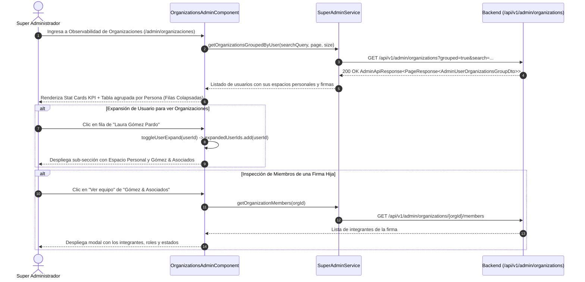

# 📖 Historia de Usuario: HU-25 - Consola Super Admin: Observabilidad de Organizaciones Jerárquica y Agrupada por Usuario Propietario con Desglose de Espacio Personal y Firmas Jurídicas

---

## 📌 1. Información General de la Historia

| Metadato | Detalle |
| :--- | :--- |
| **Identificador** | `HU-25` (Equivalente: `HU-25-ADMIN-ORGANIZATIONS-USER-GROUPING-OBSERVABILITY`) |
| **Código Equivalente Backend** | `US-029` (`Agrupación Jerárquica de Espacios Personales y Organizaciones por Usuario Propietario en Consola de Observabilidad Super Admin`) |
| **Título** | Consola Super Admin: Observabilidad de Organizaciones Jerárquica y Agrupada por Usuario Propietario con Desglose de Espacio Personal y Firmas Jurídicas |
| **Épica** | Backoffice Técnico (`/admin/organizaciones`), Gobernanza Multi-Tenancy y Observabilidad Estructurada de Cuentas |
| **Módulos / Rutas Angular** | `src/app/features/admin/organizations/organizations-admin.component.{ts,html}`, `src/app/core/models/super-admin.model.ts`, `src/app/core/services/super-admin.service.ts` (`/admin/organizaciones`) |
| **Estado** | `🚀 Implementada / Verificada` |
| **Prioridad** | `Alta (Gobernanza Multi-Tenancy, Usabilidad Operativa y Claridad en Soporte Técnico)` |
| **Tipo** | `Experiencia de Usuario (UX/UI) / Refactor Componente / Standalone Angular 19+` |
| **Actor Principal** | `Super Administrador (SUPER_ADMIN - Área Técnica y de Infraestructura de Dokqet)` |
| **Historias Relacionadas** | Extiende `HU-18` (Consola de Super Administrador, Observabilidad Global de Organizaciones y Catálogos) y `HU-21` (Consola Super Admin y Ficha de Soporte) |

---

## 🎯 2. Narrativa de Negocio y Experiencia de Usuario (User Story Narrative)

> **Como** Super Administrador (`SUPER_ADMIN`) de la plataforma **Dokqet**,  
> **Quiero** disponer en la pantalla de **Observabilidad de Organizaciones** (`/admin/organizaciones`) de un modo de visualización agrupado por usuario propietario o titular, donde la tabla principal liste a las personas registradas y permita expandir cada fila para desplegar ordenadamente tanto su espacio de trabajo personal como las firmas colectivas u organizaciones que ha creado o administra,  
> **Para** comprender de forma intuitiva, organizada y centralizada el ecosistema de espacios que posee cada usuario, distinguir sin confusión los entornos personales de las firmas jurídicas corporativas, y realizar labores de supervisión, auditoría y soporte técnico con total claridad sin tener filas dispersas e inconexas en una lista plana.

---

## 🔍 2.1. Diagnóstico del Estado Actual en `dokqet-frontend` y Justificación UX

1. **Problema de la Lista Plana Desarticulada (`HU-18`):**
   - Actualmente, la tabla de `/admin/organizaciones` (`organizations-admin.component.html`) presenta una lista plana paginada donde cada fila es una organización (`AdminOrganizationSummary`).
   - Cuando un usuario litigante se registra en Dokqet:
     1. El sistema le crea automáticamente un **Espacio Personal** (`isPersonal: true`, ej. *Laura Gómez*).
     2. Posteriormente, dicho usuario crea una o varias **Firmas Jurídicas** colectivas (`isPersonal: false`, ej. *Gómez & Asociados Abogados S.A.S.*).
   - En la tabla actual, estos dos registros aparecen como filas totalmente independientes, separadas y mezcladas con organizaciones de otros usuarios.
   - **Consecuencia Operativa:** El Super Administrador no puede saber a simple vista qué firmas u organizaciones pertenecen a un usuario concreto ni cuántos expedientes vigila en conjunto esa persona en sus diferentes entornos, viéndose forzado a buscar por nombres cruzados o inspeccionar manualmente los miembros de cada firma.

2. **Propuesta de Observabilidad Jerárquica Centrada en la Persona:**
   - **Selector de Modo de Visualización:**
     * **`Agrupado por Persona` (Modo Recomendado / Por Defecto):** Presenta a los usuarios como filas maestras de primer nivel con avatar, nombre, correo, resumen de tenencia (`1 Espacio Personal · 2 Firmas`) y métricas acumuladas (total de expedientes y miembros).
     * **`Lista General (Plana)`:** Conserva la vista clásica preexistente de tabla plana para auditorías puntuales directas.
   - **Fila Maestra de Usuario (Nivel 1):**
     * Indicador interactivo de expansión (Chevron rotatorio).
     * Nombre completo del usuario y correo electrónico.
     * Insignias sintéticas: Píldora de estado de la cuenta (`Activo`, `Suspendido`), indicador de `Espacio Personal Activo` y conteo de `N Firmas Jurídicas`.
     * Total consolidado de expedientes vigilados (suma de procesos en su espacio personal + firmas).
     * Total de integrantes vinculados en sus organizaciones.
   - **Sub-tabla o Detalle Desplegado (Nivel 2 - Al Expandir la Fila del Usuario):**
     * **Bloque 1: Espacio de Trabajo Personal:**
       - Nombre del espacio personal.
       - Badge identificativo `Espacio Personal` (Persona Natural).
       - Conteo de expedientes propios.
       - Fecha de creación.
     * **Bloque 2: Firmas Jurídicas y Organizaciones Colectivas:**
       - Tabla anidada con: Nombre comercial y Razón social, Tipo (`Firma Jurídica`), NIT y Dígito de Verificación, Integrantes vinculados (`membersCount`), Expedientes de la firma (`processesCount`), Fecha de registro y botón directo **`Ver equipo`** para desplegar el modal de miembros existente.
   - **Control Masivo «Expandir Todos / Colapsar Todos»:**
     * Botón de acción masiva en la barra superior para abrir o cerrar todos los grupos de usuarios simultáneamente.
   - **Búsqueda Inteligente Multi-Nivel:**
     * El buscador filtra instantáneamente tanto por nombre o correo del usuario titular como por nombre comercial, razón social o NIT de cualquiera de sus organizaciones subordinadas.

---

## 🧭 2.2. Diagramas de Interacción y Arquitectura de Estados (Mermaid)

### 2.2.1. Diagrama de Flujo de Navegación y Agrupamiento Jerárquico

```mermaid
flowchart TD
    A["Navegación a /admin/organizaciones"] --> B["SuperAdminService.getOrganizationsGroupedByUser()"]
    B --> C{"Modo de Visualización Seleccionado"}
    
    C -->|GROUPED_BY_USER (Default)| D["Renderiza Tabla Maestra por Usuario"]
    C -->|FLAT_LIST| E["Renderiza Tabla Plana Tradicional (HU-18)"]
    
    D --> F["Fila Maestra: Usuario (Laura Gómez) + Badges + Métricas Totales"]
    F -->|Clic en Fila / Chevron| G{"¿Fila Expandida?"}
    
    G -->|Sí (Expandir)| H["Despliega Sub-contenedor Jerárquico"]
    H --> H1["Tarjeta/Fila: Espacio de Trabajo Personal (1 vigilado)"]
    H --> H2["Tabla Anidada: Firmas Jurídicas (Gómez & Asociados - 12 miembros - 45 vigilados)"]
    H2 -->|Clic en 'Ver equipo'| I["Abre Modal de Integrantes (app-modal)"]
    
    G -->|No (Colapsar)| J["Oculta Sub-contenedor con Transición Suave"]
```

### 2.2.2. Diagrama de Secuencia de Consulta y Renderizado



---

## 🧱 3. Modelos de Datos en Cliente y Contratos API (`TypeScript`)

> [!IMPORTANT]
> **Auditoría de Código Preexistente (Cero Duplicación):**  
> `AdminOrganizationSummary`, `AdminPlatformOverview` y `AdminMember` **ya existen** en `src/app/core/models/super-admin.model.ts` (`[EXISTENTE - REUTILIZADO]`). Se incorpora la extensión de metadatos de propietario en `AdminOrganizationSummary` (`[MODIFICADO / POR EXTENDER]`) y se crea la interfaz compuesta de agrupación `AdminUserOrganizationsGroupDto` (`[NUEVO / POR CREAR]`).

### 3.1. Extensión de Modelos (`src/app/core/models/super-admin.model.ts`)

```typescript
// [MODIFICADO / POR EXTENDER]: Se agregan metadatos opcionales del titular/propietario
export interface AdminOrganizationSummary {
  id: string;
  name: string;
  personType: 'NATURAL' | 'JURIDICA';
  legalName: string | null;
  nit: string | null;
  nitDv: string | null;
  isPersonal: boolean;
  membersCount: number;
  activeMembersCount: number;
  processesCount: number;
  createdAt: string; // ISO 8601 UTC
  // Metadatos de propietario para trazabilidad directa
  ownerId?: string | null;
  ownerName?: string | null;
  ownerEmail?: string | null;
}

// [NUEVO / POR CREAR]: Contrato de Usuario con sus Espacios de Trabajo Agrupados
export interface AdminUserOrganizationsGroupDto {
  userId: string;
  userName: string;
  userEmail: string;
  userDocumentType?: string | null;
  userDocumentNumber?: string | null;
  userStatus: 'ACTIVE' | 'UNVERIFIED' | 'SUSPENDED' | string;
  personalWorkspace: AdminOrganizationSummary | null;
  organizations: AdminOrganizationSummary[];
  totalWorkspacesCount: number;
  totalProcessesCount: number;
  totalMembersCount: number;
  createdAt: string;
}

// [NUEVO / POR CREAR]: Tipo de vista en la consola de observabilidad
export type OrganizationsViewMode = 'GROUPED' | 'FLAT';
```

---

## ⚖️ 4. Reglas de Negocio en Frontend (RN-FE)

- **RN-FE-01 ([Selector de Modo de Visualización]):**  
  La pantalla debe ofrecer un selector ergonómico de dos pestañas o botones conmutadores: `Agrupado por Persona` (`GROUPED`) y `Lista General` (`FLAT`). El modo predeterminado al ingresar a la ruta `/admin/organizaciones` debe ser `GROUPED` para garantizar una experiencia estructurada y limpia.
- **RN-FE-02 ([Fila Maestra de Usuario y Resumen de Entidades]):**  
  En el modo agrupado, cada fila de primer nivel representa a un usuario y debe mostrar:
  1. Ícono chevron rotatorio interactivo con accesibilidad (`aria-expanded="false|true"`).
  2. Avatar con iniciales o silueta y nombre completo del titular.
  3. Correo electrónico del usuario en tipografía secundaria.
  4. Insignia compuesta de pertenencia: Indicador `Espacio Personal` si posee workspace personal activo y píldora `N Firmas Jurídicas` si administra organizaciones colectivas.
  5. Cifra tabular del **Total de Expedientes Vigilados** (suma consolidada del espacio personal + todas las firmas).
  6. Conteo total de personas vinculadas en sus organizaciones.
  7. Estado de la cuenta del usuario (`Activo` en verde, `Suspendido` en rojo, `No verificado` en ámbar).
- **RN-FE-03 ([Desglose Jerárquico al Expandir]):**  
  Al hacer clic en la fila del usuario o en el chevron, la fila se expande revelando dos secciones visualmente diferenciadas:
  - **Espacio de Trabajo Personal:** Contenedor estilizado con borde sutil destacando: Nombre del espacio personal, etiqueta `Persona Natural / Personal`, total de expedientes vigilados en su espacio privado y fecha de alta.
  - **Firmas Jurídicas y Colectivas:** Sub-tabla interactiva con las columnas: Nombre Comercial / Razón Social, Tipo (`Firma Jurídica`), NIT con DV formateado (`formatNit`), Personas Vinculadas, Expedientes Vigilados y botón de acción **`Ver equipo`**.
- **RN-FE-04 ([Aislamiento de Clics y Acciones en Sub-filas]):**  
  Al hacer clic en el botón *«Ver equipo»* de una firma hija dentro del acordeón, se debe aislar el evento (`event.stopPropagation()`) para abrir el modal de integrantes sin provocar el colapso accidental de la fila del usuario.
- **RN-FE-05 ([Control Masivo «Expandir Todos / Colapsar Todos»]):**  
  En la barra superior de herramientas, junto al buscador y el selector de vista, debe existir un botón interactivo que conmute simultáneamente el estado de expansión de todos los usuarios visibles que coincidan con la búsqueda.
- **RN-FE-06 ([Búsqueda Reactiva Multi-Nivel]):**  
  El campo de búsqueda con debounce de 350ms debe filtrar tanto a nivel del usuario (nombre, apellido, correo) como a nivel de las organizaciones subordinadas (nombre comercial, razón social, NIT). Si una firma coincide, el usuario que la posee debe aparecer listado en los resultados.
- **RN-FE-07 ([Accesibilidad WCAG 2.1 AA y Prevención de Saltos CLS < 0.1]):**  
  - Las filas maestras de usuario deben contar con `role="button"`, `tabindex="0"`, `aria-expanded` y respuesta a teclado (`Enter` y `Espacio`).
  - Las transiciones de expansión/colapso deben ser progresivas y fluidas (CSS Grid / Opacity), evitando cualquier salto abrupto en la barra de desplazamiento vertical.
  - Durante la carga inicial, se debe desplegar un skeleton jerárquico que reserve exactamente el espacio visual.

---

## 🧪 5. Criterios de Aceptación (Escenarios en Formato Gherkin)

```gherkin
# language: es
Característica: HU-25 - Observabilidad de Organizaciones Agrupadas por Usuario Propietario
  Como Super Administrador de Dokqet
  Quiero visualizar las organizaciones y espacios personales agrupados bajo la persona titular en la consola de observabilidad
  Para supervisar de forma intuitiva y ordenada qué entidades y expedientes posee cada usuario en la plataforma

  Antecedentes:
    Dado que el usuario autenticado posee el rol "SUPER_ADMIN"
    Y navega a la consola de administración en "/admin/organizaciones"

  # =========================================================================
  # REGLA: CAMINO FELIZ - RENDERIZADO INICIAL AGRUPADO POR PERSONA
  # =========================================================================
  Escenario: Carga inicial de la vista con filas agrupadas por usuario colapsadas
    Dado que el servicio de observabilidad responde con usuarios y sus respectivas organizaciones
    Cuando la vista finaliza la carga
    Entonces el selector de vista muestra activo el modo "Agrupado por Persona"
    Y se renderizan las filas maestras de usuarios en estado colapsado
    Y cada fila muestra el nombre del usuario, correo, badge de espacio personal, conteo de firmas y total consolidado de expedientes
    Y el chevron de cada fila se encuentra orientado hacia abajo con "aria-expanded" en "false"

  # =========================================================================
  # REGLA: EXPANSIÓN DE FILA PARA VER ESPACIO PERSONAL Y FIRMAS
  # =========================================================================
  Escenario: Expansión de un usuario que posee espacio personal y una firma jurídica
    Dado que el usuario "Laura Gómez" posee su espacio personal y la firma "Gómez & Asociados Abogados S.A.S."
    Cuando el Super Administrador hace clic en la fila de "Laura Gómez"
    Entonces la fila ejecuta una transición suave de apertura
    Y el chevron rota hacia arriba con "aria-expanded" en "true"
    Y se visualiza el contenedor del "Espacio de Trabajo Personal" con su conteo de expedientes
    Y se visualiza la sub-tabla con la firma "Gómez & Asociados Abogados S.A.S."
    Y la firma muestra su NIT, personas vinculadas, expedientes y el botón "Ver equipo"

  # =========================================================================
  # REGLA: INTERACCIÓN CON "VER EQUIPO" SIN COLAPSAR LA FILA DEL USUARIO
  # =========================================================================
  Escenario: Apertura del modal de integrantes de una firma hija
    Dado que la fila de "Laura Gómez" se encuentra expandida
    Cuando el Super Administrador hace clic en el botón "Ver equipo" de la firma "Gómez & Asociados"
    Entonces se detiene la propagación del evento evitando que la fila del usuario se colapse
    Y se abre el modal de integrantes con la lista de miembros de "Gómez & Asociados"
    Y al cerrar el modal, la fila del usuario "Laura Gómez" permanece abierta

  # =========================================================================
  # REGLA: BÚSQUEDA REACTIVA POR DATOS DE PERSONA O DATOS DE ORGANIZACIÓN
  # =========================================================================
  Esquema del escenario: Búsqueda dinámica con coincidencia en titular o firma
    Dado que existen múltiples usuarios registrados con sus organizaciones
    Cuando el Super Administrador ingresa el término de búsqueda "<termino>"
    Entonces la tabla filtra en tiempo real y muestra al usuario "<usuarioEsperado>"
    Y al expandir la fila se observa la organización "<organizacionEsperada>"

    Ejemplos:
      | termino           | usuarioEsperado      | organizacionEsperada                   |
      | laura.gomez       | Laura Gómez Pardo    | Espacio Personal - Laura Gómez         |
      | 901234567         | Carlos Mendoza Ruiz  | Mendoza & Abogados Consultores S.A.S.  |
      | Gómez & Asociados | Laura Gómez Pardo    | Gómez & Asociados Abogados S.A.S.      |

  # =========================================================================
  # REGLA: CONMUTACIÓN AL MODO "LISTA GENERAL (PLANA)"
  # =========================================================================
  Escenario: Alternar entre vista agrupada y vista plana
    Dado que el usuario se encuentra en la vista "Agrupado por Persona"
    Cuando hace clic en el botón conmutador "Lista General"
    Entonces la tabla cambia de estructura renderizando la lista plana tradicional de organizaciones
    Y cada fila representa individualmente a una organización sin jerarquía de usuario
    Cuando vuelve a seleccionar "Agrupado por Persona"
    Entonces la tabla regresa a la visualización jerárquica centrada en el usuario

  # =========================================================================
  # REGLA: ACCIÓN MASIVA EXPANDIR TODOS / COLAPSAR TODOS
  # =========================================================================
  Escenario: Despliegue y repliegue masivo de todos los usuarios visibles
    Dado que se visualizan 5 usuarios en estado colapsado
    Cuando el Super Administrador presiona el botón "Expandir todos"
    Entonces los 5 usuarios se despliegan simultáneamente mostrando sus espacios y firmas
    Y el botón actualiza su texto a "Colapsar todos"
    Cuando el usuario presiona "Colapsar todos"
    Entonces todas las filas maestras regresan a su estado compacto minimizado
```

---

## 🏗️ 6. Mapeo a la Arquitectura Angular (Clasificación de Componentes)

### 6.1. Componentes y Plantillas Modificadas / Por Extender

- **`[MODIFICADO / POR EXTENDER]` Componente Principal de Observabilidad:**  
  `src/app/features/admin/organizations/organizations-admin.component.ts`  
  *Adiciones requeridas:*
  * Señal de modo de visualización: `readonly viewMode = signal<OrganizationsViewMode>('GROUPED');`.
  * Señal de usuarios agrupados: `readonly userGroups = signal<AdminUserOrganizationsGroupDto[]>([]);`.
  * Señal de IDs de usuarios expandidos: `readonly expandedUserIds = signal<Set<string>>(new Set<string>());`.
  * Métodos de interacción: `toggleUserExpand(userId: string): void`, `toggleAllUsers(): void`, `allUsersExpanded = computed(...)`.
  * Lógica reactiva de agrupamiento: Procesar las organizaciones retornadas por el servicio o consumir el endpoint agrupado, generando la estructura compuesta persona titular + espacio personal + firmas jurídicas.

- **`[MODIFICADO / POR EXTENDER]` Plantilla HTML de Observabilidad:**  
  `src/app/features/admin/organizations/organizations-admin.component.html`  
  *Modificaciones estructurales:*
  * Selector superior de vista: Botones conmutadores `Agrupado por Persona` vs `Lista General`.
  * Botón masivo `Expandir todos / Colapsar todos` condicionado al modo `GROUPED`.
  * Bloque `@if (viewMode() === 'GROUPED')`: Renderizado de tabla jerárquica con fila maestra de usuario clickeable y contenedor desplegable anidado con animación suave.
  * Bloque `@else`: Mantenimiento de la tabla plana preexistente (`FLAT`).

- **`[MODIFICADO / POR EXTENDER]` Modelos de Super Admin:**  
  `src/app/core/models/super-admin.model.ts`  
  *Adiciones:*
  * Exportar `AdminUserOrganizationsGroupDto`, `OrganizationsViewMode` y campos de propietario en `AdminOrganizationSummary`.

- **`[MODIFICADO / POR EXTENDER]` Servicio de Super Admin:**  
  `src/app/core/services/super-admin.service.ts`  
  *Adiciones:*
  * Método `getOrganizationsGrouped(page, size, search): Observable<AdminApiResponse<PageResponse<AdminUserOrganizationsGroupDto>>>` o soporte para parámetro `grouped=true`.

### 6.2. Componentes Compartidos y Reutilizados sin Duplicación

- **`[EXISTENTE - REUTILIZADO]` Componentes UI Dokqet:**  
  `src/app/shared/components/ui/` (`badge.component.ts`, `breadcrumbs.component.ts`, `button.component.ts`, `empty-state.component.ts`, `form-alert.component.ts`, `modal.component.ts`, `skeleton-card-grid.component.ts`, `skeleton-table.component.ts`, `stat-card.component.ts`).
- **`[EXISTENTE - REUTILIZADO]` Modal de Inspección de Integrantes:**  
  Reutilización completa del modal existente `app-modal` de integrantes de organización para invocar `openMembersModal(org)`.

---

## 🚀 7. Guía y Ejemplos Prácticos de Prueba (Testing Guide)

### 7.1. Especificación de Pruebas Unitarias Automatizadas (Jasmine / Karma)

**Archivo:** `src/app/features/admin/organizations/organizations-admin.component.spec.ts`

```typescript
import { ComponentFixture, TestBed } from '@angular/core/testing';
import { provideHttpClient } from '@angular/common/http';
import { provideHttpClientTesting } from '@angular/common/http/testing';
import { of } from 'rxjs';
import { OrganizationsAdminComponent } from './organizations-admin.component';
import { SuperAdminService } from '../../../core/services/super-admin.service';
import { AdminUserOrganizationsGroupDto } from '../../../core/models/super-admin.model';

const MOCK_USER_GROUPS: AdminUserOrganizationsGroupDto[] = [
  {
    userId: 'usr-1',
    userName: 'Laura Gómez Pardo',
    userEmail: 'laura.gomez@dokqet.com',
    userDocumentType: 'CC',
    userDocumentNumber: '52849102',
    userStatus: 'ACTIVE',
    personalWorkspace: {
      id: 'org-pers-1',
      name: 'Espacio Personal - Laura Gómez',
      personType: 'NATURAL',
      legalName: null,
      nit: null,
      nitDv: null,
      isPersonal: true,
      membersCount: 1,
      activeMembersCount: 1,
      processesCount: 3,
      createdAt: '2026-10-01T10:00:00Z'
    },
    organizations: [
      {
        id: 'org-jur-1',
        name: 'Gómez & Asociados Abogados S.A.S.',
        personType: 'JURIDICA',
        legalName: 'Gómez & Asociados Consultores Jurídicos S.A.S.',
        nit: '901234567',
        nitDv: '8',
        isPersonal: false,
        membersCount: 4,
        activeMembersCount: 4,
        processesCount: 28,
        createdAt: '2026-10-05T14:30:00Z'
      }
    ],
    totalWorkspacesCount: 2,
    totalProcessesCount: 31,
    totalMembersCount: 5,
    createdAt: '2026-10-01T10:00:00Z'
  }
];

describe('OrganizationsAdminComponent (HU-25 Observabilidad Agrupada)', () => {
  let component: OrganizationsAdminComponent;
  let fixture: ComponentFixture<OrganizationsAdminComponent>;
  let superAdminService: jasmine.SpyObj<SuperAdminService>;

  beforeEach(async () => {
    superAdminService = jasmine.createSpyObj('SuperAdminService', [
      'getPlatformOverview',
      'getOrganizations',
      'getOrganizationMembers'
    ]);

    superAdminService.getPlatformOverview.and.returnValue(of({
      success: true,
      message: 'Overview',
      timestamp: '2026-11-05T00:00:00Z',
      data: {
        totalOrganizations: 2,
        totalPersonalOrganizations: 1,
        totalCollectiveOrganizations: 1,
        totalUsers: 1,
        totalProcesses: 31
      }
    }));

    superAdminService.getOrganizations.and.returnValue(of({
      success: true,
      message: 'OK',
      timestamp: '2026-11-05T00:00:00Z',
      data: {
        content: [],
        page: 0,
        size: 10,
        totalElements: 1,
        totalPages: 1,
        last: true
      }
    }));

    await TestBed.configureTestingModule({
      imports: [OrganizationsAdminComponent],
      providers: [
        provideHttpClient(),
        provideHttpClientTesting(),
        { provide: SuperAdminService, useValue: superAdminService }
      ]
    }).compileComponents();

    fixture = TestBed.createComponent(OrganizationsAdminComponent);
    component = fixture.componentInstance;
    fixture.detectChanges();
  });

  it('debe iniciar en modo GROUPED (Agrupado por Persona) por defecto', () => {
    expect(component.viewMode()).toBe('GROUPED');
  });

  it('debe expandir y colapsar la fila de un usuario al invocar toggleUserExpand', () => {
    expect(component.isUserExpanded('usr-1')).toBeFalse();

    component.toggleUserExpand('usr-1');
    expect(component.isUserExpanded('usr-1')).toBeTrue();

    component.toggleUserExpand('usr-1');
    expect(component.isUserExpanded('usr-1')).toBeFalse();
  });

  it('debe conmutar masivamente la expansión de todos los usuarios con toggleAllUsers', () => {
    component.userGroups.set(MOCK_USER_GROUPS);
    fixture.detectChanges();

    expect(component.allUsersExpanded()).toBeFalse();

    component.toggleAllUsers();
    expect(component.allUsersExpanded()).toBeTrue();
    expect(component.isUserExpanded('usr-1')).toBeTrue();

    component.toggleAllUsers();
    expect(component.allUsersExpanded()).toBeFalse();
    expect(component.isUserExpanded('usr-1')).toBeFalse();
  });

  it('debe alternar limpiamente al modo FLAT (Lista Plana) y regresar a GROUPED', () => {
    component.viewMode.set('FLAT');
    fixture.detectChanges();
    expect(component.viewMode()).toBe('FLAT');

    component.viewMode.set('GROUPED');
    fixture.detectChanges();
    expect(component.viewMode()).toBe('GROUPED');
  });
});
```

### 7.2. Comandos de Ejecución de Pruebas

```bash
# Compilación y verificación estricta de tipos de pruebas y código Angular
npx tsc --project tsconfig.spec.json --noEmit

# Compilación de producción para validar plantillas y bundle
npx ng build
```

### 7.3. Checklist de Verificación Manual de Experiencia de Usuario (QA UI Checklist)

1. **Acceso e Inicialización:**
   - Iniciar sesión con credenciales de Super Administrador (`superadmin@dokqet.com`).
   - Ir a la ruta `/admin/organizaciones`.
   - Verificar que por defecto la vista seleccionada sea **«Agrupado por Persona»**.
2. **Visualización de la Fila Maestra de Usuario:**
   - Confirmar que aparezcan los usuarios con su avatar, nombre completo, correo, badge indicativo de `Espacio Personal` y conteo de `N Firmas Jurídicas`.
   - Comprobar que la métrica de expedientes vigilados refleje la sumatoria acumulada de todas sus entidades.
3. **Expansión y Desglose Jerárquico:**
   - Hacer clic en la fila de un usuario (ej. *Laura Gómez*).
   - Verificar que se despliegue con animación suave el bloque de **Espacio de Trabajo Personal** y la tabla de **Firmas Jurídicas**.
   - Comprobar que la firma jurídica exhiba su NIT, personas vinculadas, expedientes y el botón *«Ver equipo»*.
4. **Prueba de Aislamiento en Sub-acciones:**
   - Hacer clic en *«Ver equipo»* de la firma hija.
   - Confirmar que se abra el modal con los integrantes sin que la fila del usuario se colapse ni altere su estado.
5. **Prueba de Conmutación de Modo de Vista:**
   - Hacer clic en el conmutador **«Lista General (Plana)»**.
   - Comprobar que la tabla se transforme en la vista plana tradicional de organizaciones sin jerarquía de personas.
   - Volver a seleccionar **«Agrupado por Persona»** y verificar que la estructura jerárquica se restablezca.
6. **Prueba de Acción Masiva:**
   - Presionar **«Expandir todos»** y comprobar que todas las filas de usuarios se abran a la vez.
   - Presionar **«Colapsar todos»** y corroborar que se replieguen ordenadamente.
7. **Prueba de Accesibilidad:**
   - Navegar con la tecla `Tab` hasta las filas de usuario y abrirlas/cerrarlas con `Enter` y `Espacio`.
   - Verificar que el lector de pantalla anuncie el estado mediante `aria-expanded`.
