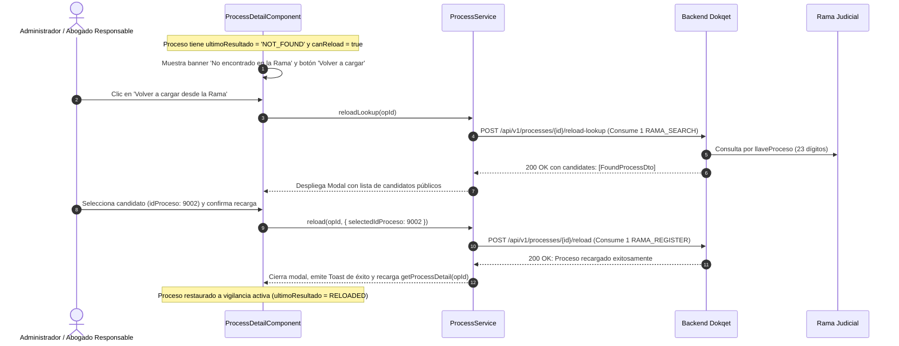

# 📖 Historia de Usuario: HU-28 - Resiliencia Judicial en Panel y Detalle: Actualización con Cooldown de 10 Minutos, Estado No Encontrado y Flujo de Recarga Manual

---

## 📌 1. Información General de la Historia

| Metadato | Detalle |
| :--- | :--- |
| **Identificador** | `HU-28` (Equivalente: `HU-28-PROCESS-RESILIENCE-COOLDOWN-NOT-FOUND-RELOAD`) |
| **Código Equivalente Backend** | `US-022` (`Resiliencia con la Rama Judicial: Detección y Cambio de ID de Proceso, Estado No Encontrado, Recarga Manual y Actualización con Cooldown`) |
| **Título** | Resiliencia Judicial en Panel y Detalle: Actualización con Cooldown de 10 Minutos, Estado No Encontrado y Flujo de Recarga Manual |
| **Épica** | Vigilancia Judicial Continua, Experiencia de Usuario en Litigio y Resiliencia Operativa |
| **Módulos / Rutas Angular** | `src/app/features/processes/list/` (`/panel` o `/procesos`), `src/app/features/processes/detail/` (`/procesos/:id`), `src/app/core/models/process.model.ts`, `src/app/core/services/process.service.ts` |
| **Estado** | `🚀 Implementada / Verificada` |
| **Prioridad** | `Alta (Core de Vigilancia Judicial, Usabilidad y Resiliencia ante la Rama Judicial)` |
| **Tipo** | `Experiencia de Usuario (UX/UI) / Funcionalidad Clave / Standalone Angular 19+` |
| **Actor Principal** | `Litigante / Abogado Responsable / Administrador de Organización (ADMIN y LAWYER)` |
| **Historias Relacionadas** | Extiende `HU-14` (Rediseño UX Prodex/Dokqet), `HU-16` (Skeleton Loaders) y complementa backend `US-022` y `US-019` (Límites de Usuario) |

---

## 🎯 2. Narrativa de Negocio y Experiencia de Usuario (User Story Narrative)

> **Como** abogado litigante y administrador de una firma jurídica en **Dokqet**,  
> **Quiero** disponer de un botón «Actualizar» en el detalle del expediente con retroalimentación clara de enfriamiento (cooldown de 10 minutos), ver fechas comprensibles de última consulta exitosa o aviso de fallas temporales en la Rama Judicial, identificar procesos no encontrados mediante un badge destacado en el panel (`NOT_FOUND`), y contar con un flujo asistido de recarga manual («Volver a cargar desde la Rama») con selección de candidatos,  
> **Para** garantizar la supervisión continua y transparente de mis expedientes judiciales ante reestructuraciones de identificadores en la Rama Judicial colombiana, evitar frustración por demoras o bloqueos externos y mantener la integridad del seguimiento sin sobrecargar los servidores judiciales.

---

## 🔍 2.1. Diagnóstico del Estado Actual en `dokqet-frontend` y Justificación UX

1. **Ausencia de Actualización Bajo Demanda en el Detalle:**
   - Actualmente, el usuario depende enteramente de las rondas automáticas del scheduler para enterarse de novedades.
   - En situaciones de diligencias urgentes (ej. audiencias, vencimiento de términos), el litigante necesita forzar una consulta individual inmediata.
   - Si no se regula esta acción con un **cooldown compartido de 10 minutos** entre usuarios y tareas del sistema, se genera sobrecarga contra los servidores de la Rama Judicial y se agota innecesariamente la cuota de búsquedas (`RAMA_SEARCH`).
   - El backend responde `HTTP 429 Too Many Requests` (RFC 9457 `ProblemDetail`) con `errorCode="PROCESS_COOLDOWN"`, `elapsedMinutes` y `remainingMinutes`. La interfaz debe capturar este error de forma elegante y amigable, mostrando un mensaje claro: *"Este proceso se consultó en la Rama hace X minutos. Puedes volver a actualizarlo en Y minutos."* con un temporizador o deshabilitación temporal del botón.

2. **Fechas Confusas y Alertas Técnicas Inadecuadas:**
   - La interfaz no debe exponer fechas internas como `ultimaActualizacionRama` para evitar confusiones al litigante (muchas veces esa fecha es antigua porque el juzgado no ha subido actuaciones recientes).
   - En su lugar, el panel y el detalle deben exhibir:
     * **En el Panel:** Columna `"Consultado"` con la fecha relativa de `ultimaConsulta` (*"hoy, 6:02 a. m."*, *"ayer, 4:15 p. m."* o fecha corta) e ícono de ayuda `ⓘ` con tooltip explicativo.
     * **En el Detalle:** Encabezado con `"Última consulta exitosa en la Rama"` (`ultimaConsulta`). Únicamente si `ultimoResultado === 'ERROR'`, mostrar un recuadro de aviso amarillo: *"Último intento fallido: … (la Rama no respondió). Se vuelve a intentar en la siguiente revisión."* (`ultimaRevision`), añadiendo alerta de *"No se ha podido consultar desde hace más de 24 horas"* si aplica.

3. **Visibilidad de Procesos No Encontrados (`NOT_FOUND`):**
   - Cuando la Rama Judicial reestructura internamente un radicado y no se cumplen los requisitos automáticos de `ID_CHANGED`, el proceso entra en `ultimoResultado = 'NOT_FOUND'`.
   - **En el Panel:** Debe mostrarse un badge prominente de color amarillo/ámbar `"No encontrado en la Rama"`.
   - **En el Detalle:** Debe desplegarse un banner de advertencia alertando que el identificador del proceso no fue localizado en la Rama Judicial.

4. **Flujo Asistido «Volver a Cargar desde la Rama» (`canReload`):**
   - Para resolver expedientes en estado `NOT_FOUND`, se expone la acción `"Volver a cargar desde la Rama"`, activa exclusivamente para administradores (`ADMIN`) y el abogado asignado como responsable del proceso en la firma (`canReload === true`). Los demás integrantes ven un texto informativo de soporte.
   - Al pulsar la acción, se abre un modal interactivo:
     1. Invoca `POST /api/v1/processes/{id}/reload-lookup` (gasta 1 de `RAMA_SEARCH`).
     2. Muestra los candidatos públicos encontrados en la Rama Judicial (excluyendo el identificador anterior), con fecha de radicación, despacho y partes procesales.
     3. Si no hay candidatos, muestra un mensaje amigable: *"Se produjo un error con este proceso en la Rama Judicial. Espera e inténtalo de nuevo más tarde; se conservan los datos guardados. Si ya no lo necesitas, un administrador puede dejar de seguirlo."*
     4. Al seleccionar un candidato y pulsar `"Confirmar Recarga"`, invoca `POST /api/v1/processes/{id}/reload` con `{ selectedIdProceso }` (gasta 1 de `RAMA_REGISTER`), sustituye datos o fusiona seguimientos, emite notificación toast de éxito y recarga el expediente restaurando la vigilancia periódica.

---

## 🧭 2.2. Diagramas de Interacción y Flujo (Mermaid)

### 2.2.1. Diagrama de Flujo: Botón Actualizar con Cooldown de 10 Minutos

```mermaid
flowchart TD
    User["Litigante en Detalle (/procesos/:id)"] --> ClickUpdate["Clic en botón 'Actualizar'"]
    ClickUpdate --> CallRefresh["ProcessService.refreshProcess(id)"]
    CallRefresh --> API{"Respuesta del Backend"}
    
    API -->|200 OK| Success["Toast verde: 'Proceso actualizado correctamente'<br/>Recarga actuaciones y actualiza fecha"]
    API -->|429 Too Many Requests (PROCESS_COOLDOWN)| Cooldown["Toast informativo / Modal ámbar:<br/>'Este proceso se consultó en la Rama hace X minutos.<br/>Puedes volver a actualizarlo en Y minutos.'"]
    Cooldown --> DisableBtn["Deshabilita botón temporalmente con cuenta regresiva"]
    API -->|400 Bad Request| ErrorReq["Alerta: No es posible actualizar un proceso no encontrado"]
```

### 2.2.2. Diagrama de Flujo: Recarga Manual para Proceso NOT_FOUND



---

## 3. Modelos de Datos en Cliente y Contratos API

### 3.1. Extensión de Modelos de Procesos
**Archivo:** `src/app/core/models/process.model.ts` `[MODIFICADO / POR EXTENDER]`

```typescript
export type ProcessCheckResult =
  | 'FIRST_LOAD'
  | 'NO_CHANGES'
  | 'CHANGES'
  | 'ERROR'
  | 'PRIVATE'
  | 'NOT_FOUND'
  | 'ID_CHANGED'
  | 'RELOADED';

export interface ProcessListItem {
  id: string; // OrganizationProcess ID
  radicado: string;
  instancia: string;
  despacho?: string | null;
  departamento?: string | null;
  fechaUltimaActuacion?: string | null;
  ultimaConsulta?: string | null;       // [NUEVO US-022]
  ultimoResultado?: ProcessCheckResult | null; // [NUEVO US-022]
  esPrivado: boolean;
  privadoDesde?: string | null;
  demandantes: string[];
  demandados: string[];
  responsibleUserId?: string | null;
  responsibleName?: string | null;
  representedParty: RepresentedParty;
  parentId?: string | null;
  parentRadicado?: string | null;
  subprocesses: ProcessListItem[];
  newCount: number;
  instanceNotices: number;
}

export interface ProcessDetailView {
  id: string;
  isHead: boolean;
  canReload?: boolean;                  // [NUEVO US-022] Permiso para recarga manual
  process: {
    radicado: string;
    instancia: string;
    despacho?: string | null;
    departamento?: string | null;
    ponente?: string | null;
    tipoProceso?: string | null;
    claseProceso?: string | null;
    subclaseProceso?: string | null;
    recurso?: string | null;
    ubicacion?: string | null;
    notaRadicacion?: string | null;
    fechaInicio?: string | null;
    fechaUltimaActuacion?: string | null;
    ultimaConsulta?: string | null;     // [NUEVO US-022] Última consulta exitosa
    ultimaRevision?: string | null;     // [NUEVO US-022] Último intento general
    esPrivado: boolean;
    privadoDesde?: string | null;
    ultimoResultado?: ProcessCheckResult | null; // [NUEVO US-022]
  };
  organization: {
    responsibleUserId?: string | null;
    responsibleName?: string | null;
    representedParty: RepresentedParty;
    notes?: string | null;
    registeredByName?: string | null;
    createdAt: string;
  };
  parties: {
    idRegSujeto: number;
    tipoSujeto?: string | null;
    categoria: PartyCategory;
    nombreRazonSocial?: string | null;
    identificacion?: string | null;
    esEmplazado: boolean;
  }[];
  actuaciones: {
    id: string;
    consecutivo: number;
    fechaActuacion?: string | null;
    fechaRegistro?: string | null;
    tipoActuacion?: string | null;
    anotacion?: string | null;
    fechaInicial?: string | null;
    fechaFinal?: string | null;
    tieneDocumentos: boolean;
    isNew: boolean;
  }[];
  totalActuaciones: number;
  newActuacionesCount: number;
  page: number;
  pageSize: number;
}

export interface RefreshProcessResponse {
  message: string;
  newActuaciones: number;
}

export interface ReloadLookupResponse {
  candidates: FoundProcess[];
  message?: string | null;
}

export interface ReloadProcessRequest {
  selectedIdProceso: number;
}

export interface ProcessCooldownErrorResponse {
  type?: string;
  title?: string;
  status: number; // 429
  detail: string; // "Este proceso se consultó en la Rama hace X minutos. Puedes volver a actualizarlo en Y minutos."
  instance?: string;
  errorCode: 'PROCESS_COOLDOWN';
  elapsedMinutes: number;
  remainingMinutes: number;
}
```

### 3.2. Métodos del Servicio Angular
**Archivo:** `src/app/core/services/process.service.ts` `[MODIFICADO / POR EXTENDER]`

```typescript
/**
 * Dispara la actualización bajo demanda con cooldown compartido de 10 min.
 * Consume 1 de cuota RAMA_SEARCH si han transcurrido >= 10 minutos.
 */
refreshProcess(id: string): Observable<{ success: boolean; data: RefreshProcessResponse }> {
  return this.http.post<{ success: boolean; data: RefreshProcessResponse }>(
    `${this.API_URL}/${id}/refresh`,
    {}
  );
}

/**
 * Consulta candidatos públicos disponibles en la Rama para recarga manual.
 * Consume 1 de cuota RAMA_SEARCH.
 */
reloadLookup(id: string): Observable<{ success: boolean; data: ReloadLookupResponse }> {
  return this.http.post<{ success: boolean; data: ReloadLookupResponse }>(
    `${this.API_URL}/${id}/reload-lookup`,
    {}
  );
}

/**
 * Ejecuta la recarga manual autorizada con el idProceso seleccionado.
 * Consume 1 de cuota RAMA_REGISTER.
 */
reload(id: string, data: ReloadProcessRequest): Observable<{ success: boolean; message: string }> {
  return this.http.post<{ success: boolean; message: string }>(
    `${this.API_URL}/${id}/reload`,
    data
  );
}
```

---

## ⚖️ 4. Reglas de Negocio en Frontend (RN-FE)

1. **`RN-FE-28-01` — Columna «Consultado» y Badges en Panel de Procesos (`/panel`):**
   - Mostrar la columna `"Consultado"` formateando `ultimaConsulta` de manera amigable:
     * Si fue hoy: *"hoy, 6:02 a. m."*
     * Si fue ayer: *"ayer, 4:15 p. m."*
     * Si fue anterior: fecha corta (ej. *"15 oct 2026"*).
   - Acompañar el encabezado de la columna con un ícono informativo `ⓘ` con tooltip: *"Indica la última vez que Dokqet consultó exitosamente la Rama Judicial para este proceso."*
   - Si `ultimoResultado === 'NOT_FOUND'`, renderizar badge amarillo/ámbar destacado: `"No encontrado en la Rama"`.

2. **`RN-FE-28-02` — Botón «Actualizar» con Cooldown de 10 Minutos en Detalle:**
   - Ubicar el botón `"Actualizar"` en la botonera de acciones del detalle con icono de recarga.
   - Ocultar o deshabilitar el botón si el proceso se encuentra en estado `NOT_FOUND` (orientando al usuario hacia la recarga manual).
   - Al hacer clic:
     * Si el servidor responde HTTP `429 Too Many Requests` con `errorCode === 'PROCESS_COOLDOWN'`:
       - No emitir error fatal en consola ni marcar la pantalla en rojo.
       - Desplegar una alerta o toast informativo con el mensaje devuelto por el servidor: *"Este proceso se consultó en la Rama hace X minutos. Puedes volver a actualizarlo en Y minutos."*
       - Bloquear temporalmente el botón mostrando el tiempo restante en un tooltip.
     * Si la respuesta es exitosa (`200 OK`):
       - Mostrar toast verde: *"Proceso actualizado correctamente. Se detectaron X actuaciones nuevas."*
       - Recargar automáticamente la lista de actuaciones y actualizar los campos de fecha.

3. **`RN-FE-28-03` — Presentación de Fechas de Consulta y Manejo de Fallas en Detalle:**
   - En el bloque de metadatos del expediente, mostrar: `"Última consulta exitosa en la Rama: [fecha y hora formateada en COT]"`.
   - **Prohibición:** No renderizar bajo ninguna circunstancia el dato `ultimaActualizacionRama` para evitar confusiones al usuario.
   - Si `ultimoResultado === 'ERROR'`:
     * Mostrar recuadro de advertencia en color amarillo: *"Último intento fallido: [ultimaRevision formateada] (la Rama no respondió). Se vuelve a intentar en la siguiente revisión."*
     * Si la falla persiste por más de 24 horas respecto a `ultimaConsulta`: añadir texto adicional de alerta: *"No se ha podido consultar desde hace más de 24 horas"*.

4. **`RN-FE-28-04` — Banner y Permisos de «Volver a Cargar desde la Rama»:**
   - Si `ultimoResultado === 'NOT_FOUND'`:
     * Mostrar banner ámbar superior: *"Expediente no encontrado en la Rama Judicial. El identificador de este proceso pudo haber cambiado o fue reestructurado en la base de datos oficial."*
     * Si `canReload === true`: habilitar el botón primario `"Volver a cargar desde la Rama"`.
     * Si `canReload === false`: mostrar nota explicativa: *"Solo los administradores de la organización o el abogado responsable del proceso pueden ejecutar la recarga desde la Rama."*

5. **`RN-FE-28-05` — Modal Asistido de Recarga Manual:**
   - Al pulsar `"Volver a cargar desde la Rama"`, abrir el modal `app-modal`:
     - Mostrar estado de carga (skeleton/spinner) mientras se ejecuta `reloadLookup(opId)`.
     - Si `candidates` está vacío o la Rama no devuelve registros: exponer el mensaje amigable oficial: *"Se produjo un error con este proceso en la Rama Judicial. Espera e inténtalo de nuevo más tarde; se conservan los datos guardados. Si ya no lo necesitas, un administrador puede dejar de seguirlo."* y deshabilitar el botón de confirmar.
     - Si hay candidatos: listar cada candidato como una tarjeta seleccionable (radio button / border highlight) con:
       * Despacho judicial y departamento.
       * Sujetos procesales destacados (demandante / demandado).
       * Fecha de radicación y fecha de última actuación reportada en la Rama.
     - Botón `"Confirmar Recarga"` deshabilitado hasta que el usuario seleccione una opción.
     - Al confirmar:
       * Ejecutar `reload(opId, { selectedIdProceso: selectedCandidate.idProceso })`.
       * Mostrar spinner de confirmación.
       * Al finalizar con éxito, cerrar modal, emitir toast de confirmación y refrescar la vista completa del proceso.

---

## ✅ 5. Criterios de Aceptación BDD (Gherkin)

```gherkin
# language: es
Característica: Resiliencia con la Rama Judicial, badge NOT_FOUND, cooldown de 10 min y recarga manual (HU-28)
  Como litigante de Dokqet
  Quiero actualizar bajo demanda con retroalimentación de cooldown y recargar procesos no encontrados
  Para mantener vigilados mis procesos sin interrupciones ni sobrecarga

  Escenario: 1. Rechazo amigable por cooldown de 10 minutos al pulsar Actualizar
    Dado que el proceso fue consultado en la Rama hace 4 minutos
    Cuando el usuario presiona el botón "Actualizar" en el detalle del expediente
    Entonces la API responde HTTP 429 con errorCode "PROCESS_COOLDOWN"
    Y la interfaz despliega el mensaje "Este proceso se consultó en la Rama hace 4 minutos. Puedes volver a actualizarlo en 6 minutos."
    Y el botón permanece deshabilitado temporalmente sin consumir cuota del usuario

  Escenario: 2. Actualización bajo demanda exitosa superados los 10 minutos
    Dado que transcurrieron más de 10 minutos desde la última revisión o consulta del proceso
    Cuando el usuario presiona el botón "Actualizar"
    Entonces el sistema envía la solicitud "POST /api/v1/processes/{id}/refresh"
    Y al responder exitosamente, expone un toast verde con las actuaciones nuevas detectadas
    Y actualiza las marcas de tiempo de consulta sin recargar toda la página

  Escenario: 3. Visualización del badge "No encontrado en la Rama" en el panel
    Dado que un proceso vigilado tiene "ultimoResultado" en "NOT_FOUND"
    Cuando el litigante visualiza la tabla en "/panel"
    Entonces la fila del proceso muestra el badge ámbar "No encontrado en la Rama"
    Y la columna "Consultado" exhibe la última fecha válida de consulta con tooltip explicativo

  Escenario: 4. Flujo completo de recarga manual por abogado responsable
    Dado que un proceso se encuentra en estado "NOT_FOUND" y "canReload" es "true"
    Cuando el abogado responsable pulsa "Volver a cargar desde la Rama"
    Entonces se abre el modal invocando "reload-lookup" y presentando los candidatos disponibles
    Y al seleccionar un candidato y pulsar "Confirmar Recarga", el sistema invoca "reload"
    Y restaura el expediente con sus nuevas actuaciones cerrando el modal con notificación de éxito
```

---

## 🏗️ 6. Definición de Hecho (DoD)

* [x] Modelos de datos `ProcessListItem`, `ProcessDetailView`, `ProcessCheckResult` y contratos de recarga/cooldown actualizados en `process.model.ts`.
* [x] Métodos `refreshProcess`, `reloadLookup` y `reload` creados en `process.service.ts`.
* [x] Columna `"Consultado"` y badge `"No encontrado en la Rama"` implementados en la lista de procesos (`/panel`).
* [x] Botón `"Actualizar"` con intercepción amigable de `429 PROCESS_COOLDOWN` y manejo de temporizador en `ProcessDetailComponent`.
* [x] Sección de fechas con `"Última consulta exitosa"` y aviso condicional ante `ERROR` implementada en el detalle.
* [x] Banner `NOT_FOUND` y Modal interactivo de Recarga Manual implementados con selección de candidatos y confirmación.
* [x] Utilidad `formatRelativeConsultationDate` implementada con cobertura de pruebas unitarias en `datetime.utils.spec.ts`.
* [x] Compilación de producción exitosa en Angular 19+ (`npm run build`) con 0 errores de TypeScript y templates.
