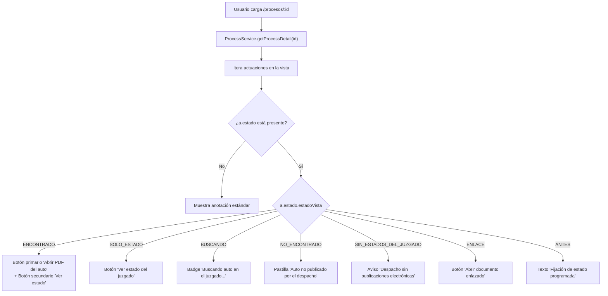

# 📖 Historia de Usuario: HU-30 - Visualización, Enlace y Apertura de PDF de Providencias y Estados Judiciales del Micrositio Oficial de la Rama Judicial

---

## 📌 1. Información General de la Historia

| Metadato | Detalle |
| :--- | :--- |
| **Identificador** | `HU-30` (Equivalente: `HU-30-ESTADOS-MICROSITIO-PDF-VIEWER`) |
| **Código Equivalente Backend** | `US-024` (`Búsqueda Automática de PDF de Estados en el Micrositio de Publicaciones Procesales de la Rama Judicial, Sincronización Programada y Notificación de Novedades`) |
| **Título** | Visualización, Enlace y Apertura de PDF de Providencias y Estados Judiciales del Micrositio Oficial de la Rama Judicial |
| **Épica** | Vigilancia Judicial Continua, Experiencia de Usuario en Litigio y Automatización Documental |
| **Módulos / Rutas Angular** | `src/app/features/processes/detail/` (`/procesos/:id`), `src/app/core/models/process.model.ts`, `src/app/core/services/process.service.ts` |
| **Estado** | `🚀 Implementada / Verificada` |
| **Prioridad** | `Alta (Diferenciador Clave de Producto / Productividad de Litigantes)` |
| **Tipo** | `Experiencia de Usuario (UX/UI) / Funcionalidad Clave / Standalone Angular 19+` |
| **Actor Principal** | `Litigante / Abogado Responsable / Administrador de Organización (ADMIN y LAWYER)` |
| **Referencias de Origen (`piloto`)** | Mejora `9.23` (`lib/estados/reglas.ts`, `lib/micrositio/cliente.ts`, `docs/documentacion-tecnica.md` v1.40 Secciones 4.4 y 6.4) |
| **Historias Relacionadas** | Extiende `HU-28` (Resiliencia y detalle de proceso), `HU-14` (Rediseño UX Prodex/Dokqet) y consume backend `US-024` |

---

## 🎯 2. Narrativa de Negocio y Experiencia de Usuario (User Story Narrative)

> **Como** abogado litigante y administrador de una firma jurídica en **Dokqet**,  
> **Quiero** ver en la línea de tiempo y en la tabla de actuaciones de mi expediente los enlaces y botones directos para abrir los archivos PDF oficiales de los autos y providencias judiciales notificados por estado en el portal de Publicaciones Procesales de la Rama Judicial,  
> **Para** leer inmediatamente las decisiones judiciales sin tener que navegar manualmente el micrositio de cada juzgado, disponer de estados claros cuando la publicación aún está en búsqueda o el despacho no ha subido el archivo, y acceder al documento en una pestaña segura con un solo clic.

---

## 🔍 2.1. Diagnóstico del Estado Actual en `dokqet-frontend` y Brecha a Implementar

1. **Actuaciones Sin Vínculo al Auto Judicial:**
   - Actualmente, la vista de detalle (`/procesos/:id`) muestra la anotación en texto plano extraída de la Rama Judicial (ej. *"Auto admisorio de la demanda fijado en estado No. 045"*), pero el litigante no cuenta con ninguna opción para abrir o descargar la providencia en PDF.
   - **Solución (`US-024` / `HU-30`):** Consumir el objeto `estado: ActuacionEstado` que retorna el backend en cada actuación del detalle.

2. **Los 6 Estados Visuales de Providencia Judicial (`Mejora 9.23`):**
   - La interfaz debe reflejar fielmente la realidad del trámite procesal en Colombia:
     1. **`ANTES`**: La fecha de fijación en estado aún no llega (providencia fijada a fecha futura).
     2. **`ENCONTRADO`**: Se localizó el PDF específico del auto emparejado por prefijo `{año}-{consecutivo}`. Debe desplegar un botón primario de acción destacada:  
        `📄 Abrir PDF del auto ({nombre})`  
        Y si existe el PDF de la lista general del despacho:  
        `📋 Ver estado del juzgado ({nombre})` (botón secundario).
     3. **`SOLO_ESTADO`**: El despacho no cargó el auto individualizado pero sí el estado general del día. Debe mostrar el botón:  
        `📋 Ver estado del juzgado ({nombre})` acompañado de una nota contextual explicativa.
     4. **`BUSCANDO`**: La actuación ocurrió recientemente (≤ 30 días calendario y dentro de los 5 días hábiles de seguimiento activo):
        - Si **`buscadoAlMenosUnaVez === false`** (el backend acaba de disparar la consulta asíncrona inicial al micrositio), muestra un indicador activo corto: `Consultando publicaciones del juzgado en este momento...` y programa hasta 2 recargas silenciosas en segundo plano (+4s y +10s) para mostrar el PDF automáticamente sin refrescar la página.
        - Si **`buscadoAlMenosUnaVez !== false`** (el portal ya fue consultado al menos una vez y el juzgado aún no carga el archivo dentro de los 5 días hábiles), muestra un distintivo calmado sin animación infinita: `Aún no publicado por el despacho · Revisión automática por 5 días hábiles` junto al enlace directo `Abrir portal oficial ↗`.
     5. **`NO_ENCONTRADO`**: Transcurrieron los 5 días hábiles legales posteriores a la fijación sin que el juzgado cargara el documento digital. Muestra una pastilla informativa:  
        `⚠️ Auto no publicado por el despacho en el portal web` + acceso rápido `Consultar portal ↗`.
     6. **`SIN_ESTADOS_DEL_JUZGADO`**: El juzgado correspondiente no publica en el portal Liferay de publicaciones procesales (p. ej. altas cortes o despachos sin micrositio). Muestra un aviso informativo sutil:  
        `ℹ️ Este despacho judicial no publica estados electrónicos en este portal` + enlace `Verificar portal ↗`.
     7. **`ENLACE`**: La anotación judicial contiene una URL directa a un repositorio o drive judicial. Muestra el botón:  
        `🔗 Abrir documento enlazado`

3. **Compatibilidad en Ambos Modos de Visualización (`TABLE` y `CARDS`):**
   - El litigante puede alternar entre la vista tabular y la vista de fichas/tarjetas. El bloque de documentos debe renderizarse armónicamente en ambos formatos, con apertura segura en nueva pestaña (`target="_blank" rel="noopener noreferrer"`).

---

## 🧭 2.2. Diagrama de Interacción Visual (Mermaid)



---

## ⚖️ 3. Reglas de Negocio Frontend

1. **`RN-FE-030-01` — Tipado Estricto de Estado Documental (`ActuacionEstado`):**
   - Agregar en `src/app/core/models/process.model.ts` la interfaz `ActuacionEstado`:
     ```typescript
     export interface ActuacionEstado {
       estadoVista: 'ANTES' | 'ENCONTRADO' | 'SOLO_ESTADO' | 'BUSCANDO' | 'NO_ENCONTRADO' | 'SIN_ESTADOS_DEL_JUZGADO' | 'ENLACE';
       processPdfUrl?: string | null;
       processPdfName?: string | null;
       estadoGeneralUrl?: string | null;
       estadoGeneralName?: string | null;
       buscadoAlMenosUnaVez?: boolean | null;
     }
     ```
   - Extender el objeto de actuación en `ProcessDetailView` para incluir `estado?: ActuacionEstado | null`.

2. **`RN-FE-030-02` — Seguridad en Apertura de Enlaces Externos:**
   - Todos los hipervínculos hacia documentos judiciales externos deben contener estrictamente `target="_blank" rel="noopener noreferrer"` para evitar vulnerabilidades de tipo tab-napping o fuga de contexto de seguridad.

3. **`RN-FE-030-03` — Accesibilidad Semántica y Teclado:**
   - Los enlaces y botones deben disponer de atributos `aria-label` descriptivos que indiquen el nombre del archivo y que se abrirá en una nueva pestaña.

---

## ✅ 4. Criterios de Aceptación BDD (Gherkin)

```gherkin
# language: es
Característica: Visualización y apertura de PDF de providencias judiciales (HU-30)
  Como litigante de Dokqet
  Quiero ver los botones y enlaces a los PDF oficiales de autos notificados por estado
  Para consultar las órdenes judiciales con un clic sin búsquedas manuales

  Escenario: 1. Actuación con auto individual encontrado y estado del juzgado disponible
    Dado que una actuación judicial tiene estadoVista en "ENCONTRADO"
    Y tiene una URL de PDF del proceso y una URL de estado general
    Cuando el usuario visualiza el detalle del expediente
    Entonces se exhibe el botón destacado "Abrir PDF del auto"
    Y se exhibe el botón secundario "Ver estado del juzgado"
    Y al pulsar "Abrir PDF del auto", se abre el documento en una nueva pestaña segura

  Escenario: 2. Actuación con únicamente estado general del juzgado
    Dado que una actuación judicial tiene estadoVista en "SOLO_ESTADO"
    Cuando el usuario visualiza la actuación
    Entonces se exhibe el botón "Ver estado del juzgado"
    Y no se muestra el botón de PDF individual

  Escenario: 3. Actuación en consulta inicial asíncrona y seguimiento pasivo dentro de los 5 días hábiles
    Dado que una actuación judicial tiene estadoVista en "BUSCANDO"
    Cuando el usuario visualiza la actuación con buscadoAlMenosUnaVez en false
    Entonces se exhibe el indicador "Consultando publicaciones del juzgado en este momento..." y se programan hasta 2 recargas silenciosas
    Cuando el backend completa la primera ronda sin documento publicado (buscadoAlMenosUnaVez en true)
    Entonces el indicador se transforma en "Aún no publicado por el despacho · Revisión automática por 5 días hábiles" sin spinner infinito y con enlace "Abrir portal oficial"

  Escenario: 4. Actuación vencida sin publicación del juzgado
    Dado que una actuación judicial tiene estadoVista en "NO_ENCONTRADO"
    Cuando el usuario visualiza la actuación
    Entonces se muestra el distintivo "Auto no publicado por el despacho en el portal web"
```

---

## 🏗️ 5. Definición de Hecho (DoD)

* [x] Interfaz `ActuacionEstado` creada en `src/app/core/models/process.model.ts` y asociada a `ProcessDetailView`.
* [x] Componente `process-detail.component.html` actualizado para renderizar el bloque de estados en modo tabla y modo tarjetas.
* [x] Enlaces con `target="_blank" rel="noopener noreferrer"` y etiquetas de accesibilidad `aria-label`.
* [x] Pruebas unitarias en `process-detail.component.spec.ts` cubriendo los estados `ENCONTRADO`, `SOLO_ESTADO`, `BUSCANDO`, etc.
* [x] Compilación exitosa en Angular 19+ (`npm run build`) con 0 errores de TypeScript y plantillas.
